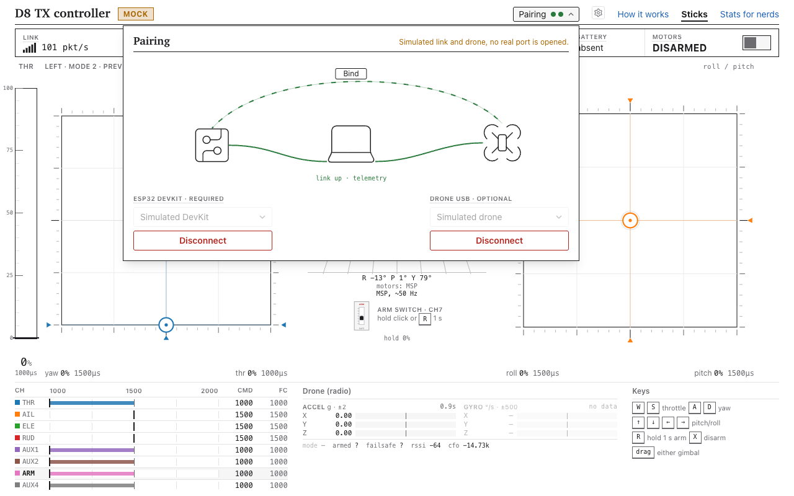

# esp32-d8tx

**An ESP32's Wi-Fi radio, hacked to speak FrSky D8. Plug it in, open a tab, fly.**

[Live app](#try-it) · [How it works (writeup)](docs/devkitv1/writeup/tx.md) · [Demo (no hardware)](#try-it)

<!-- Live app, hosted writeup and demo links point to the deployed site once it exists; until then they are local. -->

First takeoff with the ESP32 as the radio:

https://github.com/user-attachments/assets/496075c1-7d02-483a-9e4e-a3d6ad7bda64

> [!CAUTION]
> **Educational and research use; check your local regulations.** Transmitting is regulated. This firmware turns a Wi-Fi/Bluetooth-certified module into an intentional radiator outside its grant. Output power is *estimated* (about -25 dBm peak EIRP, from receiver RSSI), not measured, and harmonics were not measured. You are responsible for compliance where you are. Full text: [REGULATORY.md](REGULATORY.md).

## Why I built this

The motivation behind this was I wanted to fly my drone with my computer with Claude, but didn't have a radio module. I first tried opening up my E8 controller, and then remembered I was a software developer and did not feel in the mood to drive to the electronics store and buy a soldering iron.

So I researched online and found some people had found undocumented capabilities in the ESP32 family of boards that let it act as an SDR ([esp-sdr](https://github.com/ESPARGOS/esp-sdr)). My board wasn't one they had tested, so I tried it myself and got RX working on it ([esp32-devkitv1-sdr](https://github.com/mb6611/esp32-devkitv1-sdr)). My drone (a Tinyhawk 3) listens for FrSky D8: short 2.4 GHz packets carrying the stick positions, normally sent by a radio like the E8, that hop between 47 channels in a fixed order. So after understanding the D8 protocol (you can read more in the [writeup](docs/devkitv1/writeup/tx.md)), I decided to try to actually send commands to my drone over D8.

The problem is that it's hard to get the ESP32's Wi-Fi chip to transmit an arbitrary signal (raw I/Q); it's built to speak Wi-Fi and Bluetooth. But I eventually discovered the existence of its test tones: an undocumented feature that transmits a single pure tone at a chosen offset from the radio's carrier frequency, in steps of about 39 kHz. Other ESP32 transmitter projects like [esp32-iq-tx](https://github.com/whstudio123/esp32-iq-tx) have to disable these three test tones to do non-continuous TX, but I realized I could just use the test tones themselves, if I could tune them to the frequencies I wanted. D8 doesn't need an arbitrary signal: the receiver is entirely frequency-based and uses GFSK, so it might be possible to send commands using 2-FSK (i.e. just a one-bit symbol based on which frequency was transmitted) along the 47 channels used by D8, as long as the hopping schedule was continuous.

I first began by stealing the Betaflight config from my E8, which it turned out was stored in my drone (these protocols really are not designed to be secure). It contains the radio's ID, the starting channel and the channels it should jump between, so I tuned my ESP32 to a single channel, chosen deterministically from this config, to see if I could get it to work. (Later I got the ESP32 to bind on its own, with its own ID, like any radio.)

To test my packets I needed a receiver. Alas, due to my lazy software engineer predicament, I did not want to go out and buy a radio module, since avoiding that was the whole point of this project. So I used the STM board on my Tinyhawk 3, which already has a CC2500 radio, as my receiver: I had to build custom benchmarking firmware that basically just replaced the Betaflight flight controller firmware on it and reported every packet it heard. Once I was able to get this loop closed, I was basically just able to run cycles of tests on my ESP32 firmware until eventually I got a single packet working, and miraculously was able to get it to retune its radio between the 47 channels fast enough to transmit packets with buffer time.

Then I built a UI for the controller (though any process on my computer could control it), and properly architected it so that it could just be managed from a browser. I'll probably later add this as a CLI / MCP or something of the sort, but this was the hard part.

Step by step, every layer: [docs/how-it-works.md](docs/how-it-works.md).

## What I used

| Part | Role |
|---|---|
| **ESP32 DevKit V1** (classic ESP32, CP2102 USB bridge) | The radio. No other RF hardware. |
| **EMAX Tinyhawk III** RTF kit, drone | The aircraft: built-in CC2500 FrSky D8 receiver on a MATEKF411RX-target flight controller, Betaflight 4.2.11 |
| **EMAX E8** radio (in the same kit) | The reference: its packets and hop table are what the ESP32 had to match |
| Mac + Chrome / Electron | Runs the app over Web Serial |

## Try it

Everything, including installing the ESP32 firmware and binding the drone, happens in the same page.

**No hardware:** `pnpm install && pnpm --filter web dev`, then open the printed URL with `?mock=1` appended. Sticks, 3D drone and telemetry run against a simulated ESP32 and drone.

**With hardware:** an ESP32 DevKit V1 (classic ESP32) and a D8 drone (the one used here: EMAX Tinyhawk III, Betaflight, CC2500). Use Chrome or Edge, which have Web Serial. Step by step: [docs/getting-started.md](docs/getting-started.md); recipes in [docs/how-to/](docs/how-to/).

1. **Pairing** panel: plug in the ESP32, **Connect**.
2. **Install firmware** (one click, over USB; it never erases the ESP32's identity).
3. Plug the drone's USB in, **Connect** it, press **Bind**.
4. Unplug the drone USB, connect the battery, **props on only when you mean to fly**.
5. Hold **R** to arm, **X** to disarm.

## Status

Works: control, hopping, bind, telemetry, in-browser flashing, desktop (Electron) build, [validated on the bench](docs/validation/d8tx-web-desktop.md) and flown once (see the video above).

Not yet: range tests, a measured output power, D16 protocol, ESP32-S3/C3, Firefox and Safari (no Web Serial).

## Repo

| Path | What |
|---|---|
| `firmware/` | ESP-IDF firmware `d8tone` for the ESP32 |
| `packages/core`, `packages/serial`, `packages/ui` | link, telemetry, flight-controller client and worker; Web Serial transport; React UI |
| `apps/web`, `apps/desktop` | the web app and the Electron shell |
| `demod/` | C demodulator for D8 telemetry (native and WASM) |
| `protocol/` | [PROTOCOL.md](protocol/PROTOCOL.md), golden vectors, I/Q captures |
| `python/` | reference library (`D8Link`, `BetaflightMSP`) |
| `bench/` | bench runner, decoders, raw results behind the writeup |
| `docs/` | [writeup](docs/devkitv1/writeup/tx.md), [validation](docs/validation/d8tx-web-desktop.md), guides |

See [CONTRIBUTING.md](CONTRIBUTING.md) and [ARCHITECTURE.md](ARCHITECTURE.md).

## License

MIT, see [LICENSE](LICENSE), except `bench/betaflight-patch/` and `bench/cc2500-rxdiag/` (Betaflight derivatives, GPL-3.0-or-later). See [NOTICE.md](NOTICE.md).
