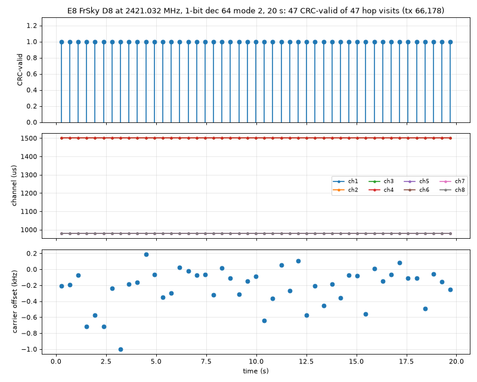

# D8 decoding with 1-bit mode-2 samples, centred (2026-11-05)

Result: 47 CRC-valid packets out of 47 hop visits in 20 s (tx id 66,178), using 1-bit samples,
dec 64 (250 kS/s), mode 2, a manual gain index of 40, and the E8's channel at 0 Hz.



## Where the E8 really transmits

The E8's table channel is 2421.096 MHz (pos1). It transmits at **2421.032 MHz**, about 64 kHz
(−26 ppm) below nominal. We measured this directly from CAP16 bursts at 16 MS/s, with no IQS mode
involved (`cap16_bursts.py` takes 500 × 1 ms captures, `cap16_tones.py` measures the tone pairs):

- LO 2420 and LO 2417.140 (+FOFS 140): the burst midpoint was at 2421.032 MHz in each case. The
  median of 7 bursts is 2421.0317 MHz, with an interquartile range of 4 kHz. The spectrograms show
  clean GFSK with ±31 kHz deviation.
- LO 2421: the lower tone sits on the LO leakage, so these captures were left out of the median.
- The 47 decoded packets put the carrier at −0.16 kHz from 2421.032 (median, s.d. 0.24 kHz).

The earlier claim of 2421.140 MHz (+44 kHz) came from a second burst with the same tx id, in the
adjacent 9 ms slot just before the real one. It is not a fixed-RF channel:

- Its apparent frequency moves with the LO: 2421.133 at LO 2417.140, about 2421.16 at LO 2421 and
  about 2421.21 at LO 2420.
- In mode-2 recordings it shows on the opposite side of the real burst from where its claimed RF
  would put it.

We take it to be a spurious response to the E8's previous hop. On the bind table that is pos0,
2404 MHz, which is 17 MHz away. The mechanism is still open. A 40 MHz crystal-harmonic check
confirms the mode-2 frequency sign for both 8-bit and 1-bit samples.

## What was wrong

1. **Hardware AGC.** At stream start the AGC sometimes picks a low gain index (16 here). That
   recording decoded only 1 packet in 20 s. With `GAIN MANUAL` 30–81 nearly every packet decodes.
   The stream CLI has no gain option, so `rec_centred.py` sets it.
2. **Wrong centre.** The recordings were tuned to the spur at 2421.140 instead of 2421.032.
3. **Channel filter too wide for 1-bit samples.** The standard decoder used ±75 kHz. On this
   recording a single pass gives:

   | Cutoff | CRC-valid packets |
   | --- | --- |
   | 35 kHz | 45 |
   | 40 kHz | 45 |
   | 50 kHz | 44 |
   | 75 kHz | 30 |
   | 30 kHz | 0 |

   No single cutoff gets all 47, but the union does. `StandardDecoder` now runs cutoffs of
   40/50/35/45 kHz plus the wide one. For each burst it keeps a CRC-valid result if there is one,
   preferring the widest filter, and takes the carrier estimate from the wide filter.

Tone polarity, sync word, bit order and timing (8.05 samples/bit) were already correct.

## Commands

```
host/.venv/bin/python docs/devkitv1/bench/d8/rec_centred.py /tmp/d8/centred_m2 2421.032 40 20
cd host && .venv/bin/python -m esp32sdr.d8_cli /tmp/d8/centred_m2.sigmf-data
# -> 99 packets found, 47 CRC ok (standard)   (the extra 52 are noise candidates that fail CRC)
```
