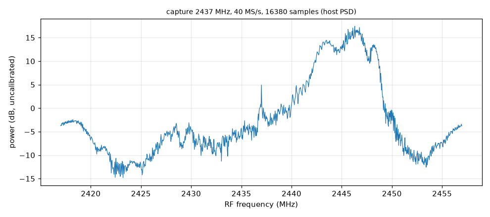
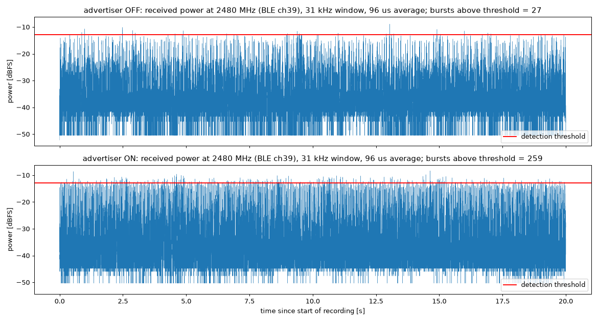
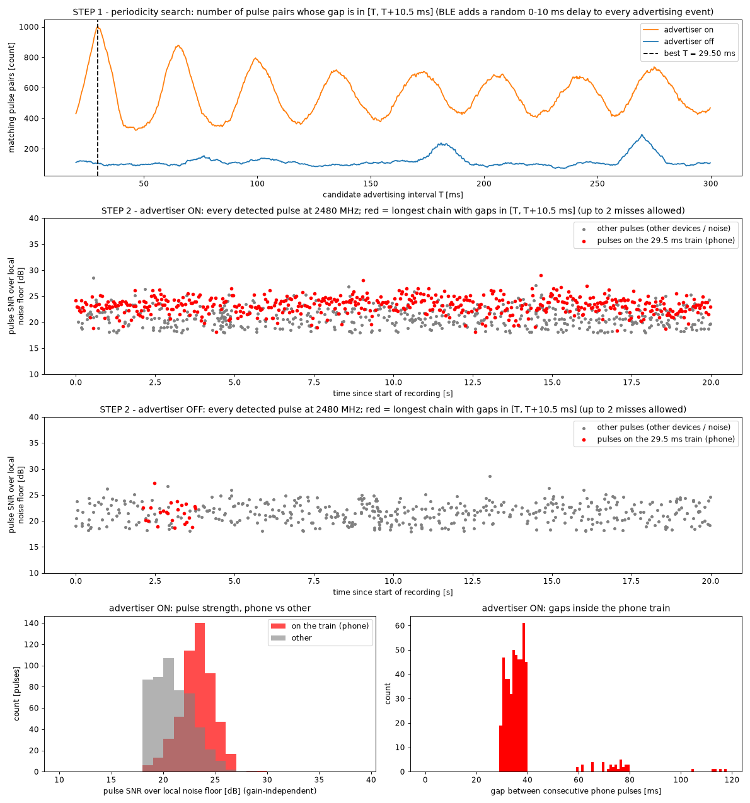
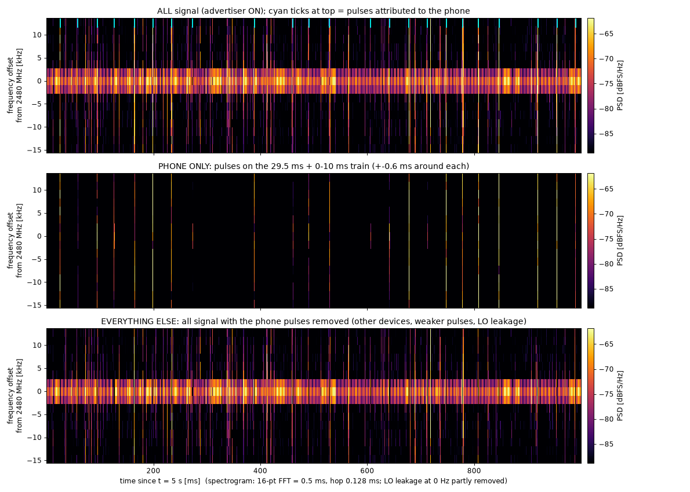
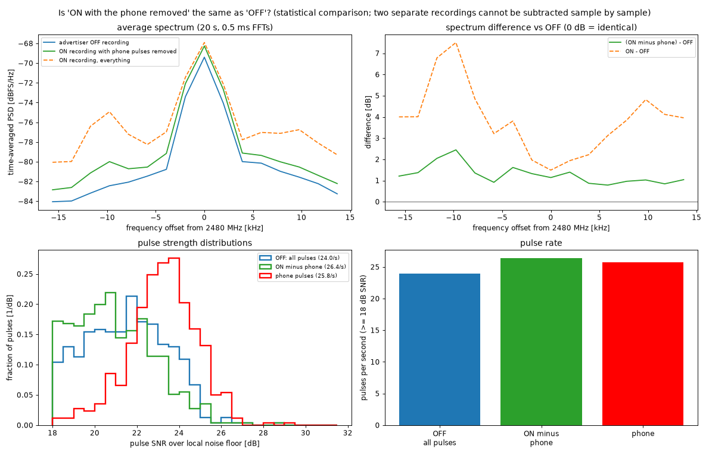
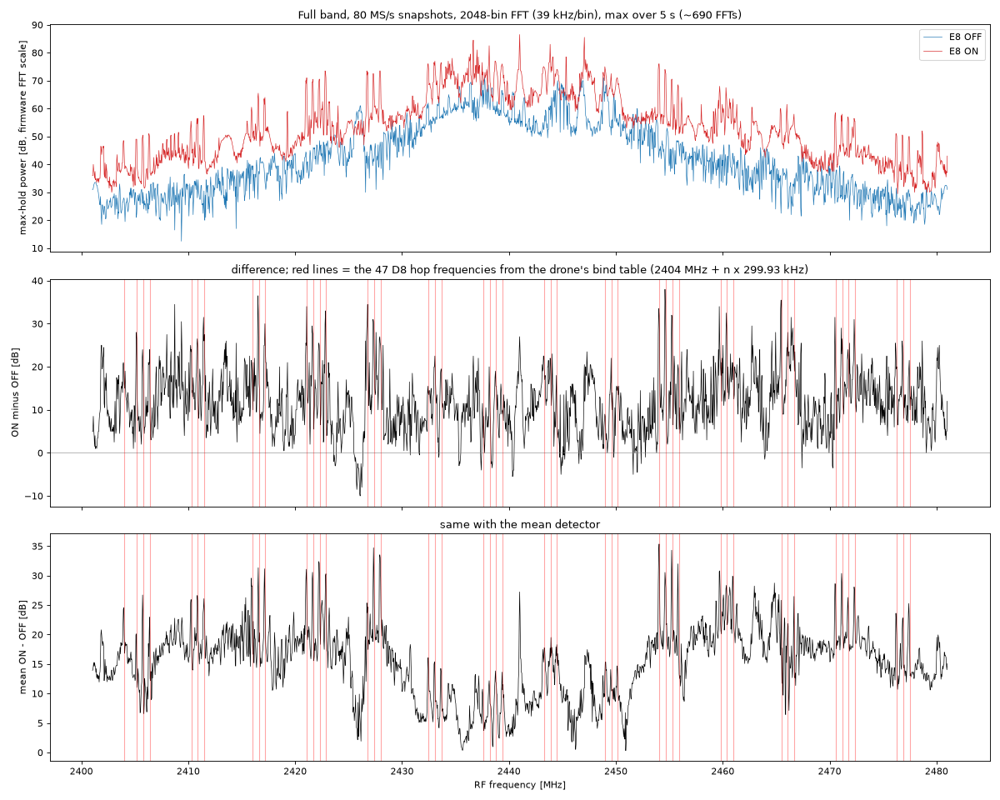
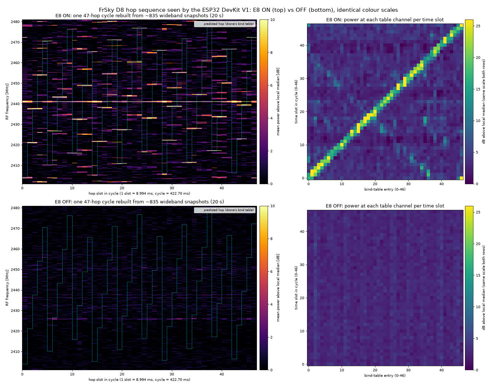
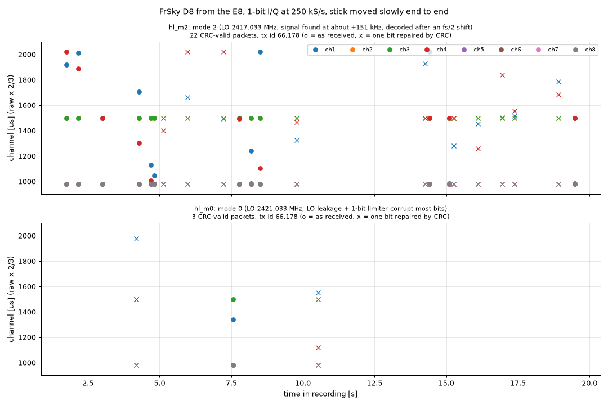
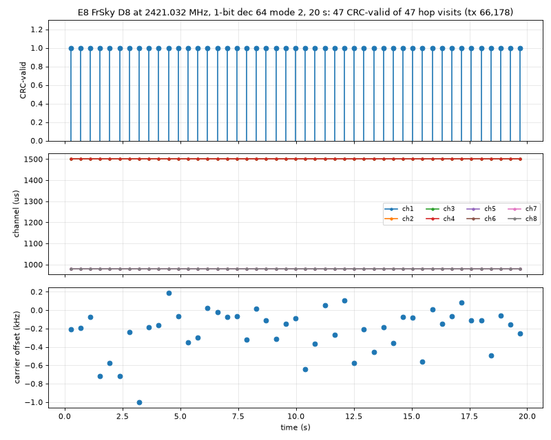
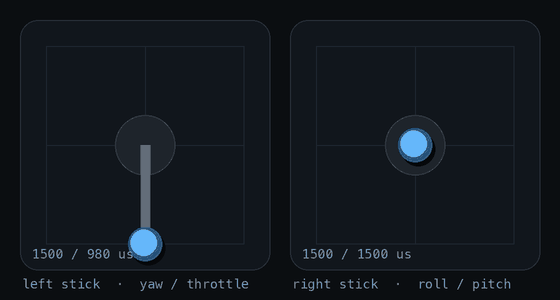

# A 2.4 GHz SDR on a $5 ESP32

*Matthew Banaag · November 2026 · [esp32-devkitv1-sdr](https://github.com/mb6611/esp32-devkitv1-sdr)*

I wanted to see whether a classic ESP32 DevKit V1, the cheap board with a CP2102 USB-serial chip, could work as a 2.4 GHz software-defined receiver. I built one on the I/Q capture path that [esp-sdr](https://github.com/ESPARGOS/esp-sdr) found in the chip, got it streaming without gaps over the board's slow serial link, and tried it on Wi-Fi, Bluetooth LE advertising and a FrSky D8 RC transmitter, whose packets it can now decode live. Everything here is receive-only.

---

## The capture path

The ESP32's Wi-Fi radio has an undocumented debug feature that copies raw I/Q samples from the receiver into RAM. ESPARGOS figured out how to drive it and wrapped it in firmware with a small serial protocol (tune, capture, spectrum). My project is a fork of theirs.

The capture window is 64 KiB of SRAM. The radio fills it with 16380 I/Q samples at 16, 40 or 80 MS/s and stops, so one capture is about 1 ms of signal at 16 MS/s, or 205 µs at 80. esp-sdr already supported the classic ESP32, but it expected a faster serial link than my board has.

## Build profile and 921600 baud

The CP2102 tops out at 921600 baud. Asked for 2 Mbaud, as in the stock build, the board just never replies, which took me a while to work out. So I added a build profile, `esp32-devkitv1`, with the UART at 921600.

```sh
. ~/esp/esp-idf/export.sh
idf.py -B build-esp32-devkitv1 -DIDF_TARGET=esp32 \
  -DSDKCONFIG_DEFAULTS=sdkconfig.defaults.esp32-devkitv1 build
idf.py -B build-esp32-devkitv1 -p /dev/cu.usbserial-0001 -b 921600 flash
```

After a reset the ROM bootloader logs at 115200 baud, which at 921600 reads as `0x00` and `0x80` bytes, so I wait about 3 seconds before talking to the board.

On the Mac, a small Python package, `esp32sdr`, handles `info`, `tune`, `capture` and `spectrum` and saves [SigMF](https://sigmf.org). Its first version dropped bytes because it set pyserial's timeout before every read; opening the port once with a fixed timeout and reading in bulk fixed it.

```
$ esp32sdr capture --freq 2437 --rate 40 --n 16380 -o ch6 --psd ch6.png
captured 16380 samples at 40 MS/s, 2437 MHz, 8-bit, CRC ok, 0.36 s -> ch6.sigmf-data
peak 2446.297 MHz 17.4 dB, median -5.1 dB (DC ±0.2 MHz excluded)
```



*One 410 µs capture on Wi-Fi channel 6, which caught a packet at about 2440–2449 MHz, roughly 20 dB above the floor.*

350 captures back to back, at all three rates and in 8 and 10 bits, gave no CRC failures, resets or hangs.

## The UART bottleneck

Each capture is 32,760 bytes, which takes about 355 ms to send at 921600 baud. You get 1 ms of radio, then you're deaf for a third of a second, which is no good for something like a phone sending a packet every 30 ms.

921600 baud is 92,160 bytes a second; with 15% headroom, about 78 KB/s. The radio at 16 MS/s with 8-bit I and Q makes 32 MB/s. To stream without gaps, the chip has to filter and throw away almost all of it; decimating by 512 gives 31.25 kS/s, or 62.5 KB/s at 8 bits.

| mode | bandwidth | gaps |
| --- | --- | --- |
| burst | 16–80 MHz | ~1 ms of radio, then ~355 ms blind |
| stream | 15.6–62.5 kHz | none |

Burst mode already worked. Streaming didn't exist on this chip yet.

## Continuous capture on the classic ESP32

To stream, the radio has to keep writing while the CPU reads. esp-sdr does that on the ESP32-S3, but I hadn't seen it done on the classic ESP32, so I first added probe commands and tried the registers one at a time.

**The window can loop.** One control bit makes the writer wrap around the buffer instead of stopping. In 1 ms the write pointer wrapped 4, 2 and 0 times at 80, 40 and 16 MS/s, as the rates predict.

**The window is two banks.** It's two 32 KiB halves, and `MAC_DUMP_MODE` in DPORT decides which one the radio owns: mode 2 the lower, mode 1 the upper. If the CPU reads the radio's half it gets the constant `0xa55aa55a`, but it can read the other half normally.

That allows ping-pong buffering: the radio writes bank A while the CPU reads bank B, then they swap. My first version swapped when the pointer wrapped and lost a few samples per swap, 0.21 per 8192 on average at 16 MS/s and never more than 7 at 80 MS/s. Each was counted, because unwritten positions keep a sentinel pattern. The final firmware swaps on a fixed schedule a little before each lap ends, and in normal running loses nothing.

**The CPU is fast enough.** The build runs FreeRTOS on one core, so I run the second core bare-metal: no RTOS, interrupts off, code in IRAM. A decimate-by-16 boxcar costs 5.37 cycles per I/Q pair at 240 MHz, 36% of the core at 16 MS/s.

What surprised me is that reading one bank while the radio writes the other is about twice as slow, around 10 cycles a pair instead of 6. So core 1 only swaps banks and runs the cheap boxcar, and the real filter runs on core 0.


Core 0 runs a Kaiser-windowed FIR that decimates by the rest (`dec/16`, up to 256 taps), rounds to 4, 8 or 16 bits, and packs samples into `IQS1` frames: a 24-byte header, up to 1024 bytes of samples, and a CRC32. Each frame carries the index of its first sample, so any loss shows up exactly.

## Streaming over UART

```
$ esp32sdr stream --freq 2402 --dec 512 --bits 8 --seconds 60 -o ble
```

- 1,874,990 samples (31,250 a second for 60 s) in 3663 frames
- 0 bad CRCs, 0 sequence gaps
- 0 lost samples, and the firmware's own count agrees

That's about 960 million radio samples filtered and decimated without a gap. The link only has room for some settings, and the firmware refuses the rest before touching the radio:

| bits | dec 256 (62.5 kS/s) | dec 512 (31.25 kS/s) | dec 1024 (15.6 kS/s) |
| --- | --- | --- | --- |
| 4 | yes (70% of link) | yes (35%) | yes (17%) |
| 8 | no (139%) | **yes (70%)** | yes (35%) |
| 16 | no | no (139%) | yes (70%) |

## Live view in SDR++

I wanted a waterfall. `esp32sdr bridge` speaks rtl_tcp, the protocol RTL-SDR dongles use, so ordinary SDR programs can connect, and it retunes the board when they ask. For SDR++ there's one command:

```sh
esp32sdr sdrpp          # defaults: --freq 2480 --dec 512 --bits 8
```

It reconfigures and launches SDR++ and presses play through its rigctl server. SDR++'s rtl_tcp source won't go below 250 kS/s, so the bridge interpolates 8× and SDR++ decimates back to the real 31.25 kHz. You can retune from a terminal:

```sh
printf 'F 2402000000\n' | nc 127.0.0.1 4532
```

gqrx works too, awkwardly: it only tunes what a real RTL-SDR can (24–1766 MHz), so I run `bridge --offset-mhz 2000` and set an LNB LO of 2000 MHz in gqrx.

One bug to watch for: when the client stops reading (gqrx with its DSP off), a blocking socket write stalls the serial reader, the USB-serial buffer overflows, and frames arrive cut short. The socket now has its own writer thread, and a slow client's blocks are dropped and counted instead. A 2.5-minute SDR++ session with retunes lost 0 samples and dropped 0 blocks.

## Bluetooth advertising at 2480 MHz

The first real test was BLE advertising channel 39, at 2480 MHz above Wi-Fi. I put an iPhone running nRF Connect's advertiser on top of the board and recorded 20 s with it off and 20 s with it on (dec 512, 8-bit, no samples lost). The stream sees 31 kHz of the 1 MHz channel: not enough to decode, but enough to see energy.

With a threshold set from the off run, I counted **27 bursts with the advertiser off and 259 with it on**, about ten times more.



*Same threshold, same position, 20 s each.*

Other devices in the room advertise too, so I wanted to pick out the phone. A BLE device advertises every *advInterval* plus a random 0–10 ms *advDelay*. For each candidate interval T, I counted pulse pairs whose gap falls between T and T + 10.5 ms. The on run has a sharp peak at **T = 29.5 ms**, with harmonics; the off run has nothing there.

Then I looked for the longest train of pulses where each gap is T plus up to 10 ms. In the on run, **515 of 1026 pulses form one train spanning 19.6 s**, 89% of the events you'd expect. In the off run only 24 pulses (4%) chain up by chance. The train pulses are also stronger (median SNR 23.3 dB against 20.7 dB for the rest), which makes sense for a phone lying on the board.



*Step 1 finds the interval, step 2 the train. Gaps inside the train fall between 29.5 and 40 ms: T plus the random delay.*



*One second of the on run, split into the phone's pulses and everything else.*

As a check, I removed the phone's pulses from the on recording and compared the rest with the off recording. The spectrum difference fell from up to 7.5 dB to about 1–2.5 dB, and the pulse rate (26.4/s) came out close to the off run's 24.0/s.



## FrSky D8 hop sequence

Next I tried the FrSky D8 link from an EMAX E8 RC transmitter, which hops across 47 channels about every 9 ms. The drone's receiver has to follow the same hops, so its Betaflight backup has a `frsky_spi_bind_hop_data` line with 47 entries, and with Betaflight's CC2500 settings, channel *n* is at 2404.000 MHz + *n* × 299.93 kHz. The modulation is GFSK at about 31 kbaud, ±31.7 kHz deviation. The drone was off and the transmitter 0.5–1 m from the board.

**Where it transmits.** I took a full-band max-hold with the on-chip spectrum (80 MS/s, 2048 bins of 39 kHz, 5 s), transmitter on and off. To stay independent of the AGC, I measured each peak above its local median. The 47 table channels average **+10.8 dB**; the 199 unused channels on the same grid average **−0.1 dB**. With the transmitter off, both are +0.1 dB.



*The red lines are the 47 frequencies from the bind table.*

**When it transmits.** Each on-chip spectrum frame comes from one short capture, well under a millisecond, and the firmware timestamps it. In 20 s I got 835 frames about 24 ms apart, slower than the hopping. But the sequence repeats, so if you fold each timestamp by the cycle length, the way a strobe light freezes a spinning wheel, every snapshot lands in some slot of one cycle.

Searching over cycle lengths, the best fit was **422.70 ms = 47 × 8.994 ms**. Then for each slot I checked which table channel had the energy.



*Left: one hop cycle rebuilt from 20 s of snapshots, predicted hops in cyan. Right: power at each table channel in each slot. Transmitter on (top) and off (bottom), same colour scale.*

Slot *k* lights up table entry *k*, which shows as a diagonal. The matched score is 23.4 dB against 4.5 ± 0.2 dB for random slot assignments (z ≈ 89); with the transmitter off it's 3.1 against 2.9 ± 0.1. So although the board samples far too slowly to follow a single hop, it recovered the hop order.

## Decoding the D8 packets

Seeing the hops was nice, but I wanted to read what the transmitter was actually saying: the stick positions. That turned out to be most of the work.

The first problem is length. A D8 packet is 4 preamble bytes, 2 sync bytes, a length byte, 17 bytes of data and a 2-byte CRC, 208 bits in all, which at 31 kbaud takes about 6.7 ms. A burst capture is 1 ms long, so it only ever holds a slice of a packet. To get a whole one I had to use the stream.

The second problem is width. With two tones at ±31.7 kHz and 31 kbaud of data, the signal is about 95 kHz wide. The widest stream my UART allowed was 4 bits at dec 256: 62.5 kS/s, which only covers ±31 kHz, with 2 samples per bit. The two tones sat right at the edge of the filter, and at that rate they fold onto each other, so an ordinary FM demodulator can't tell a 1 from a 0.

## Spending the bits better

I was stuck on this for a while until I thought about it in terms of information. The packet carries about 31 kbit/s. The UART carries 737 kbit/s, more than twenty times that. So the link was never really too slow; I was spending its bits badly.

Plain I/Q samples spend most of their bits on amplitude: how strong the signal is at each instant. But FSK is constant-envelope. The transmitter never changes its amplitude, and all the information is in which way the phase is turning. So I added a 1-bit mode to the firmware. After the filter, it keeps only the sign of I and the sign of Q, and packs four complex samples into a byte. You lose the amplitude, which you didn't need, and keep the phase to within a quarter turn, which is enough to see which way it's spinning.

With 1 bit, 250 kS/s is 62.5 KB/s, 70% of the link, the same as 4 bits at a quarter of the rate. I first tried 125 kS/s to leave more room, and in simulation it failed, which puzzled me until I worked out why. Taking signs is a very nonlinear thing to do. If you hard-limit a pure tone, you don't get a pure tone back; you get it plus odd harmonics at 3, 5, 7 times its frequency. At 125 kS/s the −3rd harmonic of one tone, −95 kHz, wraps around to +30 kHz and lands right on the other tone. At 250 kS/s it has room and stays out of the way. The simulated bit error rate went from 1–23% at 125 kS/s to nearly zero at 250 kS/s.

The firmware then fell behind. Core 0 runs the FIR, and at 250 kS/s output it does about 24 million multiply-adds a second. GCC's version of the dot product loaded one 16-bit value at a time and took about 220 cycles per input block, around 92% of the core, and the queue in front of it overflowed. The ESP32's Xtensa core has a multiply-accumulate unit that can multiply the low halves and the high halves of two 32-bit registers, so I wrote the inner loop in inline assembly: two 32-bit loads feed two multiply-adds, in a hardware loop with no branch overhead. I also handed the filter whole runs of blocks instead of one at a time. That brought it to 77–119 cycles per block, about 50% of core 0 at 1-bit dec 64. Three 20-second runs had no gaps and no lost samples.

## The first packets

Before the 1-bit mode worked, I'd already tried the old 4-bit recording at 62.5 kS/s, the one with 2 samples per bit and the tones folded together. Since the plain demodulator couldn't separate the tones, I made the decoder model the whole receiver instead: for every possible run of 9 bits, it computes what my filter chain would put out, then searches for the bit sequence whose predicted output best matches the recording (a Viterbi search). It's slow, but it found **31 packets with a valid CRC**, all with the same transmitter ID, 66,178, and stick values that made sense.

The CRC is what makes me trust that. It's a 16-bit checksum the transmitter computes over the packet and sends at the end. If even one bit comes out wrong, the checksum almost never matches, so a packet that passes is, with very high odds, exactly what was sent.

## Tuning off to the side

The 1-bit mode had a problem of its own. Every direct-conversion receiver leaks a little of its own local oscillator into the signal, which shows up as a strong spike at 0 Hz. With 8-bit samples you can just ignore it. With 1-bit samples you can't, because the sign of each sample is decided by whichever is stronger, and near 0 Hz that is often the leakage.

The firmware already had a "mode 2" from esp-sdr: tune the LO 4 MHz below the channel, then on the chip multiply the samples by *j*ⁿ (1, *j*, −1, −*j*, ...), which shifts everything by a quarter of 16 MS/s, 4 MHz, before the filter. The channel comes back to 0 Hz and the leakage moves to −4 MHz, where the filter throws it away before anything gets reduced to signs. I added `--center` and `--mode 2` to the host so it works out the LO for you.

The difference is large. In one recording where I moved the sticks slowly from end to end, mode 2 gave 22 CRC-valid packets and mode 0 gave 3.



*The same stick sweep in mode 2 (top) and mode 0 (bottom). Dots were received exactly, crosses had one bit repaired using the CRC.*

## Where the transmitter really is

22 out of a possible 47 was still poor, and fixing it took longer than I'd like to admit, because several things were wrong at once and each hid the others.

The first was the frequency. I'd been tuning to 2421.096 MHz, the table channel I was recording. When I looked at the recordings I found the transmitter apparently at 2421.14, so I moved there. That made things worse. In the end I stopped trusting the stream and measured the transmitter directly from 16 MS/s burst captures, at two different LO settings so that anything belonging to the receiver would move and anything real would not. Both gave **2421.032 MHz**, 64 kHz below nominal, about −26 parts per million. The E8's crystal is simply a little slow.

So what was at 2421.14? There's a second burst about 9 ms before the real one, and it decodes, with the same transmitter ID. 9 ms earlier the E8 was on its previous hop, at 2404 MHz, 17 MHz away, so I think this is that packet leaking through somehow. Its apparent frequency shifted by tens of kHz as I moved the LO by megahertz. That could mean the E8 really emits it, or that my receiver makes it up; the measurements were too weak to say which, and I still don't know the mechanism. It's a good reminder that a clean, CRC-valid packet tells you what was sent, not where.

The second was the gain. When the stream starts, the radio's automatic gain control picks a gain, and sometimes it picks a bad one. One recording got gain index 16 and decoded 1 packet in 20 s. I never saw this coming, because nothing looks broken: the samples arrive, the stream is clean, and the signal is just buried. With the gain fixed manually anywhere from 30 to 81 almost every packet decodes. I use 40.

With 1-bit samples the decoder's own channel filter also matters more than I expected: ±35–50 kHz works, ±75 kHz loses a third of the packets, so it now tries a few widths and keeps whichever passes the CRC.

With the right frequency, a fixed gain and mode 2, a 20-second recording had **47 CRC-valid packets out of 47** visits to the channel. The carrier estimates of those packets came out within a fraction of a kHz of 2421.032 MHz, which agrees with the burst measurement.



*Every visit to the channel in 20 s decoded (top), with the sticks at rest (middle). The carrier offsets (bottom) are all within 1 kHz of 2421.032 MHz.*

## Can it hop?

Hearing one channel means hearing one packet in 47. To hear them all, the board would have to hop along with the transmitter. A slot is 9 ms and a packet 6.7 ms, so there are about 2 ms between packets to retune.

A normal tune on the ESP32 takes 25–60 ms, because it recalibrates the receiver. I timed the parts. The ROM function that actually moves the synthesizer takes about 0.25 ms, and a small register release before it takes 12 µs. Watching the board's own 40 MHz crystal harmonics during a hop, the LO leaves the old frequency within about 50 µs and is on the new one by the time the call returns. So a hop without recalibration costs about **0.26 ms** out of the 2 ms.

Why does the calibration exist, then? It's there for Wi-Fi. 64-QAM packs information into fine differences of both amplitude and phase, so DC offsets and I/Q imbalance have to be measured and removed carefully, it has to work on weak signals across the whole gain range, and Wi-Fi rarely changes channel, so spending 50 ms on it is cheap. FSK from a transmitter a metre away needs none of that care: it only cares which way the phase is turning. To check that skipping it doesn't break anything, I calibrated once at 2404 MHz and fast-retuned through all 47 D8 channels in hop order, comparing each with a fully recalibrated tune. The crystal-harmonic line landed in the right FFT bin on every channel, and DC offset and clipping were the same either way.

## Watching the sticks live

The last piece was to decode in real time. `esp32sdr d8live` streams 1-bit samples at 250 kS/s in mode 2 and decodes as they arrive. Running the full decoder on every sample would use about a quarter of a core, so after the first good packet it locks on: the E8 comes back to my channel every 422.6 ms, so it only decodes a 20 ms window around the next expected packet, and corrects its timing from each hit. That's under 5% of the samples, and about 5% of a CPU. The results go over a WebSocket to a small web page with two stick gimbals, bars for the eight channels and a plot over time.

```sh
cd host/web/d8live && npm install && npm run build   # once
cd host && .venv/bin/esp32sdr d8live --center 2421.032 --gain 40 --open
# http://127.0.0.1:8765/
```



*My two sticks, redrawn from 30 s of packets decoded live while I moved them. Real updates arrive about 2.4 times a second; the knob glides in between.*

In one 274-second run it decoded **649 of the 649** visits to the channel, with no lost samples. It updates about 2.4 times a second, which is exactly what you'd expect from hearing 1 channel out of 47. It works, but it's slow next to the 111 packets a second the transmitter is really sending.

## What's next

The obvious next step is to put the hop in the firmware: once a packet is decoded, follow the bind table on the chip, retuning in the 2 ms gap before each packet, so the board hears every packet instead of one in 47. The retune is fast enough. What I haven't tried is retuning while the stream is running; so far the hop tests used one-shot captures.

## Reproducing it

You need an ESP32 DevKit V1 (CP2102), a Mac or Linux machine, ESP-IDF at commit `25fe69f946311abdaf9ad56591f25fedbc20ac98` in `~/esp/esp-idf`, and Python 3.11+.

```sh
git clone --recursive https://github.com/mb6611/esp32-devkitv1-sdr
cd esp32-devkitv1-sdr

# firmware
. ~/esp/esp-idf/export.sh
idf.py -B build-esp32-devkitv1 -DIDF_TARGET=esp32 \
  -DSDKCONFIG_DEFAULTS=sdkconfig.defaults.esp32-devkitv1 build
idf.py -B build-esp32-devkitv1 -p /dev/cu.usbserial-0001 -b 921600 flash

# host tools
cd host && python3 -m venv .venv && . .venv/bin/activate && pip install -e .[dev,plot]

esp32sdr info                                                    # expect TRANSPORT UART 921600
esp32sdr capture --freq 2437 --rate 40 --n 16380 -o ch6 --psd ch6.png
esp32sdr stream --freq 2402 --dec 512 --bits 8 --seconds 60 -o ble
esp32sdr sdrpp                                                   # live waterfall at 2480 MHz

# the bluetooth test: phone advertiser off, then on
esp32sdr stream --freq 2480 --dec 512 --bits 8 --seconds 20 -o /tmp/ble/off
esp32sdr stream --freq 2480 --dec 512 --bits 8 --seconds 20 -o /tmp/ble/on

# D8: record 20 s centred on the E8's channel at manual gain 40, then decode
python ../docs/devkitv1/bench/d8/rec_centred.py /tmp/d8/c 2421.032 40 20
python -m esp32sdr.d8_cli /tmp/d8/c.sigmf-data
esp32sdr d8live --center 2421.032 --gain 40 --open      # live page (build host/web/d8live first)
```

`--port` defaults to `/dev/cu.usbserial-0001`. The analysis scripts (numpy, scipy, matplotlib; reading from `/tmp/ble` and `/tmp/d8`) are in [`docs/devkitv1/bench/`](../bench/): `ble-onoff/analyze.py` and `isolate.py` for Bluetooth, `d8/maxhold.py`, `strobe.py`, `strobe2.py` and `sbs.py` for the D8 hops, and `d8/rec_centred.py` (which also sets a manual gain), `cap16_bursts.py` and `cap16_tones.py` for the decoding work. The decoder is `host/esp32sdr/d8.py`, the fast-retune measurements are in [fast-hop.md](../fast-hop.md) and the decoding notes in [bench/d8/centred-m2.md](../bench/d8/centred-m2.md). Full numbers are in [bench-results.md](../bench-results.md), register probes in [ring-feasibility.md](../ring-feasibility.md), the link budget in [iq-stream-uart.md](../iq-stream-uart.md) and viewer setup in [live-view.md](../live-view.md).

---

Built on [esp-sdr](https://github.com/ESPARGOS/esp-sdr) by ESPARGOS. GPL-3.0-or-later; see [NOTICE.md](../../../NOTICE.md).
