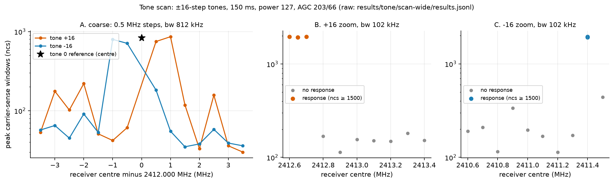
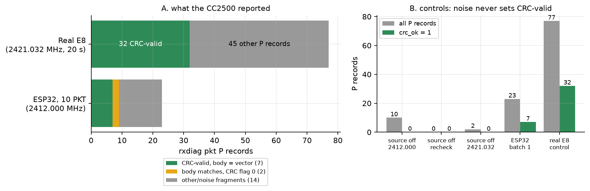
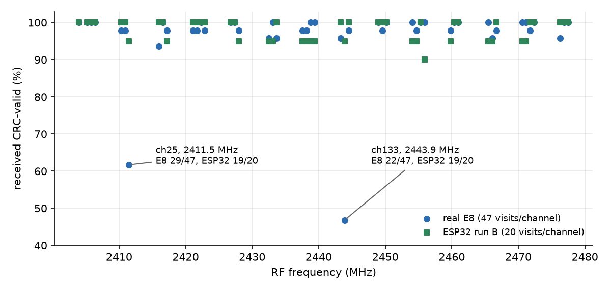
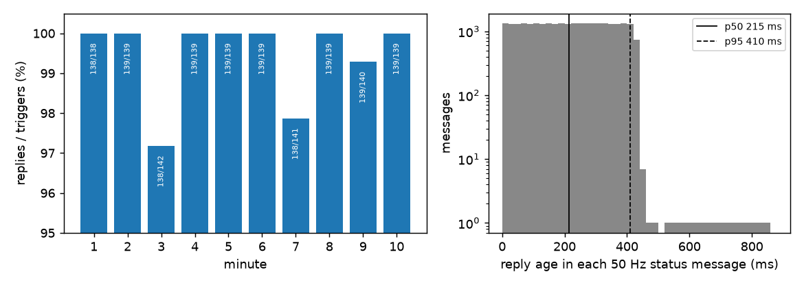
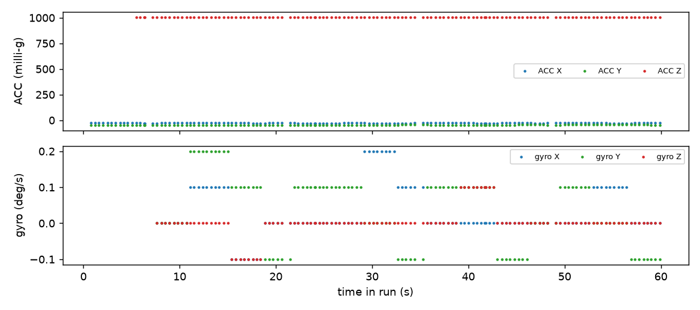
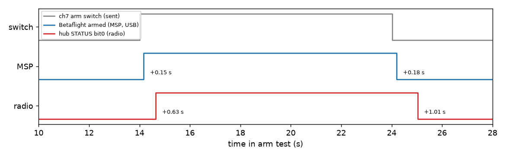
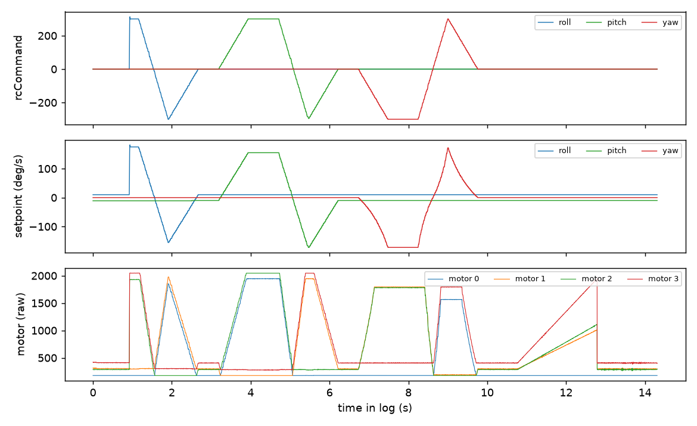
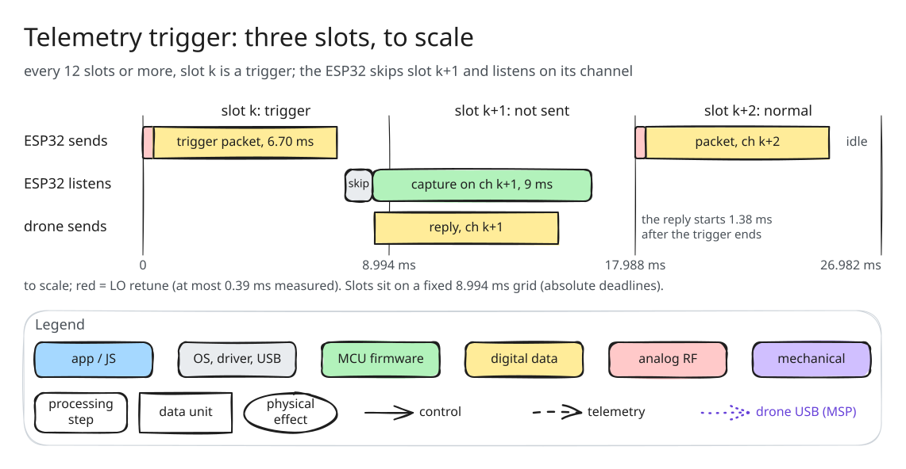

# Making a $5 ESP32 speak FrSky D8

*TX research note · November 2026 · companion to the RX write-up, [A 2.4 GHz SDR on a $5 ESP32](README.md)*

The RX write-up ended with a board that could listen: record a FrSky D8 transmitter, decode it, follow its hops. That is a long way from talking. Nothing in it showed that the same chip could produce a packet a real D8 receiver chip would accept. This chapter starts with the first time that happened, on a bench, once: an ESP32 DevKit V1 transmitted a hand-built D8 packet and an independent CC2500 reported it with a valid hardware CRC. The first try got 7 of 10; after fixing a receiver-side bug, 140 more attempts got about 94%, the same rate the real E8 transmitter gets on that receiver. Then it hopped all 47 D8 channels at about 98%, slightly better than the E8 on the same receiver (Sections 1 to 6).

It ends with the whole protocol: the ESP32 drives a stock Betaflight drone at 111 packets a second while hopping (Section 7, including a first takeoff), receives its telemetry replies (Sections 8 and 9), binds the drone to an identity of its own over the air (Section 10), and does all of it from a browser tab or desktop app with no server (Sections 11 to 13). It is still not a calibrated transmitter: output power is estimated, not measured, and there is no range test.

The short version of what worked: the ESP32's Wi-Fi PHY has a test-tone generator whose frequency can be stepped by a ROM function. Switching that tone between two steps at 31 kbaud is a crude 2-FSK modulator. A CC2500 listening on the channel decoded it. Most of the effort went into finding out where the tone actually lands, because the first attempts saw nothing.

All numbers below are re-derived from the raw logs by [`bench/d8-tx/analysis/plot_tx.py`](../../../bench/d8-tx/analysis/plot_tx.py) (`--summary` prints them). Raw logs are in [`bench/d8-tx/results/`](../../../bench/d8-tx/results/).

## Why one packet, and how to know it worked

The plan was one packet before any hopping, on purpose. A single fixed-channel packet is the smallest thing that can fail for only a few reasons (wrong frequency, wrong timing, wrong bytes), and it gives a yes/no answer that does not depend on my own decoder: the receiver's CRC check.

That independence matters. The ESP32 can read back its own registers and report that it "keyed for 6700 µs", but that proves the CPU ran a loop, not that RF came out ([`d8tone.c`](../../../firmware/main/d8tone.c) says so in its header: "none of this is RF evidence"). The only evidence accepted here is a **second radio, receiving**:

- A MATEK F411RX board with a CC2500, running a locally built Betaflight with a receive-only diagnostic (`rxdiag`, [firmware README](../../../bench/cc2500-rxdiag/firmware/README.md)). Its transmit path is guarded off. `rxdiag freq` reports, per 100 ms window, how many samples had carrier sense (`ncs`); `rxdiag pkt` reports each packet it demodulates with the chip's hardware CRC flag.
- A real FrSky E8 transmitter, used only as a **positive control**: if the receiver cannot see the real thing at that frequency and setup, an absence of ESP32 packets means nothing.
- The ESP32 firmware, `d8tone`, is RF-silent at boot and keys only on a command (`TONE`, `ALT`, `PKT`) for at most 200 ms, with a host-side envelope on power, duration and command count ([`bench/d8-tx/README.md`](../../../bench/d8-tx/README.md)).

## The transmitter

The transmit path is not a documented API. It reuses what Espressif's PHY already does for calibration: a numerically controlled oscillator injects a tone, and the ROM function `rom_start_tx_tone_step(1, f, 127, …)` sets its frequency as a signed step `f` from the Wi-Fi channel centre (here channel 1, 2412 MHz). `rom_pbus_force_test(5, 1, pwr)` then turns the transmit chain on ([`key()` and `tone_set()` in `d8tone.c`](../../../firmware/main/d8tone.c)). The keying sequence is adapted from an earlier experiment, not written from documentation.

What the packet needs from it:

| | Stock D8 (CC2500) | This ESP32 |
|---|---|---|
| Modulation | Gaussian-filtered 2-FSK | abrupt 2-FSK by switching tone step |
| Deviation | ±31.7 kHz (DEVIATN 0x42) | ±1 step ≈ ±39.06 kHz (40 MHz/1024) |
| Baud | 31,044 (MDMCFG4/3 = 0xAA/0x39) | 7731 CPU cycles/bit at 240 MHz ≈ 31,043 baud |
| Packet | 4×0xAA preamble, D3 91 sync, length+17 bytes, CRC16 | same bytes |
| Duration | | 208 bits × 7731 cycles = 6.70 ms |

The register arithmetic is in the comments at [`run_packet()`](../../../firmware/main/d8tone.c); the cycle count is rounded to an integer, accumulating under 9 cycles of drift over the packet. The deviation difference (39 vs 31.7 kHz) is a limit of the tone path, and it was not tuned or compensated.

**Packet bytes.** [`packet.c`](../../../firmware/main/packet.c) builds the 26 on-air bytes: `AA AA AA AA D3 91`, then the 18-byte frame (length `0x11` plus 17 payload bytes), then a CRC16 (poly 0x8005, init 0xFFFF) over those 18 bytes. The frame layout (transmitter ID `42 B2`, hop counter, eight 12-bit channels split across low bytes and shared nibbles) comes from the host builder [`d8_vectors.py`](../../../bench/d8-tx/host/d8_vectors.py), which does not import the RX decoder, and each has offline tests ([`test_packet.c`](../../../firmware/test/test_packet.c), [`test_d8_pkt.py`](../../../bench/d8-tx/tests/test_d8_pkt.py)). The test vector is `d8_vectors.build(0)`, body `1142b2000001cacacaca8888cacacaca8888`, CRC `afa7`. Each bit becomes tone step +1 for a 1 and −1 for a 0, switched from a busy loop with interrupts off.

## What happened

### 1. The first attempt: nothing, and a firmware bug

Before any RF, the first firmware image rebooted every 3.5 s while idle. [`esp_idle_wdt_reboot_observation.txt`](../../../bench/d8-tx/results/tone/esp_idle_wdt_reboot_observation.txt) shows `I,boot,reason=7` (RTC watchdog) at 3.8, 7.3 and 10.8 s with nothing commanded. The watchdog was meant to guarantee that a hang reboots into the RF-silent state; instead it fired on a healthy idle loop, so no keying was attempted on that image. The current source feeds it from the input poll (at most every 10 ms) and at the start of each keyed window; the fixed image idled 16 s without a reboot ([`esp_idle_retry.txt`](../../../bench/d8-tx/results/tone/esp_idle_retry.txt)). The old input loop used blocking `fgetc(stdin)`; ESP-IDF's UART VFS waited indefinitely for a character, so the idle loop could not feed the RTC watchdog. Replacing it with a bounded 10 ms UART read fixed the idle-reset observation. That diagnosis comes from source inspection plus the before/after idle logs, not a hardware trace of the watchdog.

Then the first RF test: 12 keyings (tone at steps 0, +16, −16 and an alternating pair, 150/100 ms, power 32) with the CC2500 at 2412.000 MHz, 812 kHz bandwidth, AGC 251/64. The ESP32's own readback was fine for all 12. The CC2500 saw nothing: the maximum `ncs` in any window of any run was 1, a single stray count in one window, **250 ms after** the tone had ended (panel A below, [`NOTE.md`](../../../bench/d8-tx/results/tone/NOTE.md)). The positive control at that setting did work: the real E8 produced carrier-sense in 28 of 50 windows at 2421.032 MHz.

So: the ESP32 believed it was transmitting, the receiver could hear a real transmitter, and no ESP32 RF was detected. That is a **null result, not a negative**. Candidate explanations were all untested at this point: tone too weak at power 32, tone outside the receiver's bandwidth, or no RF at all.


*Figure 1 ([SVG](img/tx-evidence/null-and-trap.svg)). A: max `ncs` in any 100 ms window for each of the 12 first-attempt keyings. B, C: carrier-sense counts with nothing keyed at 2412.000 MHz and AGC 203/66. Source: `results/tone/retry_*_stm.txt`, `rerun2/control_source_off_2412000.txt`, `rerun3/control_bw102.txt`.*

### 2. The detector trap

Raising the receiver gain (AGC 203/66, a more sensitive setting) and the transmit power to 127 made the next run look like a success: `ncs` rose about 5–20× in the keyed windows. It was not interpretable. With nothing keyed, **all 30 of 30** windows already had carrier sense, `ncs` 18–149, and the frequency estimate was pinned at its limits ([`rerun2/NOTE.md`](../../../bench/d8-tx/results/tone/rerun2/NOTE.md)). At 203 kHz bandwidth the estimate was still saturated in 24/30 windows. Only at 102 kHz was the source-off control quiet (2/30 windows, `ncs` 3 each; panel C).

This is the lesson of the whole bench phase: a detector that fires on noise cannot confirm a signal. The previous run had to be thrown out, not argued about, and every later keyed measurement used the quiet 102 kHz setting, with a source-off control first.

### 3. Narrowing, and finding where the tone is

At 102 kHz bandwidth, keying the tone at the centre (step 0) gave a clean response: `ncs` ≈ 1970 in the peak window against ~0–3 with nothing keyed. So the keyed carrier was in-band at 2412.000 MHz. But the receiver's frequency estimate (FREQEST) was not usable: the same step-0 tone read −9.5, +11.1 and −12.7 kHz on three keyings, a spread bigger than any difference I wanted to measure ([`rerun3/NOTE.md`](../../../bench/d8-tx/results/tone/rerun3/NOTE.md)). A scan from −500 to +500 kHz around 2412 MHz in 50 kHz steps then failed to locate the ±16 tones ([`scan/NOTE.md`](../../../bench/d8-tx/results/tone/scan/NOTE.md)). I was looking in the wrong place.

The wide scan ([`scan-wide`](../../../bench/d8-tx/results/tone/scan-wide/NOTE.md), 51 keyings, power 127, 150 ms) widened to ±3.5 MHz at 812 kHz bandwidth, then zoomed at 100 kHz bandwidth:

- tone +16 responded around **2412.6–2412.7 MHz** (≈ +650 kHz) and tone −16 at **2411.4 MHz** (≈ −600 kHz), with `ncs` 1917–1961 on every confirming keying, roughly symmetric about the step-0 carrier;
- at bw 102, +16 was not seen at 2412.8 MHz and above, and −16 not at 2411.3 MHz (a weaker 440 at 2411.5 was not counted as a hit).

If the step is 40 MHz/2¹⁰ = 39.06 kHz, ±16 steps is ±625 kHz, inside those hits. A 100 kHz scan cannot resolve the step to better than that, and 2411.35 MHz was not measured, so this is a consistent estimate, not a measurement of 39.06 kHz. That would explain part of Section 1: with the receiver at 2412.000 MHz and 812 kHz bandwidth (±406 kHz), the ±16 tones (and the alternating ±16 pair) sat outside the passband, so those nine keyings were never going to be seen. It does not explain the three step-0 keyings, which were at the receiver centre but at power 32 and AGC 251/64 and still showed nothing. Later step-0 keyings at power 127 and AGC 203/66 were seen (`ncs` 830 at bw 812), so low power or low sensitivity is the likely reason for those three, but I did not run the one change that would separate them.

The fine steps ±1, ±2, ±4 (the ones the packet uses) all produced a response at the predicted offsets ([`fine/NOTE.md`](../../../bench/d8-tx/results/tone/fine/NOTE.md)): `ncs` 1953–1981, RSSI 14–21 at receiver centres 2412.039/2411.961, ±78 and ±156 kHz. A step +1 tone with the receiver parked on the carrier (2412.000) gave only RSSI 2 against 14–21 in the matched positions, consistent with it sitting off-centre at the filter edge. The estimate for negative steps was stable (−42.2, −82.8, −144.9 kHz measured vs −39, −78, −156 predicted), but FREQEST is only about ±10 kHz and was unstable for positive steps, so this confirms roughly 39 kHz steps, not an exact calibration.



*Figure 2 ([SVG](img/tx-evidence/tone-scan.svg)). Peak carrier-sense windows vs receiver centre for tones ±16 at AGC 203/66, power 127. Panel A: stage A, bw 812 kHz, with the step-0 reference (★). Panels B, C: stage B, bw 102 kHz; "response" means `ncs` ≥ 1500 (pre-key baseline windows at bw 102 ranged about 110–860 `ncs` in these runs, so ambient interference was present; every response is at least 2× the highest baseline). Stage A is wide enough that responses are broad. The centre of a response is not defined by this plot to better than the 100 kHz grid. Source: `results/tone/scan-wide/results.jsonl`.*

### 4. The packet

With the offset understood, the ESP32 firmware put the ±1-step 2-FSK packet on 2412.000 MHz and the CC2500 was set to the same centre with the stock D8 register set (`rxdiag pkt`; its deliberate differences, such as CRC autoflush off so that failures are visible, are listed in its [README](../../../bench/cc2500-rxdiag/firmware/README.md)). Order of operations, from [`packet/NOTE.md`](../../../bench/d8-tx/results/packet/NOTE.md):

1. **Source off (E8 off):** at 2412.000 MHz two runs gave 10 P records in total, all `crc_ok=0` fragments; a later recheck gave 0. At 2421.032 MHz: 2 records, both CRC-bad. None began with the E8's ID bytes. Noise produces short fragments, but never a CRC-valid packet.
2. **Real-E8 control at 2421.032 MHz, 20 s:** 77 P records, **32 with `crc_ok=1`**, all starting `11 42 B2 00`.
3. **ESP32 test:** 10 `PKT` commands at power 127, one batch. All 10 replied OK with `bits=208`, `on_us` 6700–6704 and no reboot. The CC2500, at 2412.000 MHz, reported 23 P records ([`batch1_2412000_stm.txt`](../../../bench/d8-tx/results/packet/batch1_2412000_stm.txt)):
   - **7** whose 18 bytes are exactly the vector body with `crc_ok=1` (RSSI raw 11–13, LQI 51);
   - 2 more whose 18 bytes equal the body but with `crc_ok=0`, `rssi=lqi=0`;
   - 14 other fragments, noise as in the source-off check.



*Figure 3 ([SVG](img/tx-evidence/packet-outcome.svg)). Receiver outcomes. "Body matches" = 18 bytes equal to `d8_vectors.build(0)[:18]`. Source: `results/packet/*.txt`, classified by `plot_tx.py`; CRC flag = CC2500 hardware CRC_OK, which strips the two CRC bytes, so a P record carries 18 bytes and a flag (the same for the E8, for which the 32 valid records are all 18 bytes).*

The ESP32 build used here has SHA-256 `3698ae6f6bbe0b11bfac103c9f008320d9d90dfe9d22d179d55da0bcd5c60461` ([flash/hash evidence](../../../bench/d8-tx/results/packet/esp_hashes.txt)); its generated `.bin` is not included in this clone, so it must be rebuilt from `firmware/`. The STM diagnostic binary and checksum manifest are included under `bench/cc2500-rxdiag/firmware/out/4bdc8581/`.

The result: with a source of known state, a distinctive byte sequence and a CRC computed independently on the receiving chip, **7 of 10 packets were received intact**, while the real transmitter's control worked and the empty channel never produced a valid record. Of the other three, I do not know why. One has no full record, two have the right bytes with the CRC flag cleared. The E8 control shows the same signature (an `EPART` error and a 2-byte stray record beside valid ones), so a receiver-side FIFO-split artefact is the likely explanation. It is a hypothesis; I did not isolate it. Section 5 shows it was right: the diagnostic's 500 µs packet-end wait was shorter than the CRC gap.

### 5. Fixed-channel reliability: about 94%, the same as the real transmitter

Seven of ten is not a reliability figure, and Section 4 already suspected the receiver. A closer look found it. The diagnostic firmware decides that a packet has ended after 500 µs with no new bytes in the FIFO. The two CRC status bytes arrive about 515 µs after the payload (two bytes at 31 kbaud, 257.7 µs each), so the 500 µs window closed just before them. Some packets were therefore reported as a body fragment plus a separate two-byte stray, and the "CRC flag 0" records of Section 4 are that split. Raising the quiet time to 2000 µs fixed it, and the ESP32 was then measured on the same fixed channel, 2412.000 MHz, with no hopping, about one packet every 516 ms, power 127. Each group was preceded by a source-off capture, and E8 controls bracketed the sessions.

**Ten batches of ten.** Nine of the ten batches (1b, 3–10) were tied to their commands: **85 CRC-valid receptions, 5 unobserved** (one each in batches 1b, 3, 9 and two in batch 6), no CRC-invalid or malformed record. Batch 2 received 8 CRC-valid packets, but they cannot be assigned to commands. That batch had no timestamp taken just before the start command, so the receiver's clock was only known against the host's to within 0.54 s, more than the 0.5 s packet spacing: each reception fits two neighbouring commands. The two clocks also drift apart by about 0.18% (1.75 ms per second; Figure 7), so the offset cannot be extrapolated from elsewhere in the run. Later batches took an anchor, narrowing the uncertainty to 30–40 ms. Counting batch 2 as raw receptions, 93 of 100 commands produced a valid packet. No batch had a CRC-invalid copy: when the sync was found, the payload was right.

**FREQEST session.** The receiver also reports its frequency estimate (FREQEST) per packet. Five more batches of ten, with that field logged, gave **47 of 50**; the ESP32 and real E8 FREQEST distributions look alike (Figure 6). Over 47 ESP32 and 88 E8 packets the means were +1.8 and −1.8 kHz and the standard deviations 16.4 and 14.7 kHz. The values stop at ±21 LSB, ±33.3 kHz, which is the clamp: 5 of 135 packets sit on it. A spread that wide, with a clamp inside it, is too noisy to resolve carrier wander of the kind the tone work suspected (±10 kHz keying to keying), so FREQEST cannot say whether the ESP32 carrier lands where it should.

**The E8 on the same receiver.** The real transmitter, one visit every 422.7 ms, would show about 47 packets per 20 s. Four controls gave 46, 41, 44 and 44: **175 of about 189, 93%**. The ESP32 got 132 of 140 attributed commands, 94%. The two intervals overlap (Figure 5, panel B), so the misses look at least partly like receiver or bench effects, not like something only the ESP32 does.

| Measurement | Sent / expected | Received (CRC-valid) | Note |
|---|---|---|---|
| Reliability, batches 1b, 3–10 | 90 | 85 | 5 unobserved, 0 CRC-invalid |
| Reliability, batch 2 | 10 | 8 raw | not attributable to commands |
| FREQEST session, 5 batches | 50 | 47 | 3 unobserved |
| Real E8, 4 × 20 s | ≈189 | 175 | one visit per 422.7 ms |


*Figure 5 ([SVG](img/tx-evidence/reliability-outcome.svg)). Panel A: each bar is ten commands; red is a command with no receiver record, the hatched bar is batch 2 (see text). Panel B: Wilson 95% intervals; the E8 denominator is the expected visit count, not an observed one, so its interval is approximate. Source: `results/packet/{reliability,freqest}/batch*_report.txt`, `control_e8*`; `plot_reliability.py`.*


*Figure 6 ([SVG](img/tx-evidence/freqest-hist.svg)). Receiver FREQEST of CRC-valid packets, in 4 kHz bins, each series normalised to its own packet count. Dashed lines: the ±21 LSB clamp. Source: `results/packet/freqest/batch*_stm.txt`, `control_e8_{pre,post}.txt`.*

**Where the misses fall in time.** For the three batches with a tight anchor and a miss, the received packets sit on a straight line against send time with at most 91 µs of residual, so the expected arrival of each missing packet is known to about 0.1 ms. At those instants the receiver recorded no packet and no noise fragment ([`missing_four_offline.md`](../../../bench/d8-tx/results/packet/reliability/missing_four_offline.md)). The packet is 6.7 ms long, the nearest noise record was at least 41 ms away, and the receiver reported no errors. These look like clean "sync not detected" events. Two explanations remain open: the receiver was blind to a sync at that instant, or the ESP32 packet start was occasionally not decodable. The recorded noise rate allows a blind time of at most about 1%, which makes four or five misses in 80–90 attempts unlikely, but that argument assumes the unrecorded events are as common as the recorded ones.


*Figure 7 ([SVG](img/tx-evidence/reliability-timing.svg)). Matched receptions lie on a line of slope 0.175% (receiver clock fast against the host), and each unobserved send is placed by that line. Batch 6 lost two in a row. Source: `results/packet/reliability/batch{3,6,9}_*`.*

**What this shows and does not show.** On a fixed channel, on one bench with one receiver position, the ESP32 packet is received CRC-valid about 94% of the time, close to what the real E8 achieves on the same receiver, and a received packet is never corrupt. It does not give an ESP32 loss rate, because receiver loss and send-side loss are not separated: the E8 baseline is about as lossy. Nor does it say why the roughly 6% are missing. The receiver would need to log every sync detect, or the ESP32 keyings would need to be captured with an SDR beside it. FREQEST cannot settle carrier accuracy. Hopping and flight are untested, and the RSSI of received packets stepped down by about 5 dB between batches 3 and 4 when the setup was touched, which did not change the loss pattern.

### 6. Hopping: all 47 channels at ~98%

**Why the tone cannot hop by itself.** The tone generator's frequency steps only reach about ±20 MHz around the LO, and the D8 hop table spans 2404–2478 MHz. The 39.06 kHz step also does not divide the 299.93 kHz channel spacing, so even a reachable channel would be off-grid. So each hop retunes the LO instead (fast-hop mode 1, one retune per slot), and the tone steps only carry the data bits. The firmware measured the retune at at most 0.39 ms (363 µs in run A, 389 µs in run B) of an 8.994 ms slot, and the keying start was at most 81 µs late, so slot timing holds to about 80 µs.

**Retune gate.** Before hopping, a 150 ms tone was keyed after retuning to 2404, 2412, 2441 and 2478 MHz, and the receiver diagnostic watched each. All four passed, with the tone's FREQEST within 13 kHz of nominal (the 2441 MHz window had a steady in-band interferer; the tone still stood 23–31 counts above it). The receiver diagnostic was then given the hop table directly (`rxdiag hop`); there was no bind, so it followed the table a bound receiver would have learned.


*Figure 8 ([SVG](img/tx-evidence/hop-retune-gate.svg)). Grey: baseline RSSI with the tone off. Green: the three keyed 150 ms tones. The label is the largest FREQEST offset of the three. The 2441 MHz baseline had a steady in-band interferer, so its rise is smaller. Source: `results/hop/retune_gate/summary.md`; `plot_hop.py`.*

**Runs.** The real E8 was recorded first as a control, then the ESP32 sent 556 slots (run A) and 940 slots (run B), always hop-counter-ordered, sticks at 1500 µs.

| | E8 control (20 s) | ESP32 run A | ESP32 run B |
|---|---|---|---|
| Slots | 2204 | 556 | 940 |
| CRC-valid | 2133 (96.8%) | 543 (97.7%) | 921 (98.0%) |
| Longest loss run | 1 | 1 | 2 |
| Counter discontinuities | 0 | 0 | 0 |
| Channels decoding | 47 of 47 | 47 of 47 | 47 of 47 |
| Sticks decoded | 1500 µs | 1500 µs | 1500 µs |

Channel and ID mismatches were zero throughout (ID 42B2). The one RESYNC in each ESP32 run came after the ESP32 stopped sending, so it is not a loss.


*Figure 9. The ESP32 (run B), 921 of 940 slots. Cyan line: the expected hop sequence. Blue dots: slots received CRC-valid, at their expected frequency. Red X: slots with no valid packet. The 19 misses are scattered, and no channel lost more than two. Source: `results/hop/esp_hop/runB_*`.*


*Figure 10. The real FrSky E8, same receiver and drawing as Figure 9 (line, dots and red X mean the same), 2133 of 2204 slots over 20 s. Channels 25 (2411.5 MHz) and 133 (2443.9 MHz) are weak, at 29/47 and 22/47. Source: `results/hop/e8_control/`.*

**The weak channels.** The E8's 96.8% hides two poor channels, ch25 and ch133. The RX write-up had already noticed ch25 and suspected the transmitter. The ESP32 decodes the same two channels fine (19/20 each in run B, 12/12 each in run A) on the same receiver.



*Figure 11 ([SVG](img/tx-evidence/hop-per-channel.svg)). One point per channel. The E8 has 47 visits per channel and the ESP32 20, so one ESP32 miss is 5%. Only the E8 drops on ch25 and ch133. Source: `results/hop/e8_control/summary.md`, `results/hop/esp_hop/runB_stats.txt`; `plot_hop.py`.*

That is consistent with an E8 transmitter quirk on those channels, but it is not proof: different time, different packet content and a small count.

**Two loose ends.** The roughly 5% of fixed-channel misses from Section 5 were parked as a receiver or bench effect; the hopping runs (2.0–2.3% missing) did not reopen them. The E8 packet layout also puts the hop counter in byte 4 of the frame (the length byte is byte 0), which matters for the coming bind with stock Betaflight.

**What this shows and does not show.** On this bench the ESP32 hops through the full 47-channel table, with a continuous counter, and a CC2500 following the table receives about 98% of slots, at least as well as the E8. It does not show binding, a stock Betaflight receiver accepting it, range, or flight, and it does not show why the E8 is weak on two channels.

**Next:** bind to stock Betaflight. The bind exchange and the hop counter in byte 4 are the first things to get right. (Section 7 first skipped the bind by cloning the E8; Section 10 does the real one.)

### 7. Driving stock Betaflight, and the first takeoff

Everything so far used a diagnostic receiver. This section points the ESP32 at the drone itself, running **stock Betaflight 4.2.11** (restored and checked: `diff all` is byte-identical to `bench/cc2500-rxdiag/results/diff_all_final.txt`, `results/bf_link/link_check/`).

**No bind.** The drone's config already stores the E8's transmitter ID (66,178 = 0x42B2) and its hop table, so the ESP32 simply clones them. The receiver cannot tell it from the E8. (Section 10 replaces this clone with a real over-the-air bind to an identity of the ESP32's own.)

**Frequency.** Betaflight stores `frsky_spi_offset = -32` (about -51 kHz), which was tuned to the E8. The E8 runs roughly 26 ppm (about 63 kHz) low, while the ESP32 lands within about 13 kHz of nominal. So a new `FOFS` command shifts every hop by -63 kHz, and I set it by comparing FREQEST against the E8 (mean difference 13 Hz; `results/bf_link/offset_tune/`). This offset only exists because of the clone; after a real bind the receiver tunes itself to the ESP32 and FOFS 0 is best (Section 10). The shift does not change the packet rate: with and without it the drone-side receiver got 96.6–97.5% of slots (four runs, `results/bf_link/ab_test/`). An earlier 85–92% session in the tune runs was a bad stretch that did not reproduce, not an effect of the offset.

**Sticks.** In the Betaflight Receiver tab the channels read **T1200 A1400 E1600 R1800** exactly, the values the host sent (owner's screenshot; the sender log is `link_check/receiver_tab_fixed_sticks.csv`). Each of the four bars sat at a different, known place, so channel order and scaling are right.

**Live sticks.** A host sender issues `HOP 0` once (hop continuously) and then streams `S` stick updates at the 8.994 ms slot rate. The first sender slipped, because relative sleeps accumulate; it now keeps absolute deadlines (111 Hz). If the host goes silent for 300 ms the firmware unkeys. In a run with roll toggling every half second, roll edges reached Betaflight with a median 44.3 ms, p95 61.8 ms, maximum 181.5 ms. That includes the USB serial leg, waiting for the next slot, Betaflight's RC smoothing and the MSP readback used to measure it, so it is an upper bound on the radio link's share.


*Figure 12 ([SVG](img/tx-evidence/live-roll-latency.svg)). Grey: roll commanded by the sender. Blue: roll read from Betaflight. Every edge arrives, delayed. Source: `results/bf_link/live_sticks/live_sender.csv`, `live_msp.csv`; `plot_latency.py`. The per-edge latencies are also in `latency.png` next to them.*

**Arming.** ARM is AUX3 (channel 7, 1700–2100 µs). The firmware forces channel 7 low unless an explicit `ARMOK` is sent before a `HOP`, and clears it after every `HOP`, so a stuck host cannot arm by accident. The first attempts failed for two reasons: my host sender also forced channel 7 low, and Betaflight holds `RX_FAILSAFE` for about 2.5 s after the link appears. After fixing the first and waiting out the second, MSP reported ARMED (`mode_flags` 3) from 3.8 s to 7.4 s.

**First takeoff.** Then arm, wait, full throttle for 0.5 s, then 1 s (`results/bf_link/motor_test/*.csv`). In the last 1 s run (`motor_test8`) channel 7 went high at 3.5 s, throttle to 2000 µs from 5.0 to 6.0 s, disarm at 7.5 s. On that run the quad took off.

<video controls preload="metadata" width="720" poster="media/esp32-first-takeoff-poster.jpg"><source src="media/esp32-first-takeoff.mp4" type="video/mp4"></video>

*Video 1 ([mp4, 2.5 MB](media/esp32-first-takeoff.mp4)). The takeoff, 34 s, recompressed to 720p from the owner's phone recording.*

**What this does not show.** It is a scripted open-loop 1 s throttle pulse from a bench script, not piloted flight. No range test was done. **Failsafe** was tested with props off: armed at idle, then the Mac stopped sending without a stop command, as if it had crashed. The ESP32 stopped transmitting 0.30 s later (`why=timeout`), Betaflight entered RX failsafe about 0.46 s after that, and it **disarmed 1.25 s after the host died** (`bench/d8-tx/results/bf_link/failsafe/`). A dead ESP32 or a lost radio link ends the same way, because Betaflight only sees the packets stop.

### 8. A usable controller: the d8tx stack

Section 7 was a bench script. To fly the same way repeatedly I built a small stack in `python/` + `app/` (usage in [`python/README.md`](../../../python/README.md)). Four layers, each thin (Section 11 later replaced the Python backend and the WebSocket with a browser app that talks to both boards itself; the firmware protocol stayed):

- **Firmware protocol v1** ([`PROTOCOL.md`](../../../protocol/PROTOCOL.md)). ASCII lines at 921600 baud. `LINK <pwr> [timeout_ms]` starts continuous hopping; `S c1..c8` sets the eight channels in µs (no reply while linked); `STOP` ends it; `FOFS` sets a frequency offset; `ARMOK` permits channel 7 high for the next link only; `INFO` and `STAT` report. Every request gets one `OK` or `ERR <code>`; asynchronous `EV` lines report boot, a once-per-second link heartbeat and the reason the link ended (`stop`, `timeout`, `err`).
- **Python library** `d8tx`. `D8Link` owns the serial port and a sender thread that writes one `S` per D8 slot (8.994 ms, `SLOT_S` in `protocol.py`), so the firmware never starves. `BetaflightMSP` reads RC channels, analog and arm status over the flight controller's USB for readback.
- **FastAPI backend** (`d8tx.server`). REST for status and link start/stop, a WebSocket for sticks in and telemetry out at 50 Hz. If the browser is silent for 250 ms the backend stops sending sticks; the firmware's own timeout and Betaflight's failsafe are behind that. The flight-controller MSP connection reconnects by itself after a replug.
- **React/Vite/Tailwind page.** Mode 2: W/S raise and lower a non-centering throttle that starts at 0%, A/D yaw, arrow keys pitch and roll, hold R to arm, X to disarm, or drag the on-screen sticks. `?mock=1` runs it without a backend.


*Figure 13. The Sticks page with `?mock=1` (headless Chrome screenshot of `app`). It is a mock backend, so it shows the layout, not a flight.*

**Safety, in layers.** Any one of these is enough to keep channel 7 low or stop the link; they are independent so a bug in one is not the whole story.

1. **UI:** arming needs R held for 1 s; X disarms; nothing arms by default.
2. **Library:** `allow_arm` defaults to false and then forces channel 7 low whatever the caller asks.
3. **Firmware:** channel 7 is forced low unless `ARMOK` was sent, and `ARMOK` is cleared when each `LINK` ends.
4. **Host silence:** the backend stops after 250 ms without browser input, and the firmware ends a link after `timeout_ms` (default 300) without `S`.
5. **Betaflight:** with no packets it enters RX failsafe and disarms 1.25 s after the host died (Section 7).

**Lessons from using it on the bench.**

- Betaflight arms only if throttle is at minimum at the moment the arm switch goes high. If the arm is refused and the switch stays high, it stays refused (`ARM_SWITCH`) until the switch goes low. My first UI sent arm and hover throttle in the same packet and locked itself out. Fixes: the UI holds minimum throttle for 0.5 s after arming, and the library has an arm-edge guard that forces throttle to 1000 µs for 0.5 s after channel 7 rises (`ARM_THROTTLE_HOLD_S` in `link.py`), whatever the caller sends.
- `RX_FAILSAFE` persists about 2.5 s after the link appears, so arm attempts in that window fail (also in Section 7).
- With props off, runaway-takeoff protection disarms within seconds of throttle. That is expected; the arm switch must go low to clear it.
- Several browser tabs fight over the sticks, because each sends its own state. Use one.
- A game-style "Fly" mode was tried and dropped in favour of real sticks.
- Keys are on/off, so each stick axis is eased toward its target: holding an arrow ramps the stick and releasing returns it to centre, roughly like a thumb on a gimbal. Raw key values were too twitchy to fly.

**A scripted hop.** [`python/examples/up_forward_land.py`](../../../python/examples/up_forward_land.py) arms, climbs, tilts forward, descends and disarms from a fixed timeline, in Angle mode. It is open loop: there is no altitude sensor and the ESP32 gets no telemetry, so every number is a guess. The first attempts at hover throttle 1450 and 1550 µs did not lift off and slid forward along the ground. So the hover throttle is unknown but above 1550, and with throttle that high the forward tilt has to be small. The next step is Betaflight blackbox logging, to measure rather than guess.

**Telemetry comes back.** Betaflight's D8 receiver replies. In [`cc2500_frsky_d.c`](https://github.com/betaflight/betaflight/blob/4.2.11/src/main/rx/cc2500_frsky_d.c), after a packet with `packet[3] % 4 == 2` (line 237) it builds a telemetry frame (`buildTelemetryFrame`, line 239) and in `STATE_TELEMETRY` waits until 1380 µs after that packet (line 290) before switching to transmit. It has already stepped to the next hop channel (`nextChannel(1)` runs before `STATE_TELEMETRY`), so the reply comes on the **next** channel, not the trigger channel. The frame is 18 bytes (length byte 0x11, lines 135–147): bind ID, A1 (battery voltage), A2 (RSSI ADC), RSSI in dBm, a hub byte count and an echo of the packet's ID, then FrSky hub bytes. In [`telemetry/frsky_hub.c`](https://github.com/betaflight/betaflight/blob/4.2.11/src/main/telemetry/frsky_hub.c) the hub cycle is 125 ms (`FRSKY_HUB_CYCLETIME_US`, line 86) and acceleration is sent once per cycle, so 8 Hz; gyro IDs are defined but nothing sends them in this version (4.2). Too slow and too coarse for control, but enough for battery and RSSI.

I then tried it. After a trigger packet the ESP32 unkeys, retunes to the next channel and starts an I/Q capture 0.21–0.37 ms later, records 10.3 ms and ships the samples to the Mac, which decodes them with the RX project's D8 decoder (`bench/d8-tx/host/tlm_listen.py`). On battery, arm channel low, a 20 s run caught a CRC-valid 18-byte reply with the drone's ID in **26 of 46 trigger slots**, arriving 1.34–1.51 ms after the trigger packet, with A1/A2 and the drone's RSSI byte (71–76) and the telemetry ID echoed correctly (`bench/d8-tx/results/telemetry/`). So the half-duplex turnaround on the hacked transmit path works. Open: no hub bytes arrived (count 0 in every frame, so no accelerometer yet), the catch rate is 57% with one long run of misses, and A1 is not yet converted to volts. For dense flight data the practical route is still blackbox on the flight controller, read afterwards.

### 9. Telemetry in the stack, a richer hub, and blackbox

Section 8 ended with a bench script that caught 57% of replies and no hub data. This section makes the replies part of the controller, makes Betaflight send more useful hub fields, and tries blackbox logging over USB. All of it was done with the drone on USB power and **no battery** (CLI `status`: `Voltage: 1 * 0.01V (0S battery - NOT PRESENT)`), props off.

**Getting to near 100% first.** Three fixes came between Section 8 and the stack (`bench/d8-tx/results/telemetry/SUMMARY.md`). The old firmware stopped transmitting for about 0.22 s while it sent each 20 KB capture over the UART, so Betaflight spent most of a run in RX failsafe; capturing int8 and streaming it out between packets took a 60 s run from 56/139 (40%) to 121/139 (87%). Hub bytes were always 0 because the drone had `FEATURE_TELEMETRY` off; turning it on (the only config change) brought hub frames. And our carrier sat about 35 kHz above the drone's receive frequency at FOFS -50 kHz, so the drone lost some trigger packets: FOFS **-75 kHz** got 97.8–100% of triggers answered, against 82% at -50 kHz back to back. (That is a property of the cloned E8 binding; once the drone was bound to the ESP32 itself, -75 kHz became the worse setting, Section 10.) The id rule also changed to Betaflight's: the next telemetry id only after a reply echoed the last one, otherwise resend the same id.

**Telemetry in d8tx.** (The backend and Python library described here were later replaced by the browser app of Section 11, which reuses the same recipe and id rule.) `D8Link.start()` now turns telemetry on by default ([`PROTOCOL.md`](../../../protocol/PROTOCOL.md), "Telemetry in the library"): a trigger every 48 slots, a 9 ms capture streamed in int8, and FOFS -75000 Hz unless the caller sets one. A worker thread decodes each capture with a vendored copy of the RX decoder (about 5 ms each) and acks the id. The backend puts a `radio` object in `/api/status` and every WebSocket message: powered (reply within 3 s), link (within 1 s), catch rate over 10 s, reply age, RSSI, A1 battery voltage (`absent` below 2 V), hub fields and an inferred `armed`. The page's "Drone (radio)" cell shows powered, link, battery and armed.

A 60 s library run answered 138 of 138 triggers. A 10-minute run through the backend, with MSP readback and sticks at 20 Hz, answered **1387 of 1395 (99.4%)**, never below 97.2% in any minute (`bench/d8-tx/results/telemetry-stack/`). The sender held 111 Hz, 66,706 sends, none skipped, worst late 799 µs.



*Figure 14 ([SVG](img/tx-evidence/tlm-catch-age.svg)). The 10-minute backend run. Reply age p50 215 ms, p95 410 ms, maximum 849 ms: it is flat because a trigger comes every 48 slots (432 ms), so a missed reply doubles it. Source: `telemetry-stack/e2e/fc_10min_b.jsonl.gz`; `plot_telemetry.py`.*

Three things went wrong on the way. WebSocket streams froze for minutes in two early runs; that was the Mac idle-sleeping, and the 10-minute run under `caffeinate` had no gap over 54 ms. Opening the ESP32's port reboots it, so a link start posted right after the backend starts can get `no reply to 'FOFS -75000'`; waiting about 3 s works. And in the 10-minute run the hub fields **stopped updating after 12.9 s** while replies kept arriving; only the gyro of the patched fields (below) had appeared by then. The shorter 40 s and 60 s runs updated hub fields to the end. The cause is in Betaflight, not the library. The receiver builds a new hub cycle only when `cmpTimeUs(now, lastCycle) >= 125 ms`, and that difference is a signed 32-bit count of microseconds. The drone's last hub cycle had been at the end of the previous session, 60.7 minutes earlier, which is more than 2^31 µs (35.8 min), so the difference came out negative. Every request then got zero hub bytes, and that lasts until the gap passes 2^32 µs (71.6 min), about a minute after the run ended. A replay of Betaflight's buffer logic through the library (`telemetry-stack/hub-stall/model.py`) gives the same frames reply by reply. 27 resends of a stale chunk with gyro Y and Z appear because the backend restart had reset our id, then ACC X and Y, then ACC Z, then nothing from reply 30. Any link that starts 36 to 72 minutes after the drone last sent hub data, or after it booted, gets no hub data until that window ends; the patched firmware could guard against it.

**A patched Betaflight hub.** Stock 4.2.11 sends ACC as `((int16_t)(acc in g)) * 1000`, so a drone sitting level reads 0 or 1000 milli-g, never 996, and it has no arm state at all. A patch to `frsky_hub.c` alone ([`bench/betaflight-patch/`](../../../bench/betaflight-patch/README.md)) keeps every stock ID and adds:

| ID | Field | Unit | Rate |
|---|---|---|---|
| 0x24–0x26 | ACC X/Y/Z | true milli-g (was whole g × 1000) | every 125 ms cycle |
| 0x46 | STATUS | bit0 armed, bit1 ANGLE, bit2 HORIZON, bit3 failsafe, bit4 arming disabled, bit5 acro | every cycle |
| 0x47 | ARMING_DISABLE | low 16 bits of `armingDisableFlags` | every cycle |
| 0x40–0x42 | GYRO | 0.1 deg/s, filtered | odd cycles (4 Hz) |
| 0x43–0x45 | ATT roll/pitch/yaw | 0.1 degree | every 4th cycle (2 Hz) |

The worst cycle is 53 bytes, under the receiver's 64-byte buffer (encoding in [`protocol/PROTOCOL.md`](../../../protocol/PROTOCOL.md), "Patched Betaflight hub fields"). The first image flashed fine and then reported `NO_GYRO`: the bare MATEKF411RX target only builds the MPU6000 driver and this Tinyhawk has an ICM20689, which the stock cloud build includes. A second patch adds that driver to the target. Image `a7c24987` (431,488 bytes) found the ICM20689, gyro at 8 kHz. Flashing needs no button: CLI `bl` reboots into the ROM DFU bootloader and `dfu-util` writes the image. The same command writes the stock 4.2.11 image back (`recovery/`, sha256 `bb32b85a…12fc5`). Flashing wipes the config, so the transmitter ID 66,178, hop table, offset -32, `feature TELEMETRY` and LEDs off were replayed and checked against `diff all` (`bench/d8-tx/results/betaflight-patch/`).

Over the radio a 90 s run answered 207 of 208 triggers. The drone sitting level read **ACC -28.1, -46.7, +1004.5 milli-g** (Z 1003–1006), gyro within ±0.6 deg/s, attitude roll -2.7°, pitch +1.6°, yaw 359.3°, and STATUS mostly 2 (ANGLE). All stock fields still arrived. Field counts came out 4:2:1 (ACC 52, gyro 26, attitude 13), the ratio the patch intends, but the absolute rates are capped by one reply every 48 slots (about 19 hub bytes a second), not by the drone. Since the new fields share that budget, each stock field updates about 30% less often per trigger. The patch's 8/4/2 Hz would need a trigger every ~10 slots; that was not measured.



*Figure 15 ([SVG](img/tx-evidence/tlm-hub-acc-gyro.svg)). Patched ACC and gyro received over the radio by the backend, drone still on the bench, one point per hub update (137 in 60 s). Mean ACC -28.3, -45.9, +1005.7 milli-g. Source: `telemetry-stack/e2e/fc_idle.jsonl.gz`; `plot_telemetry.py`.*

**Armed over the radio.** STATUS bit 0 is Betaflight's own armed flag, so the controller can show ARMED without a USB cable. In the arm test (allow arm, throttle low, channel 7 high for 10 s), MSP over USB saw the arm 0.15 s after the switch and the radio 0.63 s after it; disarm took 0.18 s and 1.01 s.



*Figure 16 ([SVG](img/tx-evidence/tlm-armed-bit.svg)). The arm switch sent, Betaflight's armed flag read over USB, and STATUS bit 0 received over the radio. Source: `results/betaflight-patch/armtest_log.csv`, `armtest_events.json`; `plot_telemetry.py`.*

Through the backend the radio lagged MSP by 0.73 s on arm and 0.37 s on disarm. With no USB at all (`nofc_arm`), it showed armed 1.26 s after the command and disarmed 1.9 s after, with `armed_source` "patched". Replies come only every 432 ms, which probably accounts for most of the lag; it is good for an indicator, not for a safety interlock. With stock firmware the library falls back to inferring arm state from the RPM field, which in several cases can only answer `None` (`PROTOCOL.md` lists them).

**Blackbox over USB.** Section 8 ended with blackbox as the way to measure a hop. This flight controller has no flash chip and no SD card, so blackbox can only go to a serial port, and I used the USB VCP, shared with MSP (`bench/blackbox/README.md`). I enabled it there (`serial 20 129 … 2000000`, the only line of `diff all` that changed) and wrote a capture, decode and plot tool in [`bench/blackbox/`](../../../bench/blackbox/).

One armed session worked, about 15 s of scripted roll, pitch and yaw sweeps. It decoded with Betaflight's `blackbox_decode` to **13,655 frames, 0 failed, at 954 Hz** over 14.31 s (`bench/blackbox/results/bench/`). The start of the header was lost (see below), so `reconstruct_header.py` rebuilt it from Betaflight 4.2's field rules for this config; that variant is the only one that decodes cleanly (variants without `rssi` or `axisD[2]` decode to 30 Hz of garbage), and the captured tail of the header matched it. rcCommand follows the script, ±300 on each axis in turn, except the first ~0.9 s: `rxSignalReceived` was 0 from 0.081 to 0.922 s, so the first roll ramp is missing.



*Figure 17 ([SVG](img/tx-evidence/blackbox-session1.svg)). The one good blackbox log. The gyro (not shown) stays within ±1 because the drone sat still. The motors swing to full with props off because nothing moves, so the I-term winds up under airmode; the ESCs were unpowered. Throttle rcCommand stays at 1000–1001 for throttle sent up to 1150 µs, which is the throttle curve of this rate profile (thr_mid 0, thr_expo 100). Source: `bench/blackbox/results/bench/bb_session1_reconstructed.01.csv`; `plot_telemetry.py`.*

**The USB hang, still open.** On this F4, Betaflight 4.2 reopens the VCP with `usbVcpOpen()` whenever the port changes owner: on arm, when blackbox takes it from MSP, and on disarm, when MSP gets it back. That pulls D+ low for 200 ms and reinitialises USB (`drivers/serial_usb_vcp.c:219`, `drivers/usb_io.c:69`). macOS does not re-enumerate, so the port goes silent. A host-side libusb reset (`usbreset.py`) brings it back; with one reset per arm the data flowed, but the start of the header was already gone, which is why it had to be rebuilt. A later two-session run reset the port on every 1.5 s of silence, and that wedged the flight controller: no USB and no radio telemetry (21 triggers, 0 replies); it needs a physical unplug and replug. That the repeated resets caused it is likely but not proven. So blackbox over the shared VCP is not a routine setup here. The options are a UART logger such as an OpenLager, or a Linux host, which might re-enumerate after the D+ pulse; neither is tested. The blackbox-on-VCP setting is still saved on the drone, and must be reverted (`bench/blackbox/results/NOTES.md`, "MORNING STEP") before MSP or `d8tx.server` work normally again.

**Fast attitude and gyro (patch 0003).** Hub bytes were too slow: at one reply per 432 ms, gyro refreshed every ~3.5 s and attitude every ~7 s. Patch 0003 makes the drone's reply carry a 10-byte block of roll/pitch/yaw and gyro x/y/z (`cnt` = 0x8A, format in `PROTOCOL.md`) in two of every three replies, and the stack now polls every 12 slots (about 8.5 replies/s). Flashed build `c3f351e4`, 60 s bench link, drone on USB, no battery:

| | before (a7c24987, every 48 slots) | after (c3f351e4, every 12 slots) |
|---|---|---|
| replies/s | 2.3 | 8.5 |
| gyro/attitude refresh | 0.29 / 0.14 Hz (3.5 s / 7 s) | 5.7 Hz (p50 0.12 s, p95 0.23 s) |
| request-to-decoded latency | 0.31 s | 0.10 s |
| ACC / STATUS refresh | ~1.7 s | ~1.5 s |
| MSP RSSI, failsafe, ch8 lag p50 | 0 failsafe, 0.02 s | 0 failsafe, 0.02 s (p95 0.04 s) |

The radio values agree with MSP_ATTITUDE (-1.8, 1.2 deg vs -18, 12 deci-deg) and gyro within noise. The same patch carries the hub-timer-stall guard, but the 36-minute idle condition was not re-tested. Evidence: `bench/d8-tx/results/fast-telemetry/e2e/`.

**What this does not show.** No flight with telemetry, and nothing on battery: the battery fields all read 0. The 8/4/2 Hz hub rates were not measured, only their ratio. The hub stall in the 10-minute run is explained by a model and by timing, but the reply byte counts were not logged and the fix (a guard in the patched firmware) is not built. The blackbox result is one 14 s log on the bench, with a rebuilt header, and the setup that produced it also hung the flight controller.

### 10. Binding over the air, with an identity of its own

Sections 7 to 9 never bound anything. The ESP32 sent the E8's transmitter ID and hop table, which the drone had stored when it was bound to the real E8. That works for one drone, as long as nobody turns the E8 on, and it means every DevKit built from this repository would pretend to be the same E8. So each DevKit now has an identity of its own and binds the drone to it, the way a FrSky transmitter does.

**Identity.** On its first boot the firmware draws a random transmitter ID (two bytes, `txid`) and a hop-table start and step with `esp_random`, and stores the four bytes in NVS (namespace `d8tx`, key `ident`; [`PROTOCOL.md`](../../../protocol/PROTOCOL.md), "Bind"). The table is entry 0 = 0, the bind channel, then entry i = (start + step·i) mod 256 for i = 1..46. `ID` prints the identity, `ID new` draws another one, and `ID xxxx s t` loads a given one, which keeps the E8 clone possible (`ID 42b2 2 55`). `INFO` reports the txid, and the links match telemetry replies against it instead of the old constant 0x42B2.

**What Betaflight expects.** A D8 bind packet is the same 18-byte frame with a different layout: `11 03 01 txid0 txid1 idx h[idx] … h[idx+4] 00 … 01` plus the CRC, that is the transmitter ID and the five hop-table entries starting at `idx`. The firmware's `BIND` command sends one per 8.994 ms slot on hop channel 0 (plus the current `FOFS`), with idx cycling 0, 5, …, 45, so the whole table goes out every 10 slots, about 90 ms. It does not hop, and it stops on `STOP` or after 30 s.

On the drone, Betaflight 4.2's bind state machine ([`cc2500_frsky_shared.c`](https://github.com/betaflight/betaflight/blob/4.2.11/src/main/rx/cc2500_frsky_shared.c), `frSkySpiDataReceived`) goes bind requested → tuning → Bind1 → Bind2 → complete. Tuning listens on channel 0 with address filter 0x03, sweeps the CC2500's frequency offset register (FSCTRL0) from −126 to +126 in steps of 5, one step every 50 ms, and keeps the first offset at which a bind packet arrives with a good CRC and LQI above 50. So the receiver tunes itself to whatever carrier the transmitter really has, and the FOFS correction of Section 7 should no longer be needed. Bind1 takes the idx-0 packet (txid and entries 0–4); Bind2 takes idx 5, 10, … strictly in order and ends at the first 0 at idx 45 or later, which gives a 47-entry list. Then it writes the result to EEPROM itself. Before any radio test, `firmware/test/test_packet.c` runs a C port of Betaflight's `getBind1` and `getBind2` ([`bf_bind_port.c`](../../../firmware/test/bf_bind_port.c)) over the firmware's own bind frames, for the E8 identity and 200 generated ones, starting at every idx, and checks that it recovers the txid and the full hop list.

**Hop tables that look like D8.** The first rule for a generated table only asked for 46 distinct entries inside the LO range (2 to 246). That also accepts small steps: steps 1–5 and 251–255 pack all 47 hops into a narrow slice of the band. The identity the drone was first bound to on the bench (below) was one of these, step 254, every second channel from 115 to 205. A real D8 table spreads over the whole band, so that a narrowband interferer costs a few hops rather than most of them. Generated identities now follow the rules of the reference transmitter implementation, Multiprotocol's FrSkyD: consecutive hops at least 30 channels (about 9 MHz) apart, no unused gap wider than 32 channels between channels 2 and 234, no entry above 234 or equal to 0x5a or 0xdc, and a first txid byte other than 0x00, 0x03 and 0xff. 142 of the 65,536 start and step pairs pass (steps 43, 65, 73, 84, 103 and 110 and their negatives). `ID xxxx s t` keeps the permissive rule, so clones like the E8 table still load.

**The bench bind.** All in [`bench/d8-tx/results/bind/SUMMARY.md`](../../../bench/d8-tx/results/bind/SUMMARY.md); props off, drone on USB power, arming disallowed in every link. The DevKit drew `txid=6ff3 start=205 step=254` on its first boot and still had it after a reset. With `BIND 30` running at FOFS 0, I typed `bind_rx` into the drone's Betaflight CLI. Four seconds later `get frsky_spi` showed the new identity, saved by the receiver code without a `save`:

| | before (E8) | after (ESP32) |
|---|---|---|
| `frsky_spi_tx_id` | 66,178 | 111,243 (= 0x6f, 0xf3) |
| `frsky_spi_offset` | −32 | 4 (3 in a second bind) |
| `frsky_spi_bind_hop_data` | E8 table | 0, 203, 201, …, 115, 113 = (205 + 254·i) mod 256 |

Those three lines are the only difference between the `diff all` before and after. The receiver's offset moved by +36 steps, about +57 kHz. That is the same correction the cloned binding had needed from the transmitter side, FOFS −50 to −75 kHz in Sections 7 and 9, now made by the receiver. The binding survives a reboot and also works without one: in the second bind, driven from the TypeScript link with the flight controller still sitting in the CLI, the link that followed got 90.9% of telemetry triggers answered.

**FOFS 0 is now the right offset.** Four 60 s links followed the first bind, telemetry on, fixed sticks read back over MSP:

| Power | FOFS | Triggers | Replies | Catch | Drone RSSI | RC readback |
|---|---|---|---|---|---|---|
| 127 | 0 | 534 | 507 | **94.9%** | −67.6 dBm | 238/238 exact |
| 127 | −75 kHz | 619 | 451 | 72.9% | −70.2 dBm | 238/238 exact |
| 30 | 0 | 662 | 431 | 65.1% | −81.8 dBm | 235/235 exact |
| 30 | −75 kHz | 702 | 371 | 52.8% | −86.2 dBm | 239/239 exact |

The −75 kHz offset that Section 9 needed for the cloned binding now costs packets at both powers. So the default offset in the libraries went back to 0, and `D8Link.bind()` sends `FOFS` before `BIND`: the receiver locks to whatever offset the bind packets had, so a bind at −75 kHz left over from an earlier link, followed by links at 0, would mis-tune it. In every run the sender held 111.18 Hz with no skipped slot, RX failsafe never came back after lock, and the drone never armed. Power 30 is near the receiver's sensitivity edge on this bench, so comparisons use 127. One earlier power-30 run, not in the table because its log was overwritten, ended at about 52 s with `link_end why=err`: the torn UART line of Section 12.

**One click.** Typing `bind_rx` into a CLI was the last manual step. Betaflight also has an MSP v2 command, `MSP2_BETAFLIGHT_BIND` (0x3000), the one Betaflight Configurator's "Bind receiver" button sends, and on this 4.2.11 build it puts the SPI receiver into bind mode with no CLI and no reboot. The app's Bind button runs the rest (`bind()` in [`packages/core/src/worker/host.ts`](../../../packages/core/src/worker/host.ts)): it pauses the link, sends `FOFS` and `BIND 40` to the DevKit, then `MSP2_BETAFLIGHT_BIND` to the drone over its USB, waits 6 s, stops the bind packets and starts a short link with arming disallowed. It reports the drone bound when a telemetry reply carrying the DevKit's txid arrives within 5 s or, failing that, when the drone's own MSP status shows its receiver out of failsafe. The bench notes record it working on 3 of 3 binds ([`.ru/memories/betaflight-drone-firmware.md`](../../../.ru/memories/betaflight-drone-firmware.md)). The app runs of Section 13 used a newer identity, txid `3537`, and the drone answered it: telemetry is only decoded when the reply carries the DevKit's own txid.


*Figure 18 ([source](../../diagrams/bind.excalidraw)). The one-click bind across the laptop, the DevKit and the drone, and the confirm link that follows it.*

**What this does not show.** One drone, one bench, and a handful of binds; I did not test binding at a distance, with a second drone, or with the drone's physical bind button. The 6 s bind window is about the 2–5 s the receiver took, not a measured margin.

### 11. A browser app with no backend

Section 8's controller needed Python on the laptop: a FastAPI server owned the serial port and the 9 ms sender, and the page talked to it over a WebSocket. That is one more program to install and keep running. Everything now runs in the browser instead, or in an Electron shell around the same build ([`ARCHITECTURE.md`](../../../ARCHITECTURE.md)). The firmware protocol did not change.

**The worker owns the cadence.** Everything with a deadline runs in a Web Worker ([`packages/core/src/worker/host.ts`](../../../packages/core/src/worker/host.ts)): `D8Link`, a TypeScript port of the Python link, writes one `S` line per 8.994 ms slot on absolute deadlines, triggers and decodes telemetry and acks its id, and a poller reads the flight controller over MSP. The React page only posts stick and settings intents and draws the state the worker posts back at 50 Hz. A stalled page does not stall the link, and if the page says nothing for 2.5 s the worker disarms and centres the sticks while the link stays up.

**Both boards over Web Serial.** Chrome and Edge reach serial ports directly. The worker tells the boards apart by USB vendor and product ID ([`packages/serial/src/web.ts`](../../../packages/serial/src/web.ts)): the DevKit by its USB bridge (CP2102 10c4:ea60, or a CH340 or CH9102), the flight controller by the STM32 virtual COM port, 0483:5740. The same core runs in Node behind a serial adapter, which is what the Electron app, the bench scripts and the hardware tests use.

**The demodulator in WebAssembly.** The telemetry decoder was Python. For the browser it is now a small C demodulator, [`demod/src/d8demod.c`](../../../demod/src/d8demod.c), with no libc, built three ways: WebAssembly for the apps (it imports only `atan2f`, `sinf`, `cosf` and `floorf`), native for tests, and a compile check for the ESP32. `make -C demod check` runs the WebAssembly build in Node over the 14 I/Q captures in [`protocol/captures/`](../../../protocol/captures/) (real int8 replies, the same replies requantized to int4, and noise) and compares with the Python decoder's output: the same packet bytes from every capture, and carrier offsets that agree to the 0.1 Hz printed, `14 captures, 0 failures`.

**One spec, shared vectors.** [`protocol/PROTOCOL.md`](../../../protocol/PROTOCOL.md) is the only description of the wire format, and the golden vectors next to it in [`protocol/vectors/`](../../../protocol/vectors/) (commands, replies, telemetry headers, hub frames, MSP frames, the telemetry-id rule) are generated from the Python package. The firmware tests (`firmware/test/test_vectors.c`), the TypeScript tests (`packages/core/src/vectors.ts`) and the Python tests all read them, so an implementation that drifts from the others fails its own tests.

**Auto link and persistence.** The worker behaves like a radio: while the DevKit is connected it keeps a link running with the current settings. It starts the link on connect, restarts it when a setting changes (never under an armed drone: the change waits for disarm), and after a lost port or link it reconnects with backoff from 250 ms to 3 s. Every start or restart holds the arm channel low until the page sends a disarmed frame. Settings and the chosen ports are saved, so a reload or an app restart reconnects by itself.

**Exclusive ports.** Each serial port has one owner. Web Serial opens ports exclusively, and the Node adapter sets `TIOCEXCL` to behave the same way ([`packages/serial/src/node.ts`](../../../packages/serial/src/node.ts)). A second tab or app that tries gets "in use by another app or tab" and retries every 2 s, so closing the first one hands the boards over.

**Flashing from the app.** The page also installs and updates the DevKit firmware, with esptool-js over the same Web Serial port ([`packages/ui/src/flash/`](../../../packages/ui/src/flash/)). It writes only the bootloader, partition table and app, never erases the whole flash, refuses any image that would overlap NVS (0x9000–0xF000), and checks each image by MD5, so the identity of Section 10 survives an update and the drone stays bound. `INFO` reports a version with a source hash, and the button reads Install, Update or Reinstall accordingly. The bundled images are release builds, which leave out the single-channel and tone bench modes of Sections 1 to 5 ([Regulatory status](#regulatory-status)).


*Figure 19 ([source](../../diagrams/overview-control.excalidraw)). The control path, one packet every 8.994 ms. Blue runs in the browser, grey is the operating system and USB, green is firmware.*



*Figure 20 ([source](../../diagrams/timeline.excalidraw)). A telemetry trigger, to scale. Every 12 slots or more, the slot after a trigger is a listen slot.*


*Figure 21 ([source](../../diagrams/overview-telemetry.excalidraw)). The telemetry path back, about 8.5 replies a second, decoded in the browser.*

### 12. What the hardware found

The TypeScript core was tested against a simulated DevKit first. The real hardware turned up four problems the simulation did not have; the first two are now simulated too ([`packages/serial/src/mock.ts`](../../../packages/serial/src/mock.ts)), so the tests cover them.

**STAT goes unanswered while a capture ships.** While linked, the firmware skips a `STAT` request without a reply if it is busy shipping a telemetry capture over the UART. With telemetry on, that was about 75% of them, so the status poll timed out most of the time. The host now resends an unanswered `STAT` after 120 ms (`STAT_RESEND_MS` in [`packages/core/src/link.ts`](../../../packages/core/src/link.ts)) and when a capture ends ([`.ru/memories/d8tx-link-uart-limits.md`](../../../.ru/memories/d8tx-link-uart-limits.md)).

**A host stall overflows the UART FIFO.** The firmware keys a packet, or listens for a reply, with interrupts off, for up to about 11.3 ms. During that time the only buffer for incoming bytes is the ESP32's 128-byte hardware UART FIFO. A sender that falls behind (a busy laptop, a slow worker turn) and then catches up in a burst writes three `S` lines and a `TID` at once, 129 bytes. The last byte is lost, the firmware reads a torn line, answers `ERR unknown cmd`, and ends the link with `link_end why=err`. That is the power-30 run that died at 52 s in Section 10. The sender now never writes two `S` lines closer than 0.8 slot apart (`SENDER_MIN_SPACING`), so it catches up gradually; two `S` lines plus a `TID` and a `STAT` fit.

**A link left running.** Closing a tab or killing the app does not stop the DevKit, so the next session can find the firmware still linked from the previous one. While linked, any request other than `S`, `STOP` and `STAT` ends the link and gets `ERR busy`. The start sequence now treats that as expected: its first `FOFS` ends the old link, and the retry lands on an idle firmware. A timeout at that point is also retried, because opening the port can reset the ESP32 and it may still be booting.

**Closing the port hung Node.** In the desktop app and the Node tests, closing the DevKit's port after a streaming session could block the whole main thread for a minute or more inside the macOS kernel, in `close` on the CP2102 driver. The cause was the way the port was configured: running `stty` as a child process on the port's own file descriptor cleared its non-blocking flag, so a read could sit in the threadpool and pin the descriptor. The port is now configured through a second, short-lived descriptor, and closing stops issuing reads and writes, waits for the ones in flight, flushes both tty queues and only then closes ([`packages/serial/src/node.ts`](../../../packages/serial/src/node.ts)).

Two smaller findings from the validation runs: the firmware's `slots` counter only counts keyed slots, so with telemetry on it reads about 90% of elapsed slots by definition, not because of loss; and a minimized Electron window still reports itself visible (with background throttling off), so the page's "hidden tab disarms" rule never fires in the desktop app ([`docs/validation/d8tx-web-desktop.md`](../../validation/d8tx-web-desktop.md)).

### 13. Validation of the app

The app was checked on the bench by a test harness that drives the real Electron app with Playwright ([`apps/desktop/e2e/run.mjs`](../../../apps/desktop/e2e/run.mjs)) and clicks the same buttons a user would. A tap inside the worker observes, without changing, every line to and from the DevKit and every MSP reply from the drone. Drone on USB, props off, no battery (MSP reported 0 cells, 0.0 V). Write-up of the runs: [`docs/validation/d8tx-web-desktop.md`](../../validation/d8tx-web-desktop.md); raw results: [`apps/desktop/e2e/results/`](../../../apps/desktop/e2e/results/).

**Ten minutes, window minimized.** Link at power 127, telemetry on, arming disallowed, window minimized 3 s after the start (`soak-2026-11-09T18-22-51-299Z.json`). This run was before the bind work, so it used the cloned E8 identity at FOFS −75 kHz.

| | Measured |
|---|---|
| `S` lines written | 64,409 (106.5 a second), longest gap 24.4 ms, none over 50 ms |
| Keyed slots, firmware count | 61,921 against 61,716 expected from the elapsed time minus listen slots (ratio 1.003) |
| Link lost | 0; the link ended with `why=stop` when the harness pressed Stop |
| Telemetry | 5,100 replies to 5,312 triggers (96.0%), 506–512 a minute; reply age under 1 s in every 1 Hz sample |
| Flight-controller attitude over MSP | 10.73 Hz |

**Arm, throttle, disarm, port loss** (`arm-2026-11-09T18-35-15-559Z.json`, window visible, max throttle set to 15%). Holding `R` for 1.2 s armed Betaflight; holding `W` took throttle to the 1150 µs cap in 1.0 s, and the drone's MSP RC channels read 1150 and arm channel 2000 while the prop-less motors spun up. `X` disarmed within 309 ms (the MSP status poll interval) and the motors went back to 1000. Then, armed again, the harness made the DevKit's port fail the way an unplug does (every read and write rejects). The worker reported the link lost 11 ms later, the page showed "Link lost: DevKit port closed" at 12 ms and DISARMED at 16 ms. With no more `S` lines the firmware stopped transmitting after its 300 ms timeout, and Betaflight went to failsafe at about 1.05 s, motors to 1000 at about 1.31 s and disarmed by about 1.57 s, its own failsafe timing.

**Auto link** (`autolink-2026-11-09T20-45-56-554Z.json`, after the bind, txid `3537`, FOFS 0, arming disallowed):

| Event | Link up | Telemetry flowing |
|---|---|---|
| Connect the DevKit | 197 ms | 831 ms |
| Power changed in Settings (incl. the page's 600 ms debounce; `STOP`, `FOFS 0`, `LINK 100 300`) | 690 ms (down at 638 ms) | 5.6 s |
| Simulated port loss (seen lost at 54 ms) | 565 ms | 3.6 s |
| Page reload, settings kept | 337 ms | 1.3 s |
| App quit (214 ms) and restart, settings kept, drone reconnected | 1.19 s | 1.66 s |

Times are from the action to the worker's state. I did not break down why telemetry takes seconds longer than the link after a settings change or a port loss.

**A second instance.** With app A linked, a fresh app B tried to connect both boards. B showed "DevKit in use" after 91 ms and the drone's USB in use after 118 ms, and kept retrying. Over the next 20 s, A's link carried on undisturbed: 101.8 keyed slots and 6.7 telemetry replies a second, no link loss. When A was closed, B took both boards over and had the link up in 1.74 s and telemetry in 1.95 s.

**With the ESP32's own identity.** A 2-minute minimized run after the bind (`soak-2026-11-09T20-47-17-909Z.json`, txid `3537`, FOFS 0) held the sender the same way (longest `S` gap 23.9 ms, no link loss), but answered only 946 of 1,292 triggers, **73.2%**, against 96.0% in the 10-minute run and 94.9% in Section 10's bind tests. I have not found why. The identity, the drone's position and the day's interference all differ between those runs, and none of them was isolated.

**What this does not show.** No flight from the app: the owner's piloted flight from Chrome and from the desktop app is not in these results. The Chrome build was not soaked in a background tab, only the Electron app. The port loss was simulated at the stream level; nobody pulled the cable. There is no results file for the in-app firmware flashing, only its tests (`packages/ui/src/flash/flash.test.ts`). And the battery was never connected.

## Regulatory status

Educational and research use. This is how the project reads under US FCC rules (47 CFR Part 15); it is not legal advice, and **you are responsible for following the regulations where you are** before building or using the transmit code.

- **Home-built device (§15.23).** The ESP32 module's FCC grant covers Wi-Fi and Bluetooth only, so this firmware makes it a home-built intentional radiator: one unit, personal use, not marketed or sold (no boards, kits or pre-flashed units). §15.23 asks for a good-faith engineering effort to meet Part 15 limits, not laboratory measurement.
- **All transmit modes are held to §15.249**, the rule the FrSky-compatible EMAX E8 it replaces is certified under (FCC ID [2AL7Y-EMAXE8](https://fccid.io/2AL7Y-EMAXE8)): 2400 to 2483.5 MHz, 50 mV/m (94 dBµV/m) average and 114 dBµV/m peak at 3 m, i.e. about -1.25 dBm average and +19 dBm peak EIRP. This covers LINK (hopping), BIND (one channel, at most 30 s) and the bench modes alike.
- **The ESP32's output is estimated, not measured**, by comparison with the E8 (below): about -25 dBm peak EIRP at full power, at least 16 dB under the limit in every run.
- **Harmonics and spurious emissions of the ESP32 were not measured**; the design relies on the module's certified RF output filter.
- **Tests were radiated, indoors, at bench range**, with no conducted or lab measurements.
- **Release build.** The single-channel and tone bench modes (TONE, ALT, RETUNE, PKT, HOP with `n_slots`, TCAP keying; Sections 2 to 5) compile only with `CONFIG_D8_BENCH=y` (default `n`), so a release build exposes LINK, BIND and housekeeping commands. `CONFIG_D8_PWR_MAX` caps the power setting, a raw PBUS code, not dBm; it is not calibrated.

### EIRP estimate from CC2500 RSSI

The E8's certification test report (Shenzhen Tongzhou Testing, report TZ210902562-E, 2021, [on fccid.io](https://fccid.io/2AL7Y-EMAXE8/Test-Report/Test-Report-DXX-5536602), page 24) measured its D8 mode at 3 m: at most 87.15 dBµV/m average and 96.32 dBµV/m peak, which is -8.05 dBm average and about +1.1 dBm peak EIRP (internal antenna, 3 dBi max). Its harmonics were at least 8 dB under the limit.

The same CC2500 receiver (the MATEK F411RX running `rxdiag`) reported the signal strength of the real E8 and of the ESP32, from CRC-valid packets in the saved logs (RSSI conversion in [`protocol/PROTOCOL.md`](../../../protocol/PROTOCOL.md)):

| Source | Mode, power | Mean RSSI | Log (under `bench/d8-tx/results/`) |
|---|---|---|---|
| Real E8 | hopping, 2133 packets | -32.3 dBm | `hop/e8_control/e8_hop_20s.txt` |
| ESP32 | hopping, `HOP 556 127` | -58.7 dBm (two runs, 510 and 472 packets) | `bf_link/offset_tune/runA.txt`, `runB.txt` |
| Real E8 | fixed 2421.032 MHz | -32.8 to -36.2 dBm (three controls) | `packet/control_e8_2421032.txt`, `packet/reliability/control_e8*.txt` |
| ESP32 | fixed 2412.000 MHz, `PKT ... 127` | about -59.5 dBm in 12 batches; -54 in three; -65.9 in the first (7 packets) | `packet/reliability/batch*_stm.txt`, `packet/freqest/batch*_stm.txt`, `packet/batch1_2412000_stm.txt` |

The ESP32 at power 127, the maximum, arrives about **26 dB below** the E8 (18 to 33 dB across all runs). The CC2500 reads power while a packet is on air, so the comparison is against the E8's peak: the ESP32 is about **-25 dBm peak EIRP**, -32 to -17 dBm across runs. Even the highest run is about 16 dB under the -1.25 dBm average limit (a continuous tone's average equals its peak) and far under the peak limit. The estimate is not a measurement: distance, orientation and antennas were not controlled, the RSSI is uncalibrated, the ESP32 level moved about 5 dB between sessions, and our E8 unit may not radiate exactly what the tested sample did. The margin is larger than these uncertainties are likely to be.

## What this does not show

- **Shown since:** binding over the air (Section 10), control of stock Betaflight and a scripted takeoff (Section 7), telemetry (Sections 8 and 9), and the browser and desktop app (Sections 11 to 13). **Still not shown:** measured output power, range, piloted flight, or any drone and receiver other than this one Tinyhawk.
- **Sections 1–6: not binding, control or flight** (Sections 7–10 cover those). Hopping works against the diagnostic receiver, which was given the hop table directly. No bind exchange and no stock Betaflight receiver were involved: the proof is that a CC2500 with the D8 settings and an independent CRC accepted the packets, not that a model aircraft would.
- **Not a calibrated transmitter.** The ±1-step deviation (≈39 kHz) is 23% wider than the stock 31.7 kHz, there is no Gaussian shaping, and the power setting has no verified output level: output power is estimated from receiver RSSI, not measured (see [Regulatory status](#regulatory-status)). The packet was radiated within bench range; there is no distance or attenuation information. Frequency accuracy rests on the 100 kHz-granularity scan and a coarse FREQEST. That the packet works says the receiver is tolerant, not that the ESP32 is accurate.
- **7/10 was one batch, and partly the receiver.** Section 5 repeats the measurement with the fixed receiver (about 94%); the cause of the remaining misses is open.
- **The ESP32's readback is not RF evidence.** `late_bits=207` of 208, `max_late_ns=1266` is timing of the CPU loop. It is small compared with a bit time (~32 µs) but I did not verify it on air.
- **Not understood:** why FREQEST at the step-0 tone swings by ±10 kHz, why 3 of 10 packets did not arrive intact, and what produced the single ncs=1 window in the first attempt.
- **Betaflight was restored** before Section 7 (stock 4.2.11, config identical to the saved one). No comparison of other receivers was done.
- **A tooling bug was fixed after the bench run:** the original `compare_p_to_vector` expected 20 bytes (including the CRC) and falsely rejected valid 18-byte CC2500 FIFO records. The current [`bench_runner.py`](../../../bench/d8-tx/host/bench_runner.py) compares the 18-byte body plus the chip's `crc_ok` flag; the independent raw-log audit used that criterion.

## Reproduce the figures

```sh
python3 -m venv /tmp/mpl && /tmp/mpl/bin/pip install matplotlib   # >=3.5; the only dependency
/tmp/mpl/bin/python bench/d8-tx/analysis/plot_tx.py               # writes docs/devkitv1/writeup/img/tx-evidence/*.{svg,png}
/tmp/mpl/bin/python docs/devkitv1/writeup/plot_reliability.py     # Figures 5-7 and the Section 5 numbers
/tmp/mpl/bin/python docs/devkitv1/writeup/plot_hop.py             # Figures 10-11
/tmp/mpl/bin/python docs/devkitv1/writeup/plot_latency.py         # Figure 12
/tmp/mpl/bin/python docs/devkitv1/writeup/plot_telemetry.py       # Figures 14-17 (--summary prints the Section 9 numbers)
python3 bench/d8-tx/analysis/plot_tx.py --summary                 # numbers only, standard library
```

Offline firmware and host tests: `python3 -m unittest discover -s bench/d8-tx/tests`, `firmware/test/run.sh`. No RF hardware is needed for any of this. The script reads only files in this repo.

For Sections 10 to 13: `make -C demod check` (the WebAssembly demodulator against the Python decoder's output on `protocol/captures`), `pnpm -r test` (TypeScript core, serial adapters, UI). The hardware runs need the DevKit and the drone: `node packages/core/scripts/bind-check.ts` binds and verifies ([`docs/how-to/bind.md`](../../how-to/bind.md)), and `cd apps/desktop && node e2e/run.mjs soak 10`, `node e2e/run.mjs autolink` and `E2E_ALLOW_ARM=1 node e2e/run.mjs arm` (props off) repeat Section 13 ([`docs/validation/d8tx-web-desktop.md`](../../validation/d8tx-web-desktop.md)). To use the app rather than test it, see [Getting started](../../getting-started.md).
