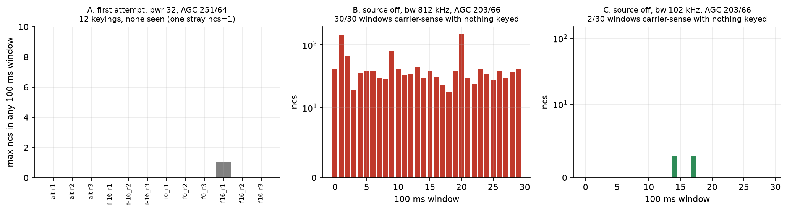
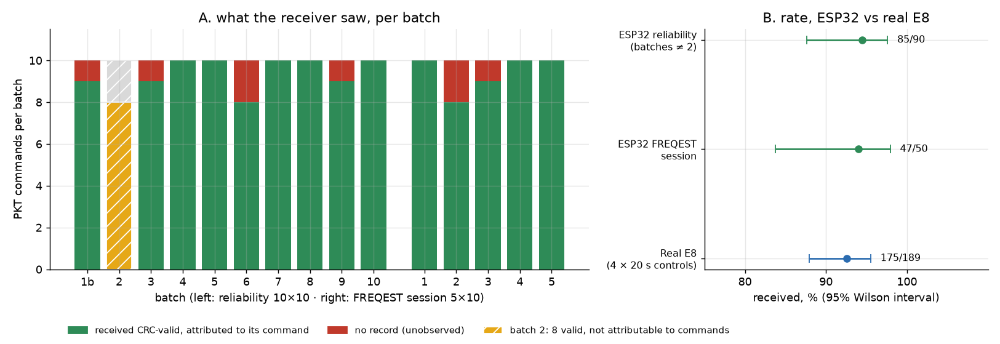
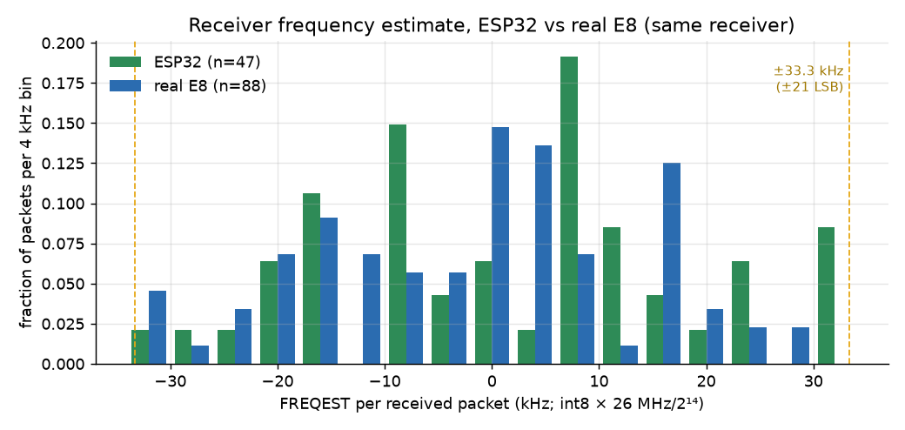
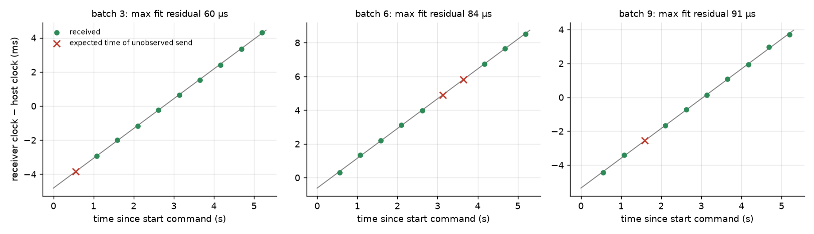
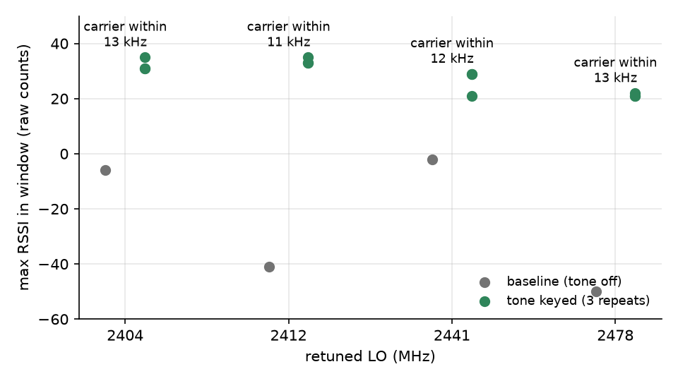
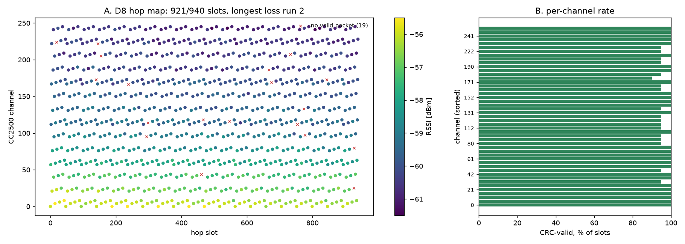
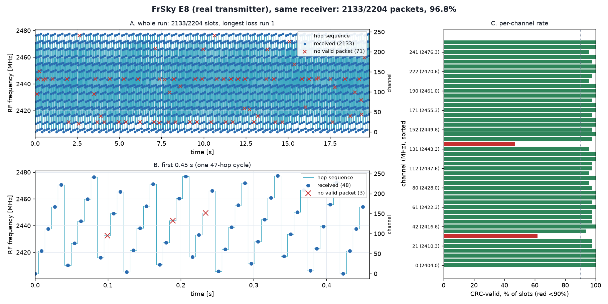
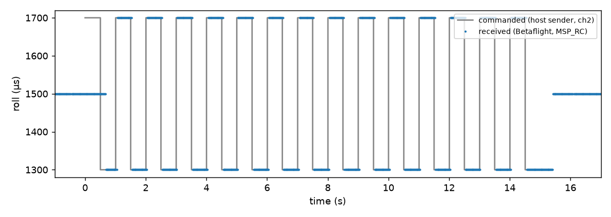
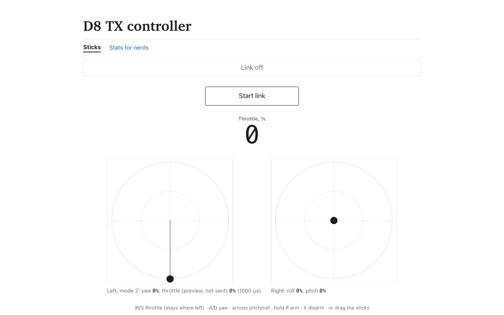

# Making a $5 ESP32 say one FrSky D8 packet

*Private TX research note · November 2026 · companion to the RX write-up, [A 2.4 GHz SDR on a $5 ESP32](README.md)*

The RX write-up ended with a board that could listen: record a FrSky D8 transmitter, decode it, follow its hops. That is a long way from talking. Nothing in it showed that the same chip could produce a packet a real D8 receiver chip would accept. This note covers the first time that happened, on a bench, once: an ESP32 DevKit V1 transmitted a hand-built D8 packet and an independent CC2500 reported it with a valid hardware CRC. The first try got 7 of 10; after fixing a receiver-side bug, 140 more attempts got about 94%, the same rate the real E8 transmitter gets on that receiver. Then it hopped all 47 D8 channels at about 98%, slightly better than the E8 on the same receiver. It is not yet bound to a real flight controller, not control, and not a calibrated transmitter.

The short version of what worked: the ESP32's Wi-Fi PHY has a test-tone generator whose frequency can be stepped by a ROM function. Switching that tone between two steps at 31 kbaud is a crude 2-FSK modulator. A CC2500 listening on the channel decoded it. Most of the effort went into finding out where the tone actually lands, because the first attempts saw nothing.

All numbers below are re-derived from the raw logs by [`bench/d8-tx/analysis/plot_tx.py`](../../../bench/d8-tx/analysis/plot_tx.py) (`--summary` prints them). Raw logs are in [`bench/d8-tx/results/`](../../../bench/d8-tx/results/).

## Why one packet, and how to know it worked

The plan was one packet before any hopping, on purpose. A single fixed-channel packet is the smallest thing that can fail for only a few reasons (wrong frequency, wrong timing, wrong bytes), and it gives a yes/no answer that does not depend on my own decoder: the receiver's CRC check.

That independence matters. The ESP32 can read back its own registers and report that it "keyed for 6700 µs", but that proves the CPU ran a loop, not that RF came out ([`d8tone.c`](../../../bench/d8-tx/firmware/main/d8tone.c) says so in its header: "none of this is RF evidence"). The only evidence accepted here is a **second radio, receiving**:

- A MATEK F411RX board with a CC2500, running a locally built Betaflight with a receive-only diagnostic (`rxdiag`, [firmware README](../../../bench/cc2500-rxdiag/firmware/README.md)). Its transmit path is guarded off. `rxdiag freq` reports, per 100 ms window, how many samples had carrier sense (`ncs`); `rxdiag pkt` reports each packet it demodulates with the chip's hardware CRC flag.
- A real FrSky E8 transmitter, used only as a **positive control**: if the receiver cannot see the real thing at that frequency and setup, an absence of ESP32 packets means nothing.
- The ESP32 firmware, `d8tone`, is RF-silent at boot and keys only on a command (`TONE`, `ALT`, `PKT`) for at most 200 ms, with a host-side envelope on power, duration and command count ([`bench/d8-tx/README.md`](../../../bench/d8-tx/README.md)).

## The transmitter

The transmit path is not a documented API. It reuses what Espressif's PHY already does for calibration: a numerically controlled oscillator injects a tone, and the ROM function `rom_start_tx_tone_step(1, f, 127, …)` sets its frequency as a signed step `f` from the Wi-Fi channel centre (here channel 1, 2412 MHz). `rom_pbus_force_test(5, 1, pwr)` then turns the transmit chain on ([`key()` and `tone_set()` in `d8tone.c`](../../../bench/d8-tx/firmware/main/d8tone.c)). The keying sequence is adapted from an earlier private experiment, not written from documentation.

What the packet needs from it:

| | Stock D8 (CC2500) | This ESP32 |
|---|---|---|
| Modulation | Gaussian-filtered 2-FSK | abrupt 2-FSK by switching tone step |
| Deviation | ±31.7 kHz (DEVIATN 0x42) | ±1 step ≈ ±39.06 kHz (40 MHz/1024) |
| Baud | 31,044 (MDMCFG4/3 = 0xAA/0x39) | 7731 CPU cycles/bit at 240 MHz ≈ 31,043 baud |
| Packet | 4×0xAA preamble, D3 91 sync, length+17 bytes, CRC16 | same bytes |
| Duration | | 208 bits × 7731 cycles = 6.70 ms |

The register arithmetic is in the comments at [`run_packet()`](../../../bench/d8-tx/firmware/main/d8tone.c); the cycle count is rounded to an integer, accumulating under 9 cycles of drift over the packet. The deviation difference (39 vs 31.7 kHz) is a limit of the tone path, and it was not tuned or compensated.

**Packet bytes.** [`packet.c`](../../../bench/d8-tx/firmware/main/packet.c) builds the 26 on-air bytes: `AA AA AA AA D3 91`, then the 18-byte frame (length `0x11` plus 17 payload bytes), then a CRC16 (poly 0x8005, init 0xFFFF) over those 18 bytes. The frame layout (transmitter ID `42 B2`, hop counter, eight 12-bit channels split across low bytes and shared nibbles) comes from the host builder [`d8_vectors.py`](../../../bench/d8-tx/host/d8_vectors.py), which does not import the RX decoder, and each has offline tests ([`test_packet.c`](../../../bench/d8-tx/firmware/test/test_packet.c), [`test_d8_pkt.py`](../../../bench/d8-tx/tests/test_d8_pkt.py)). The test vector is `d8_vectors.build(0)`, body `1142b2000001cacacaca8888cacacaca8888`, CRC `afa7`. Each bit becomes tone step +1 for a 1 and −1 for a 0, switched from a busy loop with interrupts off.

## What happened

### 1. The first attempt: nothing, and a firmware bug

Before any RF, the first firmware image rebooted every 3.5 s while idle. [`esp_idle_wdt_reboot_observation.txt`](../../../bench/d8-tx/results/tone/esp_idle_wdt_reboot_observation.txt) shows `I,boot,reason=7` (RTC watchdog) at 3.8, 7.3 and 10.8 s with nothing commanded. The watchdog was meant to guarantee that a hang reboots into the RF-silent state; instead it fired on a healthy idle loop, so no keying was attempted on that image. The current source feeds it from the input poll (at most every 10 ms) and at the start of each keyed window; the fixed image idled 16 s without a reboot ([`esp_idle_retry.txt`](../../../bench/d8-tx/results/tone/esp_idle_retry.txt)). The old input loop used blocking `fgetc(stdin)`; ESP-IDF's UART VFS waited indefinitely for a character, so the idle loop could not feed the RTC watchdog. Replacing it with a bounded 10 ms UART read fixed the idle-reset observation. That diagnosis comes from source inspection plus the before/after idle logs, not a hardware trace of the watchdog.

Then the first RF test: 12 keyings (tone at steps 0, +16, −16 and an alternating pair, 150/100 ms, power 32) with the CC2500 at 2412.000 MHz, 812 kHz bandwidth, AGC 251/64. The ESP32's own readback was fine for all 12. The CC2500 saw nothing: the maximum `ncs` in any window of any run was 1, a single stray count in one window, **250 ms after** the tone had ended (panel A below, [`NOTE.md`](../../../bench/d8-tx/results/tone/NOTE.md)). The positive control at that setting did work: the real E8 produced carrier-sense in 28 of 50 windows at 2421.032 MHz.

So: the ESP32 believed it was transmitting, the receiver could hear a real transmitter, and no ESP32 RF was detected. That is a **null result, not a negative**. Candidate explanations were all untested at this point: tone too weak at power 32, tone outside the receiver's bandwidth, or no RF at all.



*Figure 1 ([SVG](img/tx-evidence/null-and-trap.svg)). A: max `ncs` in any 100 ms window for each of the 12 first-attempt keyings. B, C: carrier-sense counts with nothing keyed at 2412.000 MHz and AGC 203/66. Source: `results/tone/retry_*_stm.txt`, `rerun2/control_source_off_2412000.txt`, `rerun3/control_bw102.txt`.*

### 2. The detector trap

Raising the receiver gain (AGC 203/66, a more sensitive setting) and the transmit power to 127 made the next run look like a success: `ncs` rose about 5–20× in the keyed windows. It was not interpretable. With nothing keyed, **all 30 of 30** windows already had carrier sense, `ncs` 18–149, and the frequency estimate was pinned at its limits ([`rerun2/NOTE.md`](../../../bench/d8-tx/results/tone/rerun2/NOTE.md)). At 203 kHz bandwidth the estimate was still saturated in 24/30 windows. Only at 102 kHz was the source-off control quiet (2/30 windows, `ncs` 3 each; panel C).

This is the lesson of the whole bench phase: a detector that fires on noise cannot confirm a signal. The previous run had to be thrown out, not argued about, and every later keyed measurement used the quiet 102 kHz setting, with a source-off control first.

### 3. Narrowing, and finding where the tone is

At 102 kHz bandwidth, keying the tone at the centre (step 0) gave a clean response: `ncs` ≈ 1970 in the peak window against ~0–3 with nothing keyed. So the keyed carrier was in-band at 2412.000 MHz. But the receiver's frequency estimate (FREQEST) was not usable: the same step-0 tone read −9.5, +11.1 and −12.7 kHz on three keyings, a spread bigger than any difference I wanted to measure ([`rerun3/NOTE.md`](../../../bench/d8-tx/results/tone/rerun3/NOTE.md)). A scan from −500 to +500 kHz around 2412 MHz in 50 kHz steps then failed to locate the ±16 tones ([`scan/NOTE.md`](../../../bench/d8-tx/results/tone/scan/NOTE.md)). I was looking in the wrong place.

The wide scan ([`scan-wide`](../../../bench/d8-tx/results/tone/scan-wide/NOTE.md), 51 keyings, power 127, 150 ms) widened to ±3.5 MHz at 812 kHz bandwidth, then zoomed at 100 kHz bandwidth:

- tone +16 responded around **2412.6–2412.7 MHz** (≈ +650 kHz) and tone −16 at **2411.4 MHz** (≈ −600 kHz), with `ncs` 1917–1961 on every confirming keying, roughly symmetric about the step-0 carrier;
- at bw 102, +16 was not seen at 2412.8 MHz and above, and −16 not at 2411.3 MHz (a weaker 440 at 2411.5 was not counted as a hit).

If the step is 40 MHz/2¹⁰ = 39.06 kHz, ±16 steps is ±625 kHz, inside those hits. A 100 kHz scan cannot resolve the step to better than that, and 2411.35 MHz was not measured, so this is a consistent estimate, not a measurement of 39.06 kHz. That would explain part of Section 1: with the receiver at 2412.000 MHz and 812 kHz bandwidth (±406 kHz), the ±16 tones (and the alternating ±16 pair) sat outside the passband, so those nine keyings were never going to be seen. It does not explain the three step-0 keyings, which were at the receiver centre but at power 32 and AGC 251/64 and still showed nothing. Later step-0 keyings at power 127 and AGC 203/66 were seen (`ncs` 830 at bw 812), so low power or low sensitivity is the likely reason for those three, but I did not run the one change that would separate them.

The fine steps ±1, ±2, ±4 (the ones the packet uses) all produced a response at the predicted offsets ([`fine/NOTE.md`](../../../bench/d8-tx/results/tone/fine/NOTE.md)): `ncs` 1953–1981, RSSI 14–21 at receiver centres 2412.039/2411.961, ±78 and ±156 kHz. A step +1 tone with the receiver parked on the carrier (2412.000) gave only RSSI 2 against 14–21 in the matched positions, consistent with it sitting off-centre at the filter edge. The estimate for negative steps was stable (−42.2, −82.8, −144.9 kHz measured vs −39, −78, −156 predicted), but FREQEST is only about ±10 kHz and was unstable for positive steps, so this confirms roughly 39 kHz steps, not an exact calibration.


*Figure 2 ([SVG](img/tx-evidence/tone-scan.svg)). Peak carrier-sense windows vs receiver centre for tones ±16 at AGC 203/66, power 127. Panel A: stage A, bw 812 kHz, with the step-0 reference (★). Panels B, C: stage B, bw 102 kHz; "response" means `ncs` ≥ 1500 (pre-key baseline windows at bw 102 ranged about 110–860 `ncs` in these runs, so ambient interference was present; every response is at least 2× the highest baseline). Stage A is wide enough that responses are broad. The centre of a response is not defined by this plot to better than the 100 kHz grid. Source: `results/tone/scan-wide/results.jsonl`.*

### 4. The packet

With the offset understood, the ESP32 firmware put the ±1-step 2-FSK packet on 2412.000 MHz and the CC2500 was set to the same centre with the stock D8 register set (`rxdiag pkt`; its deliberate differences, such as CRC autoflush off so that failures are visible, are listed in its [README](../../../bench/cc2500-rxdiag/firmware/README.md)). Order of operations, from [`packet/NOTE.md`](../../../bench/d8-tx/results/packet/NOTE.md):

1. **Source off (E8 off):** at 2412.000 MHz two runs gave 10 P records in total, all `crc_ok=0` fragments; a later recheck gave 0. At 2421.032 MHz: 2 records, both CRC-bad. None began with the E8's ID bytes. Noise produces short fragments, but never a CRC-valid packet.
2. **Real-E8 control at 2421.032 MHz, 20 s:** 77 P records, **32 with `crc_ok=1`**, all starting `11 42 B2 00`.
3. **ESP32 test:** 10 `PKT` commands at power 127, one batch. All 10 replied OK with `bits=208`, `on_us` 6700–6704 and no reboot. The CC2500, at 2412.000 MHz, reported 23 P records ([`batch1_2412000_stm.txt`](../../../bench/d8-tx/results/packet/batch1_2412000_stm.txt)):
   - **7** whose 18 bytes are exactly the vector body with `crc_ok=1` (RSSI raw 11–13, LQI 51);
   - 2 more whose 18 bytes equal the body but with `crc_ok=0`, `rssi=lqi=0`;
   - 14 other fragments, noise as in the source-off check.


*Figure 3 ([SVG](img/tx-evidence/packet-outcome.svg)). Receiver outcomes. "Body matches" = 18 bytes equal to `d8_vectors.build(0)[:18]`. Source: `results/packet/*.txt`, classified by `plot_tx.py`; CRC flag = CC2500 hardware CRC_OK, which strips the two CRC bytes, so a P record carries 18 bytes and a flag (the same for the E8, for which the 32 valid records are all 18 bytes).*

The ESP32 build used here has SHA-256 `3698ae6f6bbe0b11bfac103c9f008320d9d90dfe9d22d179d55da0bcd5c60461` ([flash/hash evidence](../../../bench/d8-tx/results/packet/esp_hashes.txt)); its generated `.bin` is not included in this clone, so it must be rebuilt from `bench/d8-tx/firmware/`. The STM diagnostic binary and checksum manifest are included under `bench/cc2500-rxdiag/firmware/out/4bdc8581/`.

The result: with a source of known state, a distinctive byte sequence and a CRC computed independently on the receiving chip, **7 of 10 packets were received intact**, while the real transmitter's control worked and the empty channel never produced a valid record. Of the other three, I do not know why. One has no full record, two have the right bytes with the CRC flag cleared. The E8 control shows the same signature (an `EPART` error and a 2-byte stray record beside valid ones), so a receiver-side FIFO-split artefact is the likely explanation. It is a hypothesis; I did not isolate it. Section 5 shows it was right: the diagnostic's 500 µs packet-end wait was shorter than the CRC gap.

### 5. Fixed-channel reliability: about 94%, the same as the real transmitter

Seven of ten is not a reliability figure, and Section 4 already suspected the receiver. A closer look found it. The diagnostic firmware decides that a packet has ended after 500 µs with no new bytes in the FIFO. The two CRC status bytes arrive about 515 µs after the payload (two bytes at 31 kbaud, 257.7 µs each), so the 500 µs window closed just before them. Some packets were therefore reported as a body fragment plus a separate two-byte stray, and the "CRC flag 0" records of Section 4 are that split. Raising the quiet time to 2000 µs fixed it, and the ESP32 was then measured on the same fixed channel, 2412.000 MHz, with no hopping, about one packet every 516 ms, power 127. Each group was preceded by a source-off capture, and E8 controls bracketed the sessions.

**Ten batches of ten.** Nine of the ten batches (1b, 3–10) were tied to their commands: **85 CRC-valid receptions, 5 unobserved** (one each in batches 1b, 3, 9 and two in batch 6), no CRC-invalid or malformed record. Batch 2 received 8 CRC-valid packets, but they cannot be assigned to commands. That batch had no timestamp taken just before the start command, so the receiver's clock was only known against the host's to within 0.54 s, more than the 0.5 s packet spacing: each reception fits two neighbouring commands. The two clocks also drift apart by about 0.18% (1.75 ms per second; Figure 7), so the offset cannot be extrapolated from elsewhere in the run. Later batches took an anchor, narrowing the uncertainty to 30–40 ms. Counting batch 2 as raw receptions, 93 of 100 commands produced a valid packet. No batch had a CRC-invalid copy: when the sync was found, the payload was right.

**FREQEST session.** The receiver also reports its frequency estimate (FREQEST) per packet. Five more batches of ten, with that field logged, gave **47 of 50**; the ESP32 and real E8 FREQEST distributions look alike (Figure 6). Over 47 ESP32 and 88 E8 packets the means were +1.8 and −1.8 kHz and the standard deviations 16.4 and 14.7 kHz. The values stop at ±21 LSB, ±33.3 kHz, which is the clamp: 5 of 135 packets sit on it. A spread that wide, with a clamp inside it, is too noisy to resolve carrier wander of the kind the tone work suspected (±10 kHz keying to keying), so FREQEST cannot say whether the ESP32 carrier lands where it should.

**The E8 on the same receiver.** The real transmitter, one visit every 422.7 ms, would show about 47 packets per 20 s. Four controls gave 46, 41, 44 and 44: **175 of about 189, 93%**. The ESP32 got 132 of 140 attributed commands, 94%. The two intervals overlap (Figure 5, panel B), so the misses look at least partly like receiver or bench effects, not like something only the ESP32 does.

| Measurement | Sent / expected | Received (CRC-valid) | Note |
|---|---|---|---|
| Reliability, batches 1b, 3–10 | 90 | 85 | 5 unobserved, 0 CRC-invalid |
| Reliability, batch 2 | 10 | 8 raw | not attributable to commands |
| FREQEST session, 5 batches | 50 | 47 | 3 unobserved |
| Real E8, 4 × 20 s | ≈189 | 175 | one visit per 422.7 ms |



*Figure 5 ([SVG](img/tx-evidence/reliability-outcome.svg)). Panel A: each bar is ten commands; red is a command with no receiver record, the hatched bar is batch 2 (see text). Panel B: Wilson 95% intervals; the E8 denominator is the expected visit count, not an observed one, so its interval is approximate. Source: `results/packet/{reliability,freqest}/batch*_report.txt`, `control_e8*`; `plot_reliability.py`.*



*Figure 6 ([SVG](img/tx-evidence/freqest-hist.svg)). Receiver FREQEST of CRC-valid packets, in 4 kHz bins, each series normalised to its own packet count. Dashed lines: the ±21 LSB clamp. Source: `results/packet/freqest/batch*_stm.txt`, `control_e8_{pre,post}.txt`.*

**Where the misses fall in time.** For the three batches with a tight anchor and a miss, the received packets sit on a straight line against send time with at most 91 µs of residual, so the expected arrival of each missing packet is known to about 0.1 ms. At those instants the receiver recorded no packet and no noise fragment ([`missing_four_offline.md`](../../../bench/d8-tx/results/packet/reliability/missing_four_offline.md)). The packet is 6.7 ms long, the nearest noise record was at least 41 ms away, and the receiver reported no errors. These look like clean "sync not detected" events. Two explanations remain open: the receiver was blind to a sync at that instant, or the ESP32 packet start was occasionally not decodable. The recorded noise rate allows a blind time of at most about 1%, which makes four or five misses in 80–90 attempts unlikely, but that argument assumes the unrecorded events are as common as the recorded ones.



*Figure 7 ([SVG](img/tx-evidence/reliability-timing.svg)). Matched receptions lie on a line of slope 0.175% (receiver clock fast against the host), and each unobserved send is placed by that line. Batch 6 lost two in a row. Source: `results/packet/reliability/batch{3,6,9}_*`.*

**What this shows and does not show.** On a fixed channel, on one bench with one receiver position, the ESP32 packet is received CRC-valid about 94% of the time, close to what the real E8 achieves on the same receiver, and a received packet is never corrupt. It does not give an ESP32 loss rate, because receiver loss and send-side loss are not separated: the E8 baseline is about as lossy. Nor does it say why the roughly 6% are missing. The receiver would need to log every sync detect, or the ESP32 keyings would need to be captured with an SDR beside it. FREQEST cannot settle carrier accuracy. Hopping and flight are untested, and the RSSI of received packets stepped down by about 5 dB between batches 3 and 4 when the setup was touched, which did not change the loss pattern.

### 6. Hopping: all 47 channels at ~98%

**Why the tone cannot hop by itself.** The tone generator's frequency steps only reach about ±20 MHz around the LO, and the D8 hop table spans 2404–2478 MHz. The 39.06 kHz step also does not divide the 299.93 kHz channel spacing, so even a reachable channel would be off-grid. So each hop retunes the LO instead (fast-hop mode 1, one retune per slot), and the tone steps only carry the data bits. The firmware measured the retune at at most 0.39 ms (363 µs in run A, 389 µs in run B) of an 8.994 ms slot, and the keying start was at most 81 µs late, so slot timing holds to about 80 µs.

**Retune gate.** Before hopping, a 150 ms tone was keyed after retuning to 2404, 2412, 2441 and 2478 MHz, and the receiver diagnostic watched each. All four passed, with the tone's FREQEST within 13 kHz of nominal (the 2441 MHz window had a steady in-band interferer; the tone still stood 23–31 counts above it). The receiver diagnostic was then given the hop table directly (`rxdiag hop`); there was no bind, so it followed the table a bound receiver would have learned.



*Figure 8 ([SVG](img/tx-evidence/hop-retune-gate.svg)). Grey: baseline RSSI with the tone off. Green: the three keyed 150 ms tones. The label is the largest FREQEST offset of the three. The 2441 MHz baseline had a steady in-band interferer, so its rise is smaller. Source: `results/hop/retune_gate/summary.md`; `plot_hop.py`.*

**Runs.** The real E8 was recorded first as a control, then the ESP32 sent 556 slots (run A) and 940 slots (run B), always hop-counter-ordered, sticks at 1500 µs.

| | E8 control (20 s) | ESP32 run A | ESP32 run B |
|---|---|---|---|
| Slots | 2204 | 556 | 940 |
| CRC-valid | 2133 (96.8%) | 543 (97.7%) | 921 (98.0%) |
| Longest loss run | 1 | 1 | 2 |
| Counter discontinuities | 0 | 0 | 0 |
| Channels decoding | 47 of 47 | 47 of 47 | 47 of 47 |
| Sticks decoded | 1500 µs | 1500 µs | 1500 µs |

Channel and ID mismatches were zero throughout (ID 42B2). The one RESYNC in each ESP32 run came after the ESP32 stopped sending, so it is not a loss.



*Figure 9. The ESP32 (run B), 921 of 940 slots. Cyan line: the expected hop sequence. Blue dots: slots received CRC-valid, at their expected frequency. Red X: slots with no valid packet. The 19 misses are scattered, and no channel lost more than two. Source: `results/hop/esp_hop/runB_*`.*



*Figure 10. The real FrSky E8, same receiver and drawing as Figure 9 (line, dots and red X mean the same), 2133 of 2204 slots over 20 s. Channels 25 (2411.5 MHz) and 133 (2443.9 MHz) are weak, at 29/47 and 22/47. Source: `results/hop/e8_control/`.*

**The weak channels.** The E8's 96.8% hides two poor channels, ch25 and ch133. The RX write-up had already noticed ch25 and suspected the transmitter. The ESP32 decodes the same two channels fine (19/20 each in run B, 12/12 each in run A) on the same receiver.


*Figure 11 ([SVG](img/tx-evidence/hop-per-channel.svg)). One point per channel. The E8 has 47 visits per channel and the ESP32 20, so one ESP32 miss is 5%. Only the E8 drops on ch25 and ch133. Source: `results/hop/e8_control/summary.md`, `results/hop/esp_hop/runB_stats.txt`; `plot_hop.py`.*

That is consistent with an E8 transmitter quirk on those channels, but it is not proof: different time, different packet content and a small count.

**Two loose ends.** The roughly 5% of fixed-channel misses from Section 5 were parked as a receiver or bench effect; the hopping runs (2.0–2.3% missing) did not reopen them. The E8 packet layout also puts the hop counter in byte 4 of the frame (the length byte is byte 0), which matters for the coming bind with stock Betaflight.

**What this shows and does not show.** On this bench the ESP32 hops through the full 47-channel table, with a continuous counter, and a CC2500 following the table receives about 98% of slots, at least as well as the E8. It does not show binding, a stock Betaflight receiver accepting it, range, or flight, and it does not show why the E8 is weak on two channels.

**Next:** bind to stock Betaflight. The bind exchange and the hop counter in byte 4 are the first things to get right.

### 7. Driving stock Betaflight, and the first takeoff

Everything so far used a diagnostic receiver. This section points the ESP32 at the drone itself, running **stock Betaflight 4.2.11** (restored and checked: `diff all` is byte-identical to `bench/cc2500-rxdiag/results/diff_all_final.txt`, `results/bf_link/link_check/`).

**No bind.** The drone's config already stores the E8's transmitter ID (66,178 = 0x42B2) and its hop table, so the ESP32 simply clones them. The receiver cannot tell it from the E8.

**Frequency.** Betaflight stores `frsky_spi_offset = -32` (about -51 kHz), which was tuned to the E8. The E8 runs roughly 26 ppm (about 63 kHz) low, while the ESP32 lands within about 13 kHz of nominal. So a new `FOFS` command shifts every hop by -63 kHz, and I set it by comparing FREQEST against the E8 (mean difference 13 Hz; `results/bf_link/offset_tune/`). The shift does not change the packet rate: with and without it the drone-side receiver got 96.6–97.5% of slots (four runs, `results/bf_link/ab_test/`). An earlier 85–92% session in the tune runs was a bad stretch that did not reproduce, not an effect of the offset.

**Sticks.** In the Betaflight Receiver tab the channels read **T1200 A1400 E1600 R1800** exactly, the values the host sent (owner's screenshot; the sender log is `link_check/receiver_tab_fixed_sticks.csv`). Each of the four bars sat at a different, known place, so channel order and scaling are right.

**Live sticks.** A host sender issues `HOP 0` once (hop continuously) and then streams `S` stick updates at the 8.994 ms slot rate. The first sender slipped, because relative sleeps accumulate; it now keeps absolute deadlines (111 Hz). If the host goes silent for 300 ms the firmware unkeys. In a run with roll toggling every half second, roll edges reached Betaflight with a median 44.3 ms, p95 61.8 ms, maximum 181.5 ms. That includes the USB serial leg, waiting for the next slot, Betaflight's RC smoothing and the MSP readback used to measure it, so it is an upper bound on the radio link's share.



*Figure 12 ([SVG](img/tx-evidence/live-roll-latency.svg)). Grey: roll commanded by the sender. Blue: roll read from Betaflight. Every edge arrives, delayed. Source: `results/bf_link/live_sticks/live_sender.csv`, `live_msp.csv`; `plot_latency.py`. The per-edge latencies are also in `latency.png` next to them.*

**Arming.** ARM is AUX3 (channel 7, 1700–2100 µs). The firmware forces channel 7 low unless an explicit `ARMOK` is sent before a `HOP`, and clears it after every `HOP`, so a stuck host cannot arm by accident. The first attempts failed for two reasons: my host sender also forced channel 7 low, and Betaflight holds `RX_FAILSAFE` for about 2.5 s after the link appears. After fixing the first and waiting out the second, MSP reported ARMED (`mode_flags` 3) from 3.8 s to 7.4 s.

**First takeoff.** Then arm, wait, full throttle for 0.5 s, then 1 s (`results/bf_link/motor_test/*.csv`). In the last 1 s run (`motor_test8`) channel 7 went high at 3.5 s, throttle to 2000 µs from 5.0 to 6.0 s, disarm at 7.5 s. On that run the quad took off.

<video controls preload="metadata" width="720" poster="media/esp32-first-takeoff-poster.jpg"><source src="media/esp32-first-takeoff.mp4" type="video/mp4"></video>

*Video 1 ([mp4, 2.5 MB](media/esp32-first-takeoff.mp4)). The takeoff, 34 s, recompressed to 720p from the owner's phone recording.*

**What this does not show.** It is a scripted open-loop 1 s throttle pulse from a bench script, not piloted flight. No range test was done. **Failsafe** was tested with props off: armed at idle, then the Mac stopped sending without a stop command, as if it had crashed. The ESP32 stopped transmitting 0.30 s later (`why=timeout`), Betaflight entered RX failsafe about 0.46 s after that, and it **disarmed 1.25 s after the host died** (`bench/d8-tx/results/bf_link/failsafe/`). A dead ESP32 or a lost radio link ends the same way, because Betaflight only sees the packets stop.

### 8. A usable controller: the d8tx stack

Section 7 was a bench script. To fly the same way repeatedly I built a small stack in [`d8tx/`](../../../d8tx/) (usage in [`d8tx/README.md`](../../../d8tx/README.md)). Four layers, each thin:

- **Firmware protocol v1** ([`PROTOCOL.md`](../../../d8tx/PROTOCOL.md)). ASCII lines at 921600 baud. `LINK <pwr> [timeout_ms]` starts continuous hopping; `S c1..c8` sets the eight channels in µs (no reply while linked); `STOP` ends it; `FOFS` sets a frequency offset; `ARMOK` permits channel 7 high for the next link only; `INFO` and `STAT` report. Every request gets one `OK` or `ERR <code>`; asynchronous `EV` lines report boot, a once-per-second link heartbeat and the reason the link ended (`stop`, `timeout`, `err`).
- **Python library** `d8tx`. `D8Link` owns the serial port and a sender thread that writes one `S` per D8 slot (8.994 ms, `SLOT_S` in `protocol.py`), so the firmware never starves. `BetaflightMSP` reads RC channels, analog and arm status over the flight controller's USB for readback.
- **FastAPI backend** (`d8tx.server`). REST for status and link start/stop, a WebSocket for sticks in and telemetry out at 50 Hz. If the browser is silent for 250 ms the backend stops sending sticks; the firmware's own timeout and Betaflight's failsafe are behind that. The flight-controller MSP connection reconnects by itself after a replug.
- **React/Vite/Tailwind page.** Mode 2: W/S raise and lower a non-centering throttle that starts at 0%, A/D yaw, arrow keys pitch and roll, hold R to arm, X to disarm, or drag the on-screen sticks. `?mock=1` runs it without a backend.



*Figure 13. The Sticks page with `?mock=1` (headless Chrome screenshot of `d8tx/app`). It is a mock backend, so it shows the layout, not a flight.*

**Safety, in layers.** Any one of these is enough to keep channel 7 low or stop the link; they are independent so a bug in one is not the whole story.

1. **UI:** arming needs R held for 1 s; X disarms; nothing arms by default.
2. **Library:** `allow_arm` defaults to false and then forces channel 7 low whatever the caller asks.
3. **Firmware:** channel 7 is forced low unless `ARMOK` was sent, and `ARMOK` is cleared when each `LINK` ends.
4. **Host silence:** the backend stops after 250 ms without browser input, and the firmware ends a link after `timeout_ms` (default 300) without `S`.
5. **Betaflight:** with no packets it enters RX failsafe and disarms 1.25 s after the host died (Section 7).

**Lessons from using it on the bench.**

- Betaflight arms only if throttle is at minimum at the moment the arm switch goes high. If the arm is refused and the switch stays high, it stays refused (`ARM_SWITCH`) until the switch goes low. My first UI sent arm and hover throttle in the same packet and locked itself out. Fixes: the UI holds minimum throttle for 0.5 s after arming, and the library has an arm-edge guard that forces throttle to 1000 µs for 0.5 s after channel 7 rises (`ARM_THROTTLE_HOLD_S` in `link.py`), whatever the caller sends.
- `RX_FAILSAFE` persists about 2.5 s after the link appears, so arm attempts in that window fail (also in Section 7).
- With props off, runaway-takeoff protection disarms within seconds of throttle. That is expected; the arm switch must go low to clear it.
- Several browser tabs fight over the sticks, because each sends its own state. Use one.
- A game-style "Fly" mode was tried and dropped in favour of real sticks.
- Keys are on/off, so each stick axis is eased toward its target: holding an arrow ramps the stick and releasing returns it to centre, roughly like a thumb on a gimbal. Raw key values were too twitchy to fly.

**A scripted hop.** [`d8tx/python/examples/up_forward_land.py`](../../../d8tx/python/examples/up_forward_land.py) arms, climbs, tilts forward, descends and disarms from a fixed timeline, in Angle mode. It is open loop: there is no altitude sensor and the ESP32 gets no telemetry, so every number is a guess. The first attempts at hover throttle 1450 and 1550 µs did not lift off and slid forward along the ground. So the hover throttle is unknown but above 1550, and with throttle that high the forward tilt has to be small. The next step is Betaflight blackbox logging, to measure rather than guess.

**Could telemetry come back? (analysis only, untested.)** Betaflight's D8 receiver replies. In [`cc2500_frsky_d.c`](../../../bench/cc2500-rxdiag/firmware/work/betaflight/src/main/rx/cc2500_frsky_d.c), after a packet with `packet[3] % 4 == 2` (line 237) it builds a telemetry frame (`buildTelemetryFrame`, line 239) and in `STATE_TELEMETRY` waits until 1380 µs after that packet (line 290) before switching to transmit, on the same channel. The frame is 18 bytes (length byte 0x11, lines 135–147): bind ID, A1 (battery voltage), A2 (RSSI ADC), RSSI in dBm, a hub byte count and an echo of the packet's ID, then FrSky hub bytes. In [`telemetry/frsky_hub.c`](../../../bench/cc2500-rxdiag/firmware/work/betaflight/src/main/telemetry/frsky_hub.c) the hub cycle is 125 ms (`FRSKY_HUB_CYCLETIME_US`, line 86) and acceleration is sent once per cycle, so 8 Hz; gyro IDs are defined but nothing sends them in this version (4.2). Too slow and too coarse for control, but enough for battery and RSSI.

For the ESP32 to receive that, firmware would have to go from transmit to receive within about 1.4 ms of a packet, on the same channel, and merge the TX and RX code that today live in separate builds. That looks feasible, but I did not try it. For flight data the practical route is blackbox on the flight controller, read afterwards.

## What this does not show

- **Sections 1–6: not binding, control or flight** (Sections 7 and 8 cover those). Hopping works against the diagnostic receiver, which was given the hop table directly. No bind exchange and no stock Betaflight receiver were involved: the proof is that a CC2500 with the D8 settings and an independent CRC accepted the packets, not that a model aircraft would.
- **Not a calibrated transmitter.** The ±1-step deviation (≈39 kHz) is 23% wider than the stock 31.7 kHz, there is no Gaussian shaping, and the power setting has no verified output level. The packet was radiated within bench range; there is no distance or attenuation information. Frequency accuracy rests on the 100 kHz-granularity scan and a coarse FREQEST. That the packet works says the receiver is tolerant, not that the ESP32 is accurate.
- **7/10 was one batch, and partly the receiver.** Section 5 repeats the measurement with the fixed receiver (about 94%); the cause of the remaining misses is open.
- **The ESP32's readback is not RF evidence.** `late_bits=207` of 208, `max_late_ns=1266` is timing of the CPU loop. It is small compared with a bit time (~32 µs) but I did not verify it on air.
- **Not understood:** why FREQEST at the step-0 tone swings by ±10 kHz, why 3 of 10 packets did not arrive intact, and what produced the single ncs=1 window in the first attempt.
- **Betaflight was restored** before Section 7 (stock 4.2.11, config identical to the saved one). No comparison of other receivers was done.
- **A tooling bug was fixed after the bench run:** the original `compare_p_to_vector` expected 20 bytes (including the CRC) and falsely rejected valid 18-byte CC2500 FIFO records. The current [`bench_runner.py`](../../../bench/d8-tx/host/bench_runner.py) compares the 18-byte body plus the chip's `crc_ok` flag; the independent raw-log audit used that criterion.

## Reproduce the figures

```sh
python3 -m venv /tmp/mpl && /tmp/mpl/bin/pip install matplotlib   # >=3.5; the only dependency
/tmp/mpl/bin/python bench/d8-tx/analysis/plot_tx.py               # writes docs/devkitv1/writeup/img/tx-evidence/*.{svg,png}
/tmp/mpl/bin/python docs/devkitv1/writeup/plot_reliability.py     # Figures 5-7 and the Section 5 numbers
python3 bench/d8-tx/analysis/plot_tx.py --summary                 # numbers only, standard library
```

Offline firmware and host tests: `python3 -m unittest discover -s bench/d8-tx/tests`, `bench/d8-tx/firmware/test/run.sh`. No RF hardware is needed for any of this. The script reads only files in this repo.
