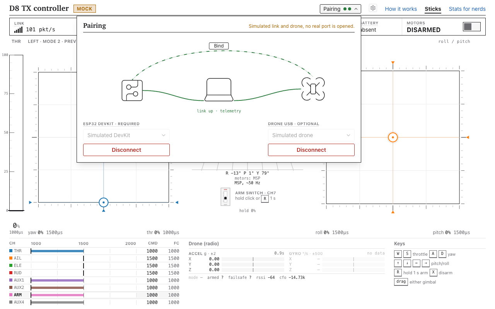

# Getting started

From a bare ESP32 DevKit to a flying D8 drone. Read the [regulatory notice](../REGULATORY.md) first: this transmits on 2.4 GHz and you are responsible for using it legally.

## Parts

- **ESP32 DevKit V1** (classic ESP32, CP2102 USB bridge, 2 MB flash or more) and a USB data cable. This is the radio. No other RF hardware.
- **A FrSky D8 drone** whose receiver is a CC2500 on a Betaflight flight controller, with a USB port. Tested only on an EMAX Tinyhawk III (from the RTF kit with the EMAX E8 radio; MATEKF411RX target) running Betaflight 4.2.11. Other drones are untested.
- **Chrome or Edge** (Web Serial) or the desktop app. Firefox and Safari have no Web Serial.
- Props off until the link is verified. Battery out while binding.

## 1. Open the app

Hosted: the live app link is in the [README](../README.md) once published. Local: `pnpm install`, then `pnpm --filter web dev` (needs `clang` with `wasm-ld`, see [apps/web](../apps/web/README.md)). Desktop: `pnpm --filter desktop dev` ([apps/desktop](../apps/desktop/README.md)).

No hardware yet? Add `?mock=1` to the URL: a simulated DevKit and drone, so you can try the whole UI.

## 2. Connect the DevKit

Plug in the DevKit. In **Pairing**, under *ESP32 DevKit*, pick its port (the browser asks permission once) and press **Connect**.

## 3. Install the firmware

If no d8tx firmware answers, the app offers **Install firmware** (or **Update firmware** if the DevKit runs an older version). Confirm with **Flash**. It writes bootloader, partition table and app only, never the identity, and takes about 20 s. If the DevKit does not enter the bootloader by itself, hold BOOT while the app says "Entering the bootloader".

## 4. Bind

1. Plug the **drone** into USB (props off, no battery needed). Under *Drone USB*, pick its port and **Connect**.
2. Press **Bind**. The app puts Betaflight into bind mode over MSP, sends bind packets for about 6 s, then runs a short link with arming off and waits for a telemetry reply from the drone. About 10 s in total.

The drone now stores this DevKit's own transmitter ID. Details: [how-to/bind.md](how-to/bind.md).

## 5. First link

The link starts by itself after connecting. Check in Pairing that the DevKit shows connected and telemetry arrives from the drone. Move the sticks (keys or the on-screen sticks) and confirm the Betaflight Receiver tab follows, with props still off.

## 6. Fly

Unplug USB, fit props, connect the battery. Arming is a deliberate gesture: **hold R** to arm, **W/S** throttle, **A/D** and arrow keys for yaw, roll and pitch, **X** to disarm at any time (works regardless of focus). If the app, tab or USB cable goes away, the link stops and Betaflight's own failsafe takes over.

Keep it in sight, near, and in a legal place. Range has not been tested.
