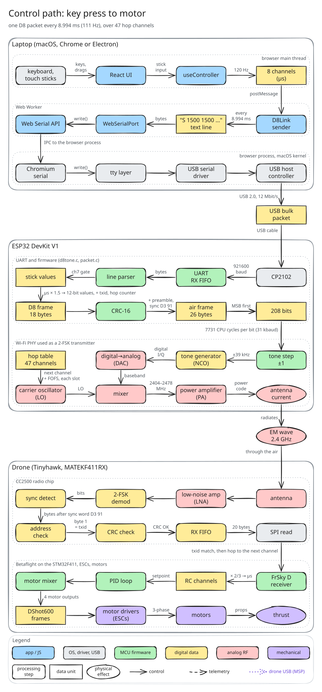
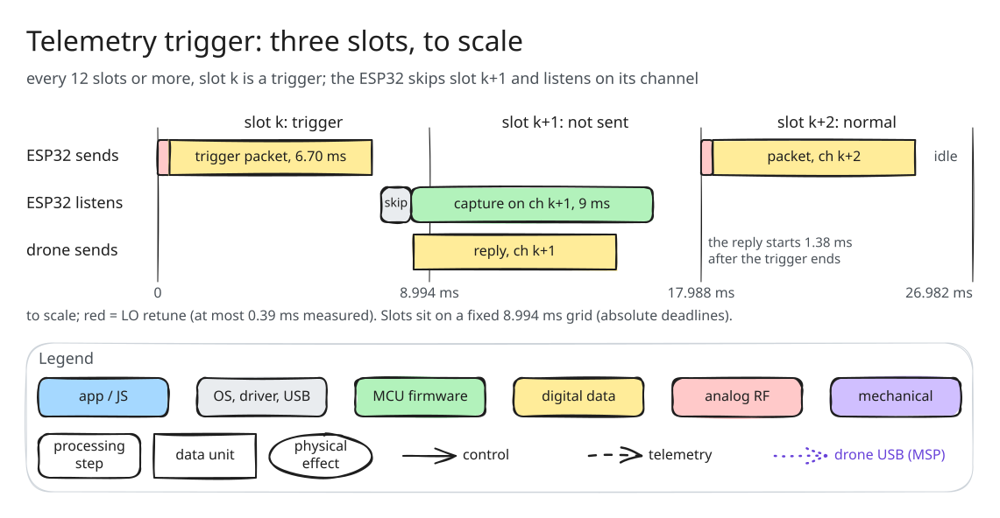
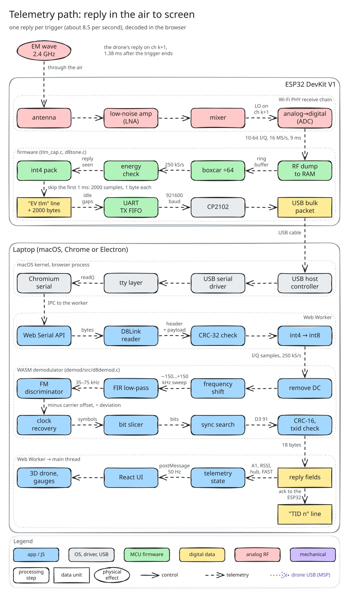
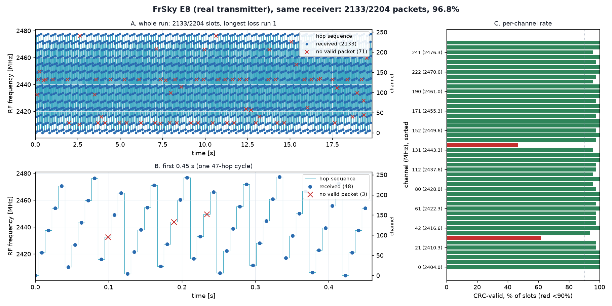
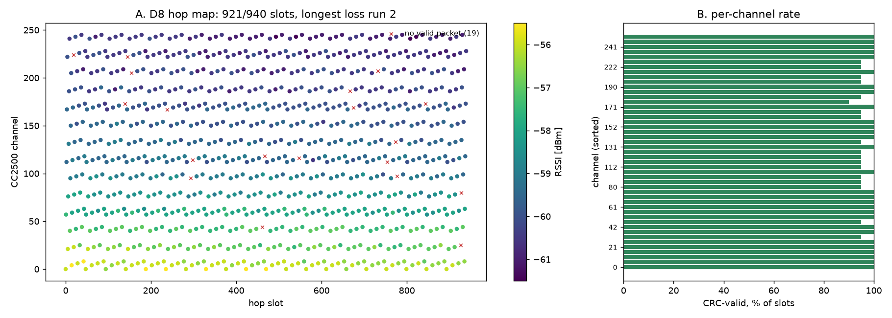

# How it works, step by step

Every layer from your key press to the motors, and the drone's reply back to the screen. For the story and the trick behind it, start with the [README](../README.md#why-i-built-this).

## 1. Your sticks become a radio packet, every 9 ms

The page reads your keyboard or touch sticks. A Web Worker turns them into a line of text, `S 1500 1500 …`, and sends it to the ESP32 over USB. The ESP32 builds a D8 packet from it and sends it by wiggling its Wi-Fi radio's frequency, on the next of 47 channels each time, the way a real FrSky radio hops. The drone receives it and flies.

## 2. Every 12th packet asks the drone to talk back

That packet is marked as a telemetry request. The drone answers right away, on the next channel, so the ESP32 skips one packet and listens there instead.

## 3. The reply is decoded in your browser

The ESP32 records the raw radio signal and streams it to the page. A decoder compiled to WebAssembly turns it back into the drone's message: battery, signal strength and more, shown live.

## Proof: the ESP32 hops like the real radio

The same receiver logged which channel each packet arrived on, for the E8 and for the ESP32. The patterns match, and about 98% of the ESP32's packets arrived.

| Real E8 | ESP32 |
|---|---|
|  |  |

How the ESP32 was made to do this, with every measurement, is in the [writeup](devkitv1/writeup/tx.md). The code's design is in [ARCHITECTURE.md](../ARCHITECTURE.md).

