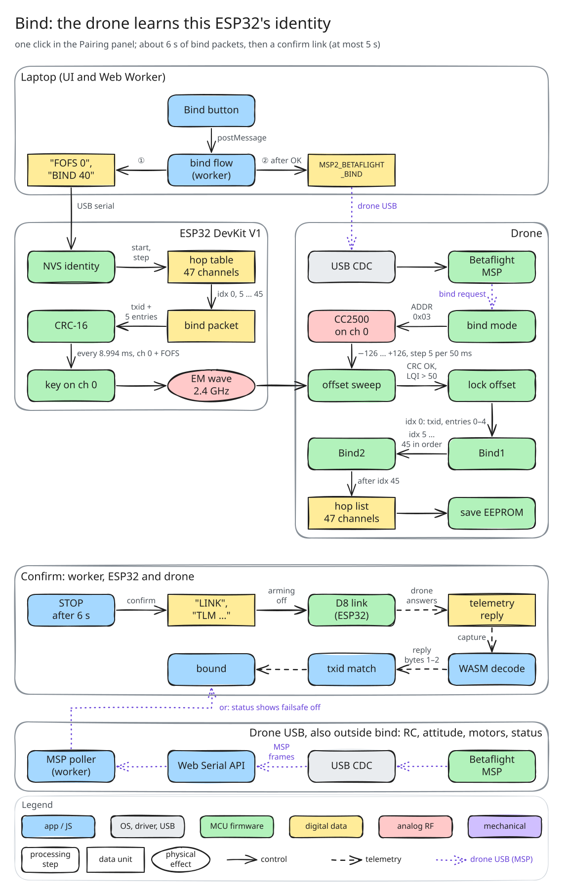

# Bind a drone to your DevKit



Each DevKit generates its own random transmitter ID (`txid`) and hop table on first boot and keeps them in NVS. Binding copies them into the drone's receiver; the drone needs no reboot.

## In the app

1. Connect the DevKit, then the drone's USB port (props off).
2. Press **Bind** in Pairing. The app pauses the link, sends MSP2_BETAFLIGHT_BIND to Betaflight, sends bind packets for about 6 s at the FOFS from Settings, runs a short no-arm link and waits for a telemetry reply carrying this `txid`. The link restarts afterwards.

## Check it

In the Betaflight CLI, `get frsky_spi_tx_id` must equal the DevKit's `txid` (the firmware prints it in lowercase hex, e.g. `6ff3` = 111,243). The bench check does this for you:

```sh
node packages/core/scripts/bind-check.ts --esp PORT --fc PORT     # add --new-id to generate a fresh identity first
```

Leaving the Betaflight CLI with `exit` reboots the FC; the bind is already saved. Measured results of the one bench bind: [bench/d8-tx/results/bind/SUMMARY.md](../../bench/d8-tx/results/bind/SUMMARY.md).

## New identity

`ID new` on the DevKit serial console generates another one (you then have to bind again).

## By hand

Put the FC into bind with `bind_rx` in the Betaflight CLI, then `BIND 30` on the DevKit (30 s of bind packets). Protocol: [protocol/PROTOCOL.md](../../protocol/PROTOCOL.md).
