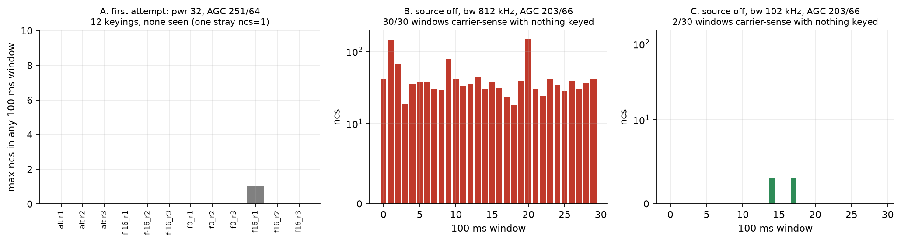

# 03: First try at a keyed tone

The playback engine in [01](../01-playback-engine-check/README.md) was a dead end for now, so I tried a simpler transmitter. The ESP32's Wi-Fi radio has a test-tone generator used for calibration, and a ROM function, `rom_start_tx_tone_step`, sets its frequency as a signed step from the channel centre (here Wi-Fi channel 1, 2412 MHz). If I could switch that tone between two steps fast enough, I would have 2-FSK, which is what D8 uses. The first thing to check was that the tone could be keyed on command and that the drone's radio could hear it.

I wrote the first version of the `d8tone` firmware (this repo's `firmware/`) for this. It is silent at boot and only transmits on a command (`TONE` for one step, `ALT` to switch between two), for at most 200 ms. A watchdog was meant to reboot it into that silent state if it ever hung. On the receiving side the drone's CC2500 ran the diagnostic firmware in `rxdiag freq` mode, which works like this: the CC2500 sets a carrier-sense bit while the signal is above its threshold, and the flight controller reads the chip's status over and over for 100 ms. A reading only counts if two back-to-back reads agree. For each window it reports `n`, the number of readings that counted, and `ncs`, how many of them had carrier sense set. So `ncs` near 0 means nothing there, and `ncs` near `n` means a signal for the whole window. With the 812 kHz filter used here, `n` was about 200 per window, because noise made most reads disagree.

I first recorded the receiver with nothing on, at 2412.000 MHz and at 2421.032 MHz: 0 windows with carrier sense at either. Then I keyed 12 times at power code 32: the tone at step 0, +16 and −16, three times each for 150 ms, and three 100 ms runs switching between +16 and −16 every 5 ms. The receiver sat at 2412.000 MHz with an 812 kHz bandwidth and AGC setting 251/64. The ESP32 replied OK to all 12 and reported the expected keyed times (150.06 ms and 100.06 ms), with no reboot.

The receiver saw nothing. Across all 12 runs the largest `ncs` in any window was 1, in a single window about 250 ms after a +16 tone had ended, so not a detection. As a positive control I recorded my real E8 transmitter on its own channel at 2421.032 MHz with the same settings: 28 of 50 windows had carrier sense. So the receiver could hear a real transmitter, and the ESP32 believed it had keyed, but no ESP32 signal was detected.

At the time I couldn't tell why. There was no known signal at 2412 MHz to show the receiver could see one there, so this was a null, not evidence that the ESP32 doesn't radiate. The tone might have been too weak at power 32, it might have landed outside the receiver's ±406 kHz passband, or there might have been no RF at all. [04](../04-tone-scan/README.md) answered part of this: one step turned out to be about 39 kHz, which puts ±16 steps at about ±625 kHz, outside the passband, so nine of these keyings could not have been seen. That doesn't explain the three step-0 keyings, which were at the receiver's centre. In 04 a step-0 tone at power 127 and the more sensitive AGC 203/66 was seen, so low power or low sensitivity is the likely reason here, but I never ran the one change that would separate the two.

*Figure: panel A is this experiment, the largest `ncs` in any 100 ms window for each of the 12 keyings (the one bar is the stray window after the tone ended). Panels B and C are from [04](../04-tone-scan/README.md). Source: `data/retry_*_stm.txt`, drawn by `../05-first-packet/scripts/plot_tx.py`.*

---

## Numbers

| What | Value | Where |
|---|---|---|
| Keyed commands with a carrier detected | 0 of 12 | `data/NOTE.md`, `data/retry_*_stm.txt` |
| Source off, windows with carrier (2412.000, 2421.032 MHz) | 0, 0 | `data/control_source_off_retry_*.txt` |
| E8 control, windows with carrier | 28 of 50 | `data/control_real_e8.txt` |

The keyed and E8 counts are printed by `../05-first-packet/scripts/plot_tx.py --summary` (`retry_*` and `e8_freq_control_*` lines).

## Files

- `data/`: all logs. `NOTE.md` is the original note. `retry_*` are the 12 keyed runs.
- `scripts/`: `keyed_retry.py` (the 12 keyed runs), `keyed.py` (an earlier version that never keyed), `stmfreq.py` (receiver helper, also used by 04).

## How to re-run

Run `python3 experiments/05-first-packet/scripts/plot_tx.py --summary` from the repo root for the numbers above; the same script draws the `null-and-trap` figure in [04](../04-tone-scan/README.md), which uses this data. The scripts here are hardware scripts: they need the ESP32 and the drone, and run from the repo root. `keyed.py` imported its helpers from `/tmp` at the time; `keyed_retry.py` uses `scripts/`.

## Ran

2026-11-06, 00:37 to 00:53 EST (`utc=` 05:37Z to 05:53Z in the receiver logs). Commit c81a554 (2026-11-06 13:23), together with 04 and 05.

**Not preserved:** `esp_flash_retry.log`, cited in `NOTE.md`, was never committed and is not on disk.

Previous: [02-register-map](../02-register-map/README.md) · Next: [04-tone-scan](../04-tone-scan/README.md) · [All experiments](../README.md)
