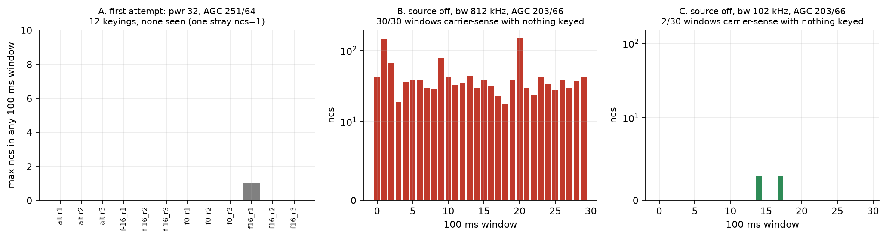
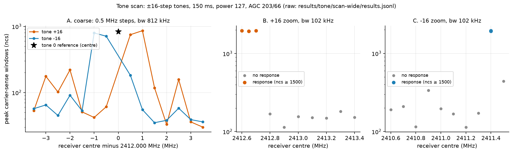

# 04: Finding the tone

After the null in [03](../03-tone-first-attempt/README.md) I didn't know whether the ESP32's tone was too weak, in the wrong place, or not there at all. To build FSK from it I needed to know both that it radiates and where each frequency step lands. I kept the ESP32 image and receiver firmware from 03 and made two changes: transmit power code 127 instead of 32, and a more sensitive receiver setting, AGC 203/66 instead of 251/64.

The first run looked like a success and wasn't. With the receiver at 2412.000 MHz and 812 kHz bandwidth, a step-0 tone raised the carrier-sense count (`ncs`) to 623 to 744 in the peak window, against 20 to 60 before keying. (As in [03](../03-tone-first-attempt/README.md), `ncs` is how many of the window's valid status readings had the CC2500's carrier-sense bit set, out of `n` valid readings. A reading counts only if two back-to-back reads agree, so `n` depends on the filter: about 200 per 100 ms window at 812 kHz when nothing is there, about 860 at 203 kHz and about 1,600 at 102 kHz, and higher while a steady tone is present.) But the source-off control, with nothing keyed, already had carrier sense in all 30 of 30 windows, `ncs` 18 to 149, and the receiver's frequency estimate (FREQEST) was stuck at the ends of its range. A detector that fires on noise can't confirm a signal, so I set the run aside and stopped before keying the ±16 tones. From then on every keyed measurement had a source-off control first.

So I narrowed the receiver's filter. At 203 kHz bandwidth the estimate was still saturated in 24 of 30 source-off windows. At 102 kHz the control was quiet: 2 of 30 windows with carrier sense, `ncs` 3 each. At that setting a step-0 tone at 2412.000 MHz gave `ncs` 1966 to 1971 in the peak window against about 0 to 3 before keying. So the tone was there, at the carrier. FREQEST, though, wasn't usable for measuring it: three keyings of the same step-0 tone read −9.5, +11.1 and −12.7 kHz, and three more later read +11.1, −9.0 and +7.9 kHz. That spread is larger than the differences I wanted to measure, so from here on I located tones by where carrier sense appeared, not by the estimate. In this same run the ±16 tones also raised `ncs` to about 1920 to 1950 with the receiver at 2412.000 MHz. I didn't understand that then and still don't; the later scans found the tones themselves far from there.



*Figure: A, the largest `ncs` in any 100 ms window for each of the 12 keyings in [03](../03-tone-first-attempt/README.md). B and C, `ncs` per window with nothing keyed at 2412.000 MHz and AGC 203/66, at 812 kHz and 102 kHz bandwidth. Source: `../03-tone-first-attempt/data/retry_*_stm.txt`, `data/rerun2/control_source_off_2412000.txt`, `data/rerun3/control_bw102.txt`.*

Next I scanned the receiver from 2411.5 to 2412.5 MHz in 50 kHz steps at 102 kHz bandwidth, keying +16 and −16 at each point (40 keyings). Neither tone showed the step-0 signature (`ncs` near 1950 with RSSI 13 to 21). The best point, 2412.050 MHz, had `ncs` about 1900 for both signs but RSSI only −1 to +6, and many points already had `ncs` of 100 to 1000 before keying, which is ambient interference rather than the ESP32. The tones were not within ±500 kHz of where I was looking.

The wide scan widened the search to ±3.5 MHz in 0.5 MHz steps at 812 kHz bandwidth, then zoomed in at 102 kHz in 100 kHz steps, 51 keyings in all. +16 responded at 2412.6, 2412.65 (twice) and 2412.7 MHz, with `ncs` 1930 to 1961 and RSSI 13 to 20, and not at 2412.8 MHz or above. −16 responded at 2411.4 MHz twice (`ncs` 1917 and 1950, RSSI 22), and not at 2411.3 MHz; 2411.5 MHz gave a weaker 440, which I didn't count. So +16 lands about 650 kHz above the carrier and −16 about 600 kHz below, roughly symmetric. If one step is 40 MHz / 1024 = 39.06 kHz, which the ROM code suggests ([02](../02-register-map/README.md)), 16 steps is 625 kHz, inside both ranges. A 100 kHz grid can't resolve the step better than that, so this is a consistent estimate, not a measurement of 39.06 kHz.



*Figure: peak `ncs` against receiver centre for the ±16 tones, power 127, AGC 203/66. A: 0.5 MHz steps at 812 kHz bandwidth, with the step-0 reference (star). B and C: 100 kHz steps at 102 kHz bandwidth; a response is `ncs` ≥ 1500. Source: `data/scan-wide/results.jsonl`.*

That explains most of 03. The receiver there was at 2412.000 MHz with 812 kHz bandwidth, ±406 kHz, so the ±16 tones at about ±625 kHz, and the ±16 switching runs, were outside its passband. It doesn't explain the three step-0 keyings in 03, which were at the centre. Here a step-0 tone at power 127 and AGC 203/66 was seen even at 812 kHz bandwidth (`ncs` 830), so low power or low sensitivity is the likely reason, but I didn't run the one change that would separate them.

Last, I checked the small steps a packet would use: ±1, ±2 and ±4, each keyed once with the receiver centred where the step should land (±39, ±78, ±156 kHz). All six responded, `ncs` 1953 to 1981 and RSSI 14 to 21. As a check, a +1 tone with the receiver left at 2412.000 MHz gave RSSI 2, consistent with the tone sitting about 39 kHz off-centre at the edge of the filter. For the negative steps the estimate held still and read −42.2, −82.8 and −144.9 kHz against −39, −78 and −156 predicted; for the positive steps it jumped around. FREQEST is only good to about ±10 kHz here, so this confirms steps of roughly 39 kHz, not an exact calibration.

So the ESP32 radiates the tone at 2412.000 MHz and each step moves it by about 39 kHz. That is close to the ±31.7 kHz deviation a real D8 transmitter uses, so switching between steps +1 and −1 could stand in for the two FSK tones. Whether a real receiver would accept a packet sent that way was the next experiment ([05](../05-first-packet/README.md)).

---

## Numbers

| What | Value | Where |
|---|---|---|
| Source-off windows with carrier sense, 812 / 203 / 102 kHz | 30 / 24 (saturated) / 2 of 30 | `data/rerun2/control_source_off_2412000.txt`, `data/rerun3/control_bw*.txt` |
| Step-0 tone, peak `ncs` at 102 kHz | 1966 to 1971 | `data/rerun3/NOTE.md` |
| +16 / −16 responses (102 kHz) | 2412.6 to 2412.7 / 2411.4 MHz | `data/scan-wide/results.jsonl` |
| Steps ±1, ±2, ±4 measured at | 2412.039 / 2411.961, 2412.078 / 2411.922, 2412.156 / 2411.844 MHz | `data/fine/results.jsonl` |
| FREQEST for steps −1, −2, −4 | −42.2, −82.8, −144.9 kHz | `data/fine/NOTE.md` |

## Files

- `data/rerun2/`, `rerun3/`: receiver controls; `scan/`, `scan-wide/`: band scans; `fine/`: step measurements. Each has its own `NOTE.md`.
- `scripts/`: the hardware drivers for each sub-run (they import `stmfreq.py` from [03](../03-tone-first-attempt/scripts/)).
- `figures/`: `tone-scan` and `null-and-trap` (SVG and PNG).

## How to re-run

From the repo root (needs matplotlib):

```
python3 experiments/05-first-packet/scripts/plot_tx.py            # writes figures into 04 and 05, prints the numbers
python3 experiments/05-first-packet/scripts/plot_tx.py --summary  # numbers only
FIGURES_OUT=/tmp/figs python3 experiments/05-first-packet/scripts/plot_tx.py   # write somewhere else
```

One script makes the figures for 03, 04 and 05 because they share a style and a summary; it lives in 05, the last one it reads. The drivers in `scripts/` need the ESP32 and the drone.

## Ran

2026-11-06, 12:20 to 12:46 EST (`utc=` 17:20Z to 17:46Z, and the epochs in `esp_runner_log*.jsonl`). Commits c81a554 (13:23) and 29daba3 (13:24, the write-up chapter).

Previous: [03-tone-first-attempt](../03-tone-first-attempt/README.md) · Next: [05-first-packet](../05-first-packet/README.md) · [All experiments](../README.md)
