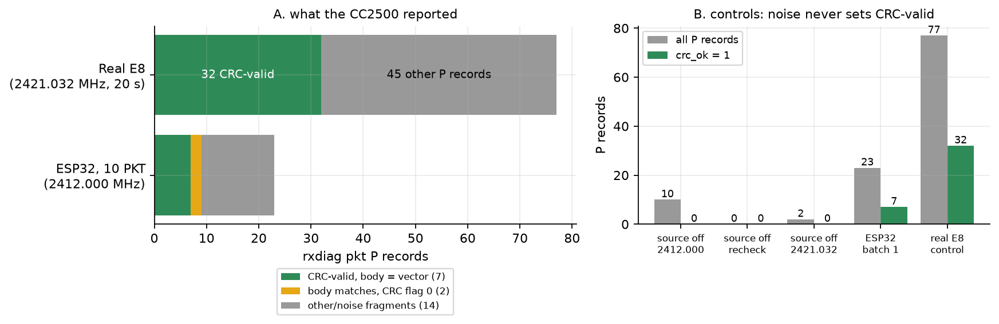

# 05: The first packet

By this point I knew where the ESP32's tones landed ([04](../04-tone-scan/README.md)): one tone step is about 39 kHz, close to the ±31.7 kHz deviation a real D8 transmitter uses. The next question was whether a sequence of those tones, arranged as a D8 packet, would be accepted by a real FrSky receiver.

On the air a D8 packet is 26 bytes: four `0xAA` preamble bytes, the sync word `D3 91`, 18 bytes of data (a length byte `0x11`, the transmitter ID, a counter and the eight channels), and a 2-byte CRC-16 over those 18 bytes. The receiver looks for the sync word, reads the data, computes the CRC itself and compares. A single wrong bit makes the CRC fail, so a CRC-valid packet is very unlikely to happen by chance.

The ESP32 sent this as 2-FSK: tone step +1 for a 1 bit, −1 for a 0, switched every 7731 CPU cycles (about 31,043 baud, against the CC2500's 31,044). The whole packet is 208 bits, 6.70 ms. I sent one fixed test packet at 2412.000 MHz, power 127. On the other side, the drone's CC2500 ran my diagnostic firmware with the stock D8 register settings, set to the same frequency, printing every record it received with its CRC flag.

Before looking at the ESP32 I recorded two controls. With no transmitter on, the receiver produced a few short fragments (10 over two runs at 2412 MHz, 0 on a later recheck), none CRC-valid. With my E8 on its own channel (2421.032 MHz) for 20 s, it produced 77 records, 32 of them CRC-valid, all starting with `11 42 B2`, the E8's length byte and ID. So the receiver works, and noise doesn't produce valid packets.

Then I sent 10 packets from the ESP32. All 10 commands completed (208 bits, 6.70 ms each). The receiver logged 23 records: 7 matching the test packet byte for byte with a valid CRC, 2 with the right 18 bytes but the CRC flag cleared, and 14 short fragments like the noise in the control.

The 2 records with correct bytes and a cleared CRC flag pointed at my receiver firmware rather than the ESP32: the E8 control showed the same signature, a valid record next to a 2-byte stray. I couldn't confirm it in this session. In [06](../06-fixed-channel-reliability/README.md) it turned out to be the receiver: the firmware ended a packet 500 µs after the last byte, and the CRC bytes arrive about 515 µs after the payload.



*Figure: receiver records per run, classified by `scripts/plot_tx.py`. CRC flag = the CC2500's hardware checksum check.*

---

## Numbers

| What | Value | Where |
|---|---|---|
| ESP32 packets sent / received with valid CRC | 10 / 7 | `data/batch1_2412000_*.txt`, `data/analysis_batch1.txt` |
| ESP32 records with correct bytes but CRC flag 0 | 2 | `data/batch1_2412000_stm.txt` |
| E8 control, CRC-valid packets in 20 s | 32 of 77 records | `data/control_e8_2421032.txt` |
| Source off, CRC-valid records | 0 | `data/source_off_*.txt` |

## Files

- `data/`: all logs; `NOTE.md` is the original step-by-step note with the firmware hashes.
- `scripts/pk.py`: the hardware driver (also imported by 06). `scripts/plot_tx.py`: figures and numbers for 03, 04 and 05.
- `figures/packet-outcome` (SVG and PNG).

## How to re-run

Run from the repo root:

```
python3 experiments/05-first-packet/scripts/plot_tx.py --summary   # every number above
python3 experiments/05-first-packet/scripts/plot_tx.py             # also redraws the figures (needs matplotlib)
python3 -m unittest discover -s tools/d8-tx-host/tests              # offline tests that re-parse these logs
```

`pk.py` is the hardware driver (ESP32 and drone).

## Ran

2026-11-06, 12:59 to 13:01 EST (`utc=` and epochs 17:59Z to 18:01Z). Commit c81a554 (2026-11-06 13:23).

**Not preserved:** `esp_flash.log`, cited in `NOTE.md`, was never committed and is not on disk.

Previous: [04-tone-scan](../04-tone-scan/README.md) · Next: [06-fixed-channel-reliability](../06-fixed-channel-reliability/README.md) · [All experiments](../README.md)
