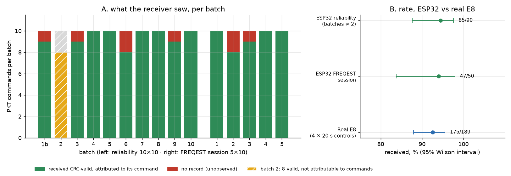

# 06: How reliable is one channel?

In [05](../05-first-packet/README.md), 7 of 10 packets got through. That isn't enough to fly: the drone gets a new packet every 9 ms and needs nearly all of them. So I wanted to measure what fraction of the ESP32's packets actually get through, and compare that with the real radio.

First I fixed the problem left over from 05. My receiver firmware ended a packet after 500 µs with no new bytes in the CC2500's FIFO. At 31 kbaud each byte takes about 258 µs, so the two CRC bytes arrive about 515 µs after the payload, just after that window closed. The firmware was splitting some packets into a payload record and a separate 2-byte record, which is what the "right bytes, CRC flag 0" records in 05 were. Raising the window to 2000 µs removed them.

Then I sent ten batches of ten packets on one fixed channel (2412 MHz, power 127, one packet every 516 ms) and matched each received packet to the command that sent it. To know whether the losses come from the ESP32 or from the receiver and bench, I recorded the real E8 on the same receiver in four 20 s controls. The E8 hops over 47 channels with an 8.994 ms slot, so it visits one channel every 422.7 ms, which gives about 47 expected packets per control.

Across both sessions the ESP32 got 132 of 140 attributable packets through (94%). The E8 got 175 of about 189 expected (93%). The 95% intervals of the two overlap, so on this bench I can't distinguish the ESP32's loss rate from the real transmitter's. In 140 packets there was not a single CRC-invalid record: a packet was either received correctly or not recorded at all.

For the batches with a tight time anchor, the received packets sit on a straight line against send time with at most 91 µs of residual. That predicts when each missing packet should have arrived to about 0.1 ms. At those instants the receiver logged no record and no noise fragment; the nearest noise record was at least 41 ms away. So these are clean missed sync detections. Whether the receiver was blind at that moment or the start of the ESP32 packet was occasionally not decodable, this setup can't separate, because the E8 baseline loses packets at the same rate.

I also logged the CC2500's per-packet frequency estimate (FREQEST) for 50 more packets (47 received). The ESP32 averaged +1.8 kHz with a 16.4 kHz standard deviation, the E8 −1.8 kHz and 14.7 kHz, and the estimate clamps at ±33.3 kHz. That spread is wider than the ±10 kHz carrier wander I was trying to see, so it can't answer how accurate the ESP32's carrier is.

So on one channel the ESP32 performs like the real radio on this receiver. The next question was whether it could keep that up while retuning to a new channel every 9 ms ([07](../07-hopping/README.md)).



*Figure: each bar is ten packets; red is a packet the receiver never recorded. Right: received fraction with 95% intervals. Source: `data/reliability/`, `data/freqest/`, `scripts/plot_reliability.py`.*

---

## Numbers

| What | Value | Where |
|---|---|---|
| ESP32, session 1 (attributable packets) | 85 of 90 valid | `data/reliability/VERDICT.md`, `batch*_report.txt` |
| ESP32, FREQEST session | 47 of 50 valid | `data/freqest/batch*_report.txt` |
| E8 controls | 175 of about 189 expected | `data/*/control_e8*.txt` |
| FREQEST, ESP32 | mean 1.8 kHz, sd 16.4 kHz | `data/freqest/batch*_stm.txt` |

All four are printed by `scripts/plot_reliability.py --summary`.

## Files

- `data/reliability/`, `data/freqest/`: the two sessions, with batch logs, reports and the original notes.
- `scripts/reliability/`, `scripts/freqest/`: the batch drivers (hardware); `freqest/plot_batches.py` draws per-batch plots; `plot_reliability.py` draws the summary figures.
- `figures/`: `reliability-outcome`, `reliability-timing`, `freqest-hist`; `plots_reliability/`, `plots_session2/` (per-batch plots).

## How to re-run

From the repo root (needs matplotlib):

```
python3 experiments/06-fixed-channel-reliability/scripts/plot_reliability.py [--summary]
python3 experiments/06-fixed-channel-reliability/scripts/freqest/plot_batches.py --batches reliability:3 reliability:6 reliability:9 --out /tmp/plots
```

Set `FIGURES_OUT=/tmp/figs` to write the summary figures somewhere else. The drivers' mocked tests are in `tools/d8-tx-host/tests`.

## Ran

2026-11-06, 14:29 to 15:32 EST: session 1 from 14:29 to 15:05, FREQEST session from 15:28 to 15:32 (Unix epochs in the logs). Commit 40f6cbe (2026-11-06 15:49).

Previous: [05-first-packet](../05-first-packet/README.md) · Next: [07-hopping](../07-hopping/README.md) · [All experiments](../README.md)
