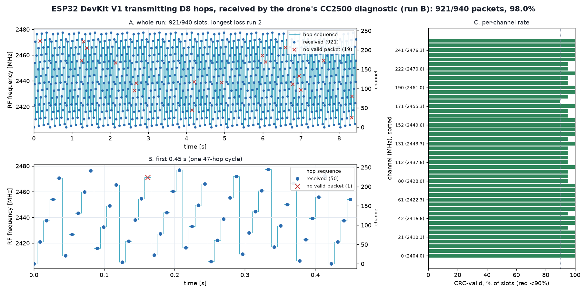
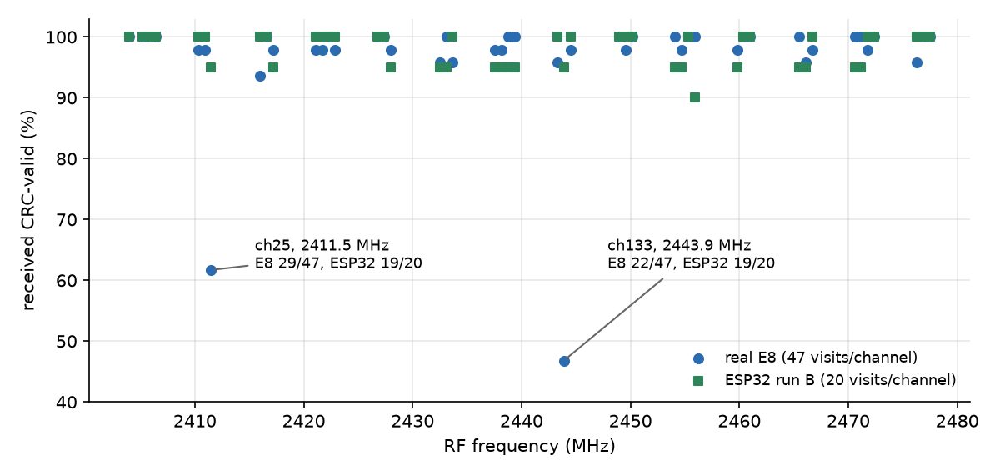

# 07: Hopping all 47 channels

A real D8 transmitter doesn't stay on one channel. It sends each packet on the next channel of a 47-entry hop table, one slot every 8.994 ms, and the receiver follows the same table. In [06](../06-fixed-channel-reliability/README.md) the ESP32 matched the E8 on one fixed channel. Here I wanted to know if it could do the same while moving to a new channel every slot.

The tone generator can't do the hopping by itself. Its steps only reach about ±20 MHz around the oscillator (LO) frequency, while the hop table spans 2404 to 2478 MHz. And a 39.06 kHz step doesn't divide the 299.93 kHz channel spacing, so even a channel in range would land off the grid. So in every slot the firmware retunes the LO to the next channel, and the tone steps only carry the data bits. The retune has to finish well inside the slot: the packet itself takes 6.70 ms of the 8.994 ms.

Before hopping I checked that a retune lands where it should. The ESP32 retuned to 2404, 2412, 2441 and 2478 MHz and keyed a 150 ms tone at each, with the CC2500 watching each frequency. All four showed up, with the receiver's frequency estimate within 13 kHz of nominal. During the hopping runs the firmware measured each retune at no more than 0.39 ms (363 µs in run A, 389 µs in run B), and the packet started at most 81 µs late, so the slot timing held to about 80 µs.

For the runs, the ESP32 hopped through the E8's own hop table with its transmitter ID (42B2), and the CC2500 ran a diagnostic mode that follows the same table (`rxdiag hop`). There was no bind: I gave the receiver the table directly, the one a bound receiver would have learned. I recorded the real E8 first as a control, then two ESP32 runs, with the sticks fixed at 1500 µs.

The E8 got 2133 of 2204 slots through in 20 s (96.8%). The ESP32 got 543 of 556 in run A (97.7%) and 921 of 940 in run B (98.0%). In all three runs every one of the 47 channels decoded, the hop counter had no gaps, and the decoded sticks read 1500 µs. The ESP32's misses were scattered: the longest run of consecutive misses was 2 slots, and no channel lost more than two.

The E8's 96.8% hides two weak channels: channel 25 (2411.5 MHz) at 29 of 47 and channel 133 (2443.9 MHz) at 22 of 47. The ESP32 decodes both fine on the same receiver (19 of 20 each in run B). That fits a quirk of the E8 on those channels, but with different times, different packet content and small counts, it isn't proof.

So the ESP32 can run the full 47-channel hop sequence at least as well as the E8, as seen by a CC2500 that follows the table. It doesn't show that stock Betaflight accepts it, which is the next experiment ([08](../08-first-flight-cloned-e8/README.md)).



*Figure: hop map of ESP32 run B, 921 of 940 slots. Line: expected hop sequence. Dots: slots received CRC-valid. Crosses: slots with no valid packet. Source: `data/esp_hop/runB_*`.*



*Figure: received percentage per channel, E8 (47 visits per channel) vs ESP32 run B (20 visits per channel). Source: `data/e8_control/summary.md`, `data/esp_hop/runB_stats.txt`.*

---

## Numbers

| | Slots | CRC-valid |
|---|---|---|
| E8 control (20 s) | 2204 | 2133 (96.8%) |
| ESP32 run A | 556 | 543 (97.7%) |
| ESP32 run B | 940 | 921 (98.0%) |

Source: `data/esp_hop/summary.md`.

## Files

- `data/retune_gate/`, `data/esp_hop/`, `data/e8_control/`: the three parts; `data/NOTE.md` is the original note; `data/esp_image/` holds the firmware binary used.
- `scripts/esp_hop/driver.py`, `scripts/retune_gate/run_gate.py`: hardware drivers. `scripts/plot_hop.py`: summary figures.
- `figures/`: `hop-retune-gate`, `hop-per-channel`, and the hop maps `runA_hop_map.png`, `runB_hop_map.png`, `e8_hop_map.png`.

## How to re-run

From the repo root (needs matplotlib):

```
python3 experiments/07-hopping/scripts/plot_hop.py
python3 tools/d8-tx-host/hop_plot.py experiments/07-hopping/data/esp_hop/runB.txt /tmp/runB.png
```

`plot_hop.py` reproduces its figures exactly. `hop_plot.py` runs, but its PNG is not byte-identical to the committed hop maps (they were drawn by an earlier environment); the content is the same plot.

## Ran

2026-11-06, about 15:40 to 16:00 EST. The retune gate has no timestamp; the E8 control ran at 15:58 and runs A and B at 15:59 to 16:00 (epochs 20:58Z to 21:00Z). Commits cf06991 (16:01), ae9932b (16:04), 4dbd85d (16:06).

Previous: [06-fixed-channel-reliability](../06-fixed-channel-reliability/README.md) · Next: [08-first-flight-cloned-e8](../08-first-flight-cloned-e8/README.md) · [All experiments](../README.md)
