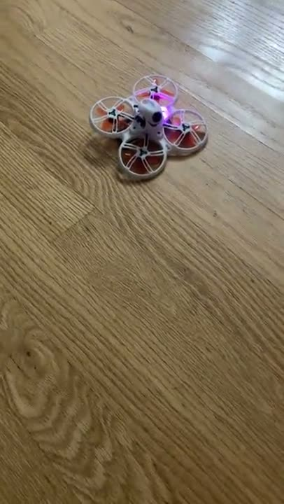
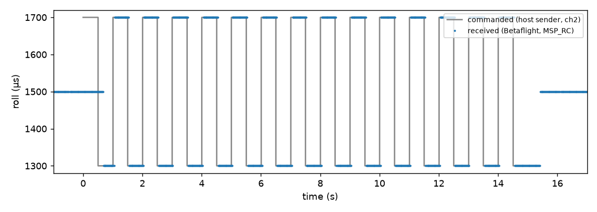

# 08: First flight, posing as the E8

In [07](../07-hopping/README.md) the ESP32 hopped all 47 channels as well as the E8 did, but the receiver was my diagnostic firmware, told the hop table directly. The question here was whether the drone's stock Betaflight would take the ESP32 as its radio, and fly on it.

A D8 receiver only listens to the transmitter it is bound to: it stores that transmitter's ID and hop table. The drone was bound to my E8, with ID 0x42B2 (66,178 in its config) and the hop table I had already used in 07. The quickest way in was to not bind at all and pose as the E8: send its ID and follow its hop table. The receiver can't tell the two apart from the packets.

The one thing the clone didn't copy was the E8's frequency error. Betaflight stores a fine frequency offset tuned to the E8, `frsky_spi_offset = -32`, about −51 kHz. The E8 runs roughly 26 ppm low, about 63 kHz at these frequencies, while the ESP32 lands within about 13 kHz of nominal ([07](../07-hopping/README.md)). So I added a `FOFS` command that shifts every hop by a fixed amount, and set it to −63 kHz so the ESP32 lands where the E8 does. To check it I put the drone back on the diagnostic firmware, tuned it to the E8's offset frequencies, and compared the ESP32's frequency estimate (FREQEST) against the E8 control from 07. The means were −800 and −780 Hz in two ESP32 runs against −793 Hz for the E8, a difference of at most 13 Hz, so I kept −63 kHz. The packet rate in those two runs was lower than I expected, though: 510 of 556 slots (91.7%) and 472 of 556 (84.9%, including a run of 47 lost slots starting at slot 509), against 96.8% for the E8.

To see whether the offset had anything to do with that, I ran an A/B test on the same receiver: twice with no offset and the receiver at nominal, twice with −63 kHz and the receiver shifted to match, 556 slots each. All four got 96.6 to 97.5%, 97.1% on average without the offset and 97.0% with it, and the earlier 85 to 92% didn't come back. So the offset doesn't change the packet rate, and I never found what caused the bad stretch. In the same session I tried the mode the drone would actually need, where the ESP32 hops continuously and the computer streams stick values (`S` commands) over USB. Over 8 s it got 869 of 891 slots (97.5%). When the host stopped sending, the ESP32 stopped transmitting about 0.31 s after the last `S`, as designed for a host that crashes.

Then I put stock Betaflight 4.2.11 back on the drone and restored its saved config. Betaflight's `diff all` CLI command, which prints every setting that differs from the defaults, gave output identical to the backup from before the diagnostic work, so the drone was exactly as it had been before any of my changes. I sent fixed sticks at 1200, 1400, 1600 and 1800 µs on the first four channels for 20 s, and Betaflight's Receiver tab showed T1200 A1400 E1600 R1800 exactly. Since each channel sat at a different known value, that shows the channel order and scaling are right, not just that packets arrive.

For live sticks the host sends at the slot rate, 111 Hz. My first sender used relative sleeps, which accumulate and let it slip behind; it now keeps absolute deadlines. I toggled roll between 1300 and 1700 µs every half second for 15 s and read roll back from Betaflight over MSP. All 29 edges arrived, with a median delay of 44.3 ms, a 95th percentile of 61.8 ms, and a maximum of 181.5 ms. That delay includes the USB serial link to the ESP32, the wait for the next slot, Betaflight's RC smoothing and the MSP readback itself, so it is an upper bound on what the radio link adds.

Arming is on channel 7 (AUX3, 1700 to 2100 µs). The firmware forces channel 7 low unless the host sends `ARMOK` before a `HOP`, and clears that after every `HOP`, so a stuck host can't arm the drone by accident. The first two motor tests didn't arm, for two reasons: my host sender was also forcing channel 7 low, and Betaflight holds RX failsafe for about 2.5 s after a link appears, so an arm command sent earlier is ignored. With both fixed, each test held the sticks at rest, raised channel 7 at 3.5 s, opened the throttle at 5.0 s, and lowered channel 7 again at 7.0 or 7.5 s. Tests 3 and 4 used throttle 1150 µs for 1 s, tests 5 and 6 full throttle (2000 µs) for 0.5 s, and tests 7 and 8 full throttle for 1 s. In test 8 the quad took off.

The last test was failsafe, with props off: arm at idle, then stop the host sender without the final stop command, as if the computer had crashed. The host stopped at 5.51 s. The ESP32 stopped transmitting about 0.3 s later, after 646 slots, reporting `why=timeout`. Betaflight went into RX failsafe at 6.27 s and disarmed at 6.75 s, 1.25 s after the host died. A dead ESP32 or a lost radio link would end the same way, because all Betaflight sees is that the packets stop.

So the ESP32 can drive a stock Betaflight drone, through arming, throttle and failsafe. What it doesn't show: the takeoff was a scripted 1 s throttle pulse, not piloted flight; there was no range test; and the link only works because the ESP32 copies the E8's identity and frequency error. A bind of its own came later ([15](../15-ota-bind/README.md)). Everything here also went one way, from the ESP32 to the drone, and Betaflight sends telemetry back, which is the next experiment ([09](../09-telemetry/README.md)).

*Video: motor test 8, the first takeoff, 34 s, recompressed to 720p from my phone recording ([mp4](../../docs/lab-log/media/esp32-first-takeoff.mp4)). Sender log: `data/motor_test/motor_test8_fullthrottle_1s_sender.csv`.*

*Figure: grey, roll commanded by the host sender; blue, roll read back from Betaflight over MSP. Source: `data/live_sticks/live_sender.csv`, `live_msp.csv`, drawn by `scripts/plot_latency.py`.*

---

## Numbers

| What | Value | Where |
|---|---|---|
| Carrier offset used | FOFS −63000 Hz | `data/offset_tune/summary.md` |
| FREQEST mean, ESP32 runs vs E8 | −800, −780 vs −793 Hz | `data/offset_tune/summary.md` |
| A/B, slots received without / with offset | 97.5, 96.8 / 97.5, 96.6% (556 slots each) | `data/ab_test/summary.md` |
| Continuous mode, 8 s | 869 of 891 (97.5%) | `data/ab_test/cont2_analysis.txt` |
| Roll edge delay, median / p95 / max | 44.3 / 61.8 / 181.5 ms (29 edges) | `data/live_sticks/` |
| Failsafe disarm after host death | 1.25 s | `data/failsafe/summary.md` |

## Files

- `data/offset_tune/`, `ab_test/`, `link_check/`, `live_sticks/`, `motor_test/`, `failsafe/`: one folder per step, in that order. `live_sticks/invalid_run3` and `invalid_run4` are kept but were invalid runs. `live_sticks/demo_circle_sender.csv` and `demo_pilot_sender.csv` are two later stick demos, sender logs only.
- `data/RESTORE.md`: how to restore the drone's config. `data/esp_image/`: the firmware used for the offset tune; `ab_test/esp_image/` and `motor_test/esp_image/` hold the later builds.
- `data/rxdiag-stock-baseline/diff_all_final.txt`: the drone's stock Betaflight config before any of this, from the receiver-diagnostic work in esp32-d8rx. The lab log cites it as the baseline.
- `scripts/`: the drivers for the offset tune and A/B test (hardware), `offset_tune/mean.py` (small helper), `plot_latency.py`.
- `figures/`: `live-roll-latency` (sent vs received roll) and `latency.png` (the original plot of the same run).

## How to re-run

Run `python3 experiments/08-first-flight-cloned-e8/scripts/plot_latency.py` from the repo root (needs matplotlib; set `FIGURES_OUT=/tmp/figs` to write elsewhere). The drivers are hardware scripts (ESP32 and drone).

## Ran

2026-11-06, 16:14 to 17:02 EST (epochs 21:14Z offset tune, 21:20Z A/B, 21:30Z link check, 21:36Z live sticks, 21:46Z motor tests, 22:02Z failsafe). Commits e9cddb5 (16:59), 32e761a (17:03).

Previous: [07-hopping](../07-hopping/README.md) · Next: [09-telemetry](../09-telemetry/README.md) · [All experiments](../README.md)
