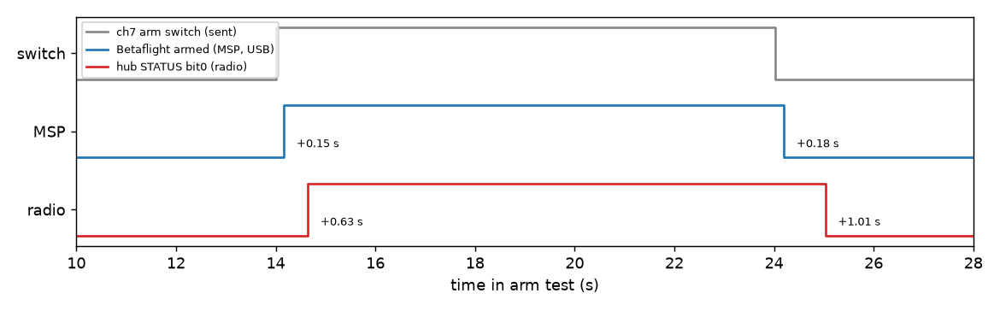

# 10: Patching Betaflight for real numbers

In [09](../09-telemetry/README.md) the drone's telemetry came through, but stock Betaflight 4.2.11 sends very little that is useful for a controller. Its hub code casts acceleration to whole g before multiplying by 1000, so a level drone reads 0 or 1000 milli-g on Z, never 996. It sends no arm state, and the gyro IDs are defined but nothing sends them. I wanted real numbers over the radio, so I patched Betaflight to send them.

The patch ([`tools/betaflight-patch`](../../tools/betaflight-patch/), `0001-frsky-hub-telemetry.patch`) only changes `frsky_hub.c` and keeps every stock field. Betaflight builds one hub cycle every 125 ms. In every cycle the patch sends acceleration in true milli-g, a STATUS word (bit 0 armed, then ANGLE, HORIZON, failsafe, arming disabled and acro) and the low 16 bits of Betaflight's arming-disable flags. Gyro in 0.1 deg/s goes in every second cycle, and roll, pitch and yaw in 0.1 degree in every fourth. The largest cycle is 53 bytes, which fits the receiver's 64-byte buffer.

Flashing needs no button: the CLI command `bl` reboots the flight controller into its ROM DFU bootloader, and `dfu-util` writes the image. The first image flashed on the second try (the first died while erasing a page) and then reported `NO_GYRO`. This board target, MATEKF411RX, only builds the MPU6000 gyro driver, and this Tinyhawk has an ICM20689; the stock cloud build had included that driver, my build from the bare target did not. A second patch (`0002-matekf411rx-icm20689.patch`) adds it. The rebuilt image, `a7c24987` (431,488 bytes), found the ICM20689 and ran the gyro at 8 kHz. Flashing wipes the config, so I replayed the old one and checked that the parts the link depends on were unchanged: transmitter ID 66,178, receiver offset −32, the hop table, and `feature TELEMETRY`.

Then I ran the radio link against it for 90 s, with the drone on USB power and no battery, a trigger every 48 slots and FOFS −75 kHz (from 09). 207 of 208 triggers were answered (99.5%), carrying 1735 hub bytes. Sitting level, the drone read acceleration X −28.1, Y −46.7 and Z +1004.5 milli-g (mean of 52 samples, Z between 1003 and 1006), gyro within ±0.6 deg/s, roll −2.7°, pitch +1.6°, yaw 359.3°, and STATUS mostly 2, which is ANGLE mode. All the stock fields still arrived, reading 0 where they depend on a battery.

The field counts were 52 for acceleration and STATUS, 26 for gyro and 13 for attitude, the 4:2:1 ratio the patch intends. The absolute rates were set by my side, not the drone's: one reply every 48 slots, about 2.3 replies a second, carries about 19 hub bytes a second. Because the new fields share that budget, the stock fields arrive less often per trigger: acceleration came in 0.25 frames per trigger, against 0.37 in the stock run of 09, about 30% less. The patch's intended 8, 4 and 2 Hz would need a trigger roughly every 10 slots. I meant to measure that, but the ESP32 hung before the faster run and I didn't get back to it here; [13](../13-fast-attitude-telemetry/README.md) took a different route to faster attitude.

Last, the arm test. With arming allowed and throttle low, the script raised the arm channel for 10 s. Betaflight's armed flag, read over USB (MSP), changed 0.15 s after the switch, and STATUS bit 0 arrived over the radio 0.63 s after it. On disarm it was 0.18 s over USB and 1.01 s over the radio. A reply only comes every 432 ms, which probably accounts for most of the radio's lag. That is fine for an indicator on the screen, but too slow for anything that has to act on it.

In a final session from 12:25 to 12:55 I fixed one leftover config line (an LED resource that was still assigned, now `resource LED 1 NONE`, saved and checked after a reboot) and ran a 20 s sanity link: 36 of 46 triggers answered (78%), with STATUS and acceleration (−26, −35, 1004 milli-g) decoding as before. I didn't look into why that short run was lower.

This was all on the bench: no battery, so the battery fields read 0, and no flight.

*Figure: arm switch sent (high from 14.0 to 24.0 s), Betaflight's armed flag read over USB (14.17 to 24.20 s), and STATUS bit 0 received over the radio (14.65 to 25.03 s). Source: `data/betaflight-patch/armtest_log.csv`, `armtest_events.json`.*

---

## Numbers

| What | Value | Where |
|---|---|---|
| Replies received (90 s, FOFS −75 kHz) | 207 of 208 | `data/betaflight-patch/NOTES.md`, `link_20261108-103352/` |
| ACC X, Y, Z, drone level | −28.1, −46.7, +1004.5 milli-g (mean of 52) | same |
| Field counts ACC : gyro : attitude | 52 : 26 : 13 | same |
| Armed, MSP / radio, after the switch | 0.15 s / 0.63 s | `armtest_log.csv`, `armtest_events.json` |
| Disarmed, MSP / radio | 0.18 s / 1.01 s | same |
| Sanity run after fix-up (20 s) | 36 of 46 | `data/telemetry/20261108-125332-link` |

## Files

- `data/betaflight-patch/`: flash logs, config diffs, image hashes, the arm test (`armtest_*`) and `NOTES.md`, the original write-up.
- `data/telemetry/20261108-103352-link`, `20261108-125332-link`: the two radio runs.
- `scripts/betaflight-patch/`: `armtest.py` and `bfcli.py` (hardware).
- `figures/tlm-armed-bit`: drawn by `../12-blackbox-usb/scripts/plot_telemetry.py`.

## How to re-run

Run `python3 experiments/12-blackbox-usb/scripts/plot_telemetry.py` to redraw the figure (see [12](../12-blackbox-usb/README.md)). The scripts here are hardware scripts (drone on USB). The patches and build scripts are in [`tools/betaflight-patch`](../../tools/betaflight-patch/).

## Ran

2026-11-08, from about 10:33 (or earlier) to 12:55 EST: radio run at 10:33 (with the gyro fix already flashed), the LED fix-up and sanity re-run 12:25 to 12:55 (run folder names, `NOTES.md`). Commit 6301799 (12:55). The Betaflight build string says "Nov 8 2026 11:20:01"; whether that is UTC is not verified.

**Not preserved:** the `msp.log` that `NOTES.md` lists in `link_20261108-103352/` is not on disk.

**Overlap:** ran in parallel with [11](../11-telemetry-stack/README.md) and [12](../12-blackbox-usb/README.md) (tracks 2, 1 and 3 of one overnight plan). Its radio run started before 11; its fix-up overlaps 11's 10-minute run and 12.

Previous: [09-telemetry](../09-telemetry/README.md) · Next: [11-telemetry-stack](../11-telemetry-stack/README.md) · [All experiments](../README.md)
