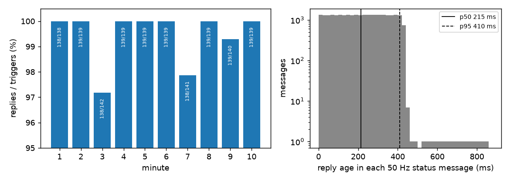
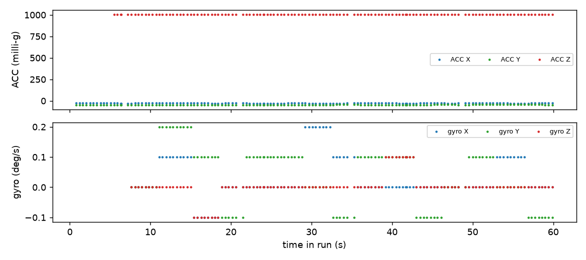

# 11: Telemetry inside the app's library

Until now telemetry had only run in a bench script ([09](../09-telemetry/README.md)), for a minute at a time. The app drives the ESP32 through a Python library that sends sticks every slot, and I wanted to know if telemetry held up there, over long runs, with the link busy the whole time. The library uses the recipe from 09: a trigger every 48 slots, the capture streamed as int8 between packets, FOFS −75 kHz, and Betaflight's rule for advancing the telemetry ID. The drone ran the patched Betaflight from [10](../10-hub-patch/README.md), on USB power with no battery.

A 10-minute run answered 1387 of 1395 triggers (99.4%), and no minute was below 97.2%. The stick sender held 111 Hz, one update per 8.994 ms slot, over 66,706 sends, none skipped, at most 799 µs late. The age of the newest reply was 215 ms at the median, 410 ms at the 95th percentile and 849 ms at most, which is two missed replies in a row. That age is set by the trigger spacing: 48 slots is 432 ms between triggers, so on average a reply is half that old. The patched acceleration came through as −28, −46, +1005 milli-g with the drone level.



*Figure: the 10-minute backend run. Left, catch rate per minute. Right, reply age in the status messages: p50 215 ms, p95 410 ms, maximum 849 ms. Source: `data/e2e/fc_10min_b.jsonl.gz`.*

But in that run the hub fields stopped updating after 12.9 s, while the replies kept arriving. Hub frames appeared on replies 1 to 29 and on none of the 1358 after. The shorter 40 s and 60 s runs had updated the hub to the end. The cause is in Betaflight. It starts a new hub cycle only when `cmpTimeUs(now, lastCycle)` is at least 125 ms, and that difference is a signed 32-bit count of microseconds. The previous hub cycle had been at the end of an earlier run, about 11:06, and this run started at 12:06:44, 60.7 minutes later. That is more than 2^31 µs (35.8 minutes), so the difference came out negative, the cycle was always skipped, and a skipped cycle doesn't update `lastCycle`. Every request then got zero hub bytes, and that would last until the gap passed 2^32 µs (71.6 minutes), about 65 s after the run ended.

To check it I wrote a model (`scripts/hub-stall/model.py`) that replays Betaflight's hub buffer logic against the telemetry IDs in the log. It reproduces the log reply by reply: 27 resends of a stale chunk carrying gyro Y and Z (my side had restarted with a fresh telemetry ID, so the drone kept resending its last unacknowledged bytes), then acceleration X and Y on reply 28, Z on reply 29, then nothing. Two things I couldn't observe directly: the hub byte count per reply wasn't logged, and I can't rule out that the flight controller rebooted between 11:06 and 12:06, which would stall it the same way. The fix is a guard in the patch that treats a negative difference as due. It went into patch 0003 later ([13](../13-fast-attitude-telemetry/README.md)), but the 36-minute idle condition was never re-tested.



*Figure: patched acceleration and gyro received over the radio by the backend, one point per hub update (137 in 60 s). Mean acceleration −28.3, −45.9, +1005.7 milli-g. Source: `data/e2e/fc_idle.jsonl.gz`.*

So telemetry runs at 99.4% over 10 minutes alongside sticks on every slot. The stall is a Betaflight bug that hits any link starting 36 to 72 minutes after the drone last sent hub data, or after it booted.

---

## Numbers

| What | Value | Where |
|---|---|---|
| 60 s library run, replies | 138 of 138 | `data/NOTES.md`, `data/lib-smoke/out.txt` |
| 60 s backend run, reply age p50 / p95 | 215 / 409 ms | `data/e2e/fc_idle.jsonl.gz` |
| 10 min run | 1387 of 1395 (99.4%), lowest minute 97.2% | `data/NOTES.md`, `data/e2e/fc_10min_b.jsonl.gz` |
| Sender, 10 min run | 66,706 sends, 0 skipped, late max 799 µs | same |
| Hub stall | hub frames on replies 1 to 29 only (t ≤ 12.9 s) | same, `scripts/hub-stall/model.py` |

## Files

- `data/e2e/`: backend logs (`*.jsonl`, `*.jsonl.gz`) and the driver's output (`*.out`). `fc_arm*` are arm-state checks through the backend; `fc_arm.jsonl` and `fc_10min.jsonl` stopped early. `data/NOTES.md` is the original write-up.
- `data/lib-smoke/`: first library smoke test. `data/ui/`: UI mock screenshots.
- `scripts/e2e/drive.py` (hardware, needs `httpx` and `websockets`), `scripts/e2e/analyze.py`, `scripts/hub-stall/model.py`, `scripts/lib-smoke/smoke.py`.
- `figures/`: `tlm-catch-age`, `tlm-hub-acc-gyro`, drawn by `../12-blackbox-usb/scripts/plot_telemetry.py`.

## How to re-run

From the repo root (`model.py` imports the `d8tx` library, which needs numpy; `python/.venv/bin/python` has it):

```
python/.venv/bin/python experiments/11-telemetry-stack/scripts/hub-stall/model.py experiments/11-telemetry-stack/data/e2e/fc_10min_b.jsonl.gz   # "log matches the model"
gunzip -c experiments/11-telemetry-stack/data/e2e/fc_idle.jsonl.gz > /tmp/fc_idle.jsonl
python3 experiments/11-telemetry-stack/scripts/e2e/analyze.py /tmp/fc_idle.jsonl
```

`analyze.py` reads plain `.jsonl` only, so the `.gz` logs need unpacking first.

## Ran

2026-11-08, 10:39 to 12:16 EST (the 10-minute run 12:06 to 12:16; header of `NOTES.md`). The stall model was done by 13:31. Commits 89830cc (12:50), 8b4c60a (13:31), 38c97e2 (13:32).

**Overlap:** ran in parallel with [10](../10-hub-patch/README.md) and [12](../12-blackbox-usb/README.md).

Previous: [10-hub-patch](../10-hub-patch/README.md) · Next: [12-blackbox-usb](../12-blackbox-usb/README.md) · [All experiments](../README.md)
