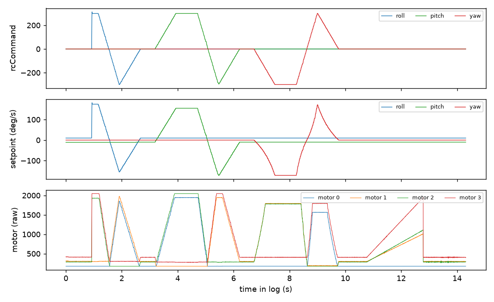

# 12: Blackbox over USB

Radio telemetry gives a few updates a second ([11](../11-telemetry-stack/README.md)). Betaflight's blackbox records the flight controller's own view, gyro, setpoints, stick commands and motor outputs, about a thousand times a second, and that is what I would need to tune a scripted hop instead of guessing hover throttle. This flight controller (MATEKF411RX) has no flash chip and no SD card, so blackbox can only go to a serial port. I used the USB virtual serial port (VCP), which MSP also uses. I wanted to know if I could stream the blackbox log over that USB cable.

First I wrote tools to capture, decode and plot blackbox data from a serial port ([`tools/blackbox`](../../tools/blackbox/)). Then I pointed Betaflight's blackbox at the VCP at 2,000,000 baud; `serial 20 129 115200 57600 0 2000000` was the only line of `diff all` (Betaflight's list of every setting that differs from the defaults) that changed. The drone was on USB power with no battery (CLI `status`: `Voltage: 1 * 0.01V (0S battery - NOT PRESENT)`), props off, running the patched Betaflight from [10](../10-hub-patch/README.md).

The first armed run produced 0 bytes, and MSP stopped answering at the moment of arming. Polling MSP during the link showed the drone becoming armable, then going silent exactly at the arm edge. Reading Betaflight's source explained it. On this F4, Betaflight 4.2 reopens the VCP with `usbVcpOpen()` whenever the port changes owner: on arm, when blackbox takes it from MSP, and on disarm, when MSP gets it back. That function pulls the USB D+ line low for 200 ms and reinitialises USB (`drivers/serial_usb_vcp.c:219`, `drivers/usb_io.c:69`). The Mac doesn't re-enumerate the device after that, so the port stays open but silent. A USB port reset from the host side (`usbreset.py`, using libusb) brought it back once while disarmed.

For session 1, at 13:10, I ran a watcher that polls MSP and does one USB reset when it goes quiet. The arm went out, MSP was lost 0.77 s later, and the port was reopened 1.9 s after the arm. By then the start of the log header had already gone, and the first bytes were mid-header. The capture was 363,085 bytes, with no end-of-log marker, since that was lost in the disarm re-init. A blackbox log can't be decoded without its header, so I rebuilt the missing start (`reconstruct_header.py`) from Betaflight 4.2's field rules for this config: yaw D is 10, so `axisD[2]` is logged; the current meter is ADC, so `amperageLatest` is logged; and `rssi` is logged. That variant decoded with Betaflight's `blackbox_decode` to 13,655 frames, 0 failed, at 954 Hz over 14.31 s. The variants without `rssi` or without `axisD[2]` decoded to garbage at 30 Hz, and the header tail that did arrive matched the rebuilt one.

The decoded log matches what the script sent. rcCommand on roll, pitch and yaw swept to ±300 in turn, and the setpoint followed at about ±170 deg/s. The gyro stayed within ±1 deg/s, because the drone sat still on the bench. The first 0.9 s is missing: `rxSignalReceived` was 0 from 0.081 to 0.922 s, so the first roll ramp isn't there, probably a gap from the link or the USB reset. Two things looked wrong but weren't. The motors swung from about 176 to 2047 with props off, because with nothing moving the PID I-term winds up under airmode; the ESCs were unpowered. And throttle rcCommand stayed at 1000 to 1001 while I sent up to 1150 µs, because this rate profile has `thr_mid` 0 and `thr_expo` 100, which makes the throttle curve flat near the bottom.

At 13:12 I tried a two-session run with a reset on every 1.5 s of silence. The stream stopped after about 1 s, the repeated resets produced nothing, and afterwards the flight controller answered neither USB nor the radio: 21 telemetry triggers, 0 replies, where it had answered at 13:00. It needed a physical unplug and replug. That the repeated resets caused the hang is likely but not proven. After the replug I reverted the blackbox setting, and `diff all` came back identical to the one from before.

So the tools work end to end on a real Betaflight 4.2 log, but blackbox over the shared USB port is not usable as a routine setup on this board with a Mac. Even with a reset per arm the header start is lost, and the reset approach hung the flight controller once. The options are a UART logger such as an OpenLager, or a Linux host, which might re-enumerate after the D+ pulse. I haven't tested either, so this is still open.



*Figure: session 1, the one good blackbox log. Top: rcCommand. Middle: setpoint. Bottom: motor outputs (props off, ESCs unpowered). The gyro is not shown; it stays within ±1 deg/s. Source: `figures/bb_session1_reconstructed.01.csv`.*

---

## Numbers

| What | Value | Where |
|---|---|---|
| Session 1 raw capture | 363,085 bytes, header start lost, no end marker | `data/bench/session1.raw`, `data/NOTES.md` |
| Session 1 decoded | 13,655 frames, 0 failed, in 14.31 s (954 Hz) | `figures/bb_session1_reconstructed.01.csv`, `data/bench/decode_stderr.txt` |
| Missing stick signal at the start | 0.081 to 0.922 s | `data/NOTES.md` |
| Telemetry after the hang | 21 triggers, 0 replies | `data/NOTES.md` |

## Files

- `data/bench/`: the raw capture (`session1.raw`), stick logs, probes, CLI logs and config diffs. `data/NOTES.md` is the original write-up (read it before trying blackbox on this drone).
- `figures/`: `bb_session1_reconstructed.bbl` (rebuilt log), `.01.csv` (decoded), `.01.png`; `blackbox-session1` (the summary figure); `sample/` (the tool's synthetic sample).
- `scripts/plot_telemetry.py`: draws the figures for 10, 11 and 12.
- The tools and their CLI config files are in [tools/blackbox](../../tools/blackbox/).

## How to re-run

From the repo root:

```
python3 tools/blackbox/reconstruct_header.py experiments/12-blackbox-usb/data/bench/session1.raw /tmp/s1.bbl   # = figures/bb_session1_reconstructed.bbl
python3 tools/blackbox/bbplot.py experiments/12-blackbox-usb/figures/bb_session1_reconstructed.01.csv --outdir /tmp/bb
python3 experiments/12-blackbox-usb/scripts/plot_telemetry.py     # figures for 10, 11 and 12 (needs matplotlib)
```

The committed CSV came from the C decoder (`tools/blackbox/build_decoder.sh`); `bbdecode.py --engine py` also works but gives a different set of columns. `plot_telemetry.py` lives here because this is the last experiment it reads; set `FIGURES_OUT=/tmp/figs` to write all its figures to one place.

## Ran

2026-11-08, 12:54 to 13:24 EST (`NOTES.md` "lock held 12:54–13:24", session 1 at 13:10, epochs 18:00Z to 18:13Z). Commits c66f94c (13:20), 59faf6f (13:25), db7196a (13:34, config reverted).

**Overlap:** ran in parallel with [10](../10-hub-patch/README.md) and [11](../11-telemetry-stack/README.md).

Previous: [11-telemetry-stack](../11-telemetry-stack/README.md) · Next: [13-fast-attitude-telemetry](../13-fast-attitude-telemetry/README.md) · [All experiments](../README.md)
